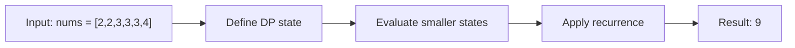

# 740. Delete and Earn

**Difficulty:** Medium  
**Concept family:** [Take-or-Skip and Knapsack](https://github.com/gaurav1kr/Miscellaneous/blob/main/DSA/DP/DP_Mathematics_Master_Guide_Illustrated/Theory/Chapter-02.md)  
**Problem:** https://leetcode.com/problems/delete-and-earn/  
**Original submission:** https://leetcode.com/submissions/detail/1499152038/

## Understand the mathematics first

This problem belongs to the study family **Take-or-Skip and Knapsack**. Start by defining the objective and minimal sufficient state; inspect the code to identify the actual transitions.

### Problem-specific recurrence

Refer to the source-grounded algorithm walkthrough below for the state transitions used by your implementation. The generic family recurrence has been removed because it may not apply to this problem.

## Code landmarks

- `sort(nums.begin(),nums.end());`
- `int del=mp[nums[i]]*nums[i]+dp[upper_bound(nums.begin(),nums.end(),nums[i]+1)-nums.begin()];`
- `int notdel=dp[i+1];`

## Detailed dry run — Delete and Earn: reduce to House Robber

### Start from the mathematical question

If we select value v, we gain v × frequency(v) but cannot select v−1 or v+1. Let gain[v] = v × frequency(v).

### Derive the recurrence

```math
F(v)=\max(F(v-1),\ gain[v]+F(v-2))
```

**Why the transition is correct:** The key is transforming values into a weighted line graph. Adjacent *values*, not adjacent array positions, conflict.

### Concrete example

**Input:** `nums = [2,2,3,3,3,4]`



**Evaluate the states in dependency order:**

| Value v | gain[v] | Skip | Take | F(v) |
|---|---:|---:|---:|---:|
| 2 | 4 | 0 | 4 | 4 |
| 3 | 9 | 4 | 9 | 9 |
| 4 | 4 | 9 | 4+4=8 | 9 |

**Expected result:** `9`.

### What to remember six months later

Explain (1) what one state means, (2) which earlier states it needs, (3) why those cases are exhaustive, and (4) why the answer is `9` for this input. Then inspect your preserved C++ solution below and match its variables to the mathematical states.

---

## Your original Accepted C++ submission (unaltered)

```cpp
class Solution 
{
public:
	unordered_map<int,int>mp;

	int deleteAndEarn(vector<int>& nums)
     {
		int n=nums.size();
		sort(nums.begin(),nums.end());
		for(auto i:nums) mp[i]++;
		vector<int> dp(n+1,0);
		for(int i=n-1;i>=0;i--)
        {
			int del=mp[nums[i]]*nums[i]+dp[upper_bound(nums.begin(),nums.end(),nums[i]+1)-nums.begin()];
			int notdel=dp[i+1];
			dp[i]=max(del,notdel);
		}
		return dp[0];
	}
};
```

## Time and Space Complexity

- **Time:** `O(n log n) or higher`
- **Auxiliary space:** `O(n) or higher`

**Reasoning:** Sorting costs O(n log n); additional data-structure operations may increase the bound. Confirm against the nested loops.

**Status:** Code-informed complexity guidance; exact tight bounds have not been individually verified.
