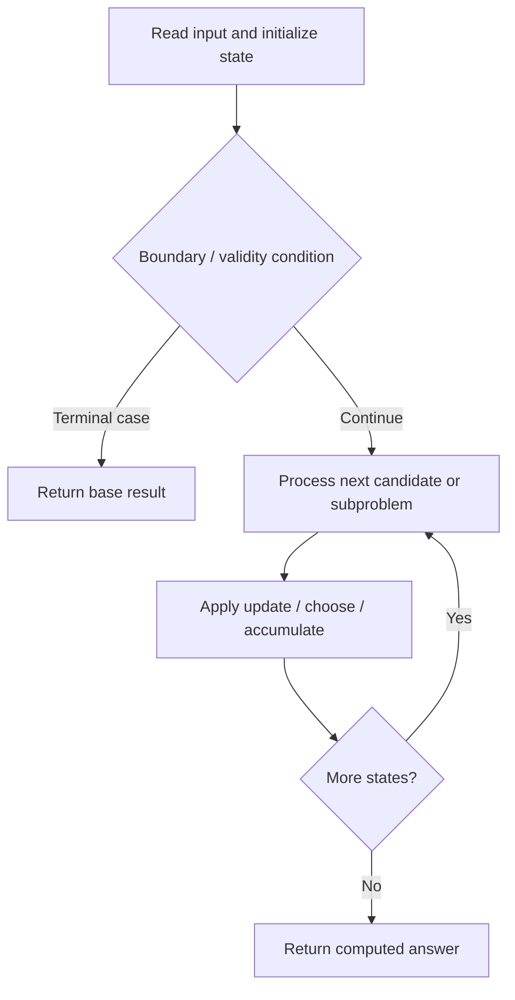

# 741. Cherry Pickup

**Difficulty:** Hard  
**Concept family:** [Grid Paths and Geometric DP](https://github.com/gaurav1kr/Miscellaneous/blob/main/DSA/DP/DP_Mathematics_Master_Guide_Illustrated/Theory/Chapter-03.md)  
**Problem:** https://leetcode.com/problems/cherry-pickup/  
**Original submission:** https://leetcode.com/submissions/detail/1412496910/

## Understand the mathematics first

This problem belongs to the study family **Grid Paths and Geometric DP**. Start by defining the objective and minimal sufficient state; inspect the code to identify the actual transitions.

### Related concept template (not necessarily this problem’s recurrence)

$$
F(i,j)=F(i-1,j)+F(i,j-1)
$$

**What this template illustrates:** For minimum cost paths, replace + of paths with min of predecessor costs, then add the current cell cost. Obstacles contribute zero ways.

**Derivation exercise:** Define exactly what each state variable means for this problem; list valid choices, base cases, and forbidden transitions. Check the submitted code against that invariant. The family template alone is not a substitute for a problem-specific proof.

## Code landmarks

- `if(dp[r1][c1][r2]!=-1)`
- `return dp[r1][c1][r2];`
- `cherries+=max(max(f1,f2),max(f3,f4));`

## Source-grounded algorithm walkthrough (expanded coverage)

> **Verification level:** The observations below are extracted from your actual Accepted C++ implementation. The symbolic trace is a **code-reading dry-run worksheet**, not a fabricated numerical run. The generic family formula above is not necessarily this problem's recurrence.

### 1. Identify the actual state and algorithm

**Problem:** 741. Cherry Pickup. Recursive state transitions are present. Check memoization, state identity, termination, and whether branches are mutually exclusive.

| Role | C++ source line | Evidence from your solution |
|---|---:|---|
| Candidate state / accumulator | 4 | `int solve(vector<vector<int>>& grid,int r1,int c1,int r2,int c2,int n,vector<vector<vector<int>>>& dp)` |
| Candidate state / accumulator | 15 | `if(dp[r1][c1][r2]!=-1)` |
| Candidate state / accumulator | 17 | `return dp[r1][c1][r2];` |
| Boundary / termination | 7 | `if(r1>=n\|\|r2>=n\|\|c1>=n\|\|c2>=n\|\|grid[r1][c1]==-1\|\|grid[r2][c2]==-1)` |
| Boundary / termination | 11 | `if(r1==n-1&&c1==n-1)` |
| Boundary / termination | 15 | `if(dp[r1][c1][r2]!=-1)` |
| Traversal order | — | No obvious matching statement; inspect the original C++ below. |
| Transition / update | 33 | `cherries+=max(max(f1,f2),max(f3,f4));` |
| Transition / update | 34 | `return dp[r1][c1][r2]=cherries;` |
| Transition / update | 41 | `int ans=solve(grid,r1,c1,r2,c2,n,dp);` |
| Transition / update | 42 | `return max(0,ans);` |
| Return / result | 9 | `return INT_MIN;` |
| Return / result | 13 | `return grid[r1][c1];` |

### 2. Trace the dependency chain



This is a **control-flow reading diagram**, not a claim about the exact shape of the mathematical state graph. Follow the code line numbers above to draw the actual dependency arrows.

### 3. Symbolic dry-run worksheet

| Stage | State to record | Mathematical question to answer |
|---|---|---|
| Initialize | Inputs, initialized containers/accumulators | What does the initial value mean? |
| First iteration / recursive call | Loop indices, branch, current state | Which predecessor states are available? |
| First update | Before → after for the updated variable | Why is this transition legal? Does it add, minimize, maximize, or overwrite? |
| Next iteration | Updated state and next candidate | Can a value be reused in this traversal order? |
| Finish | Return expression and its value | Why does this correspond to the problem's requested result? |

### 4. Mathematical explanation checklist

1. Define the exact meaning of each state variable, including all indices and constraints.
2. Translate the update expression into a mathematical equation **only after** establishing the state invariant.
3. Prove the transitions are exhaustive and do not double-count or reuse forbidden elements.
4. Check empty input, smallest input, impossible cases, and overflow/modulo behavior.
5. Compute a small numerical example using the actual problem constraints, then compare each row to the original C++.


---

## Your original Accepted C++ submission (unaltered)

```cpp
class Solution 
{
public:
    int solve(vector<vector<int>>& grid,int r1,int c1,int r2,int c2,int n,vector<vector<vector<int>>>& dp)
    {
        int cherries=0;
        if(r1>=n||r2>=n||c1>=n||c2>=n||grid[r1][c1]==-1||grid[r2][c2]==-1)
        {
            return INT_MIN;
        }
        if(r1==n-1&&c1==n-1) 
        {
            return grid[r1][c1];
        }
        if(dp[r1][c1][r2]!=-1) 
        {
            return dp[r1][c1][r2];
        }
       
        if(r1==r2&&c1==c2)
        {
            cherries+=grid[r1][c1];
        }
        else
        {
            cherries+=grid[r1][c1];
            cherries+=grid[r2][c2];
        }
        int f1=solve(grid,r1,c1+1,r2,c2+1,n,dp);
        int f2=solve(grid,r1+1,c1,r2,c2+1,n,dp);
        int f3=solve(grid,r1+1,c1,r2+1,c2,n,dp);
        int f4=solve(grid,r1,c1+1,r2+1,c2,n,dp);
        cherries+=max(max(f1,f2),max(f3,f4));
        return dp[r1][c1][r2]=cherries;
    }
    int cherryPickup(vector<vector<int>>& grid) 
    {
        int n=grid.size();
        int r1=0,c1=0,r2=0,c2=0;
        vector<vector<vector<int>>> dp(n+1, vector<vector<int>>(n+1, vector<int>(n+1, -1)));
        int ans=solve(grid,r1,c1,r2,c2,n,dp);
        return max(0,ans);
    }
};
```

## Time and Space Complexity

- **Time:** `Depends on 3D state count and transitions`
- **Auxiliary space:** `O(product of allocated DP dimensions)`

**Reasoning:** The code allocates a three-dimensional state table; inspect how many transitions are considered for each state.

**Status:** Code-informed complexity guidance; exact tight bounds have not been individually verified.
