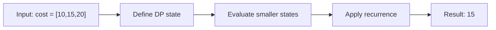

# 746. Min Cost Climbing Stairs

**Difficulty:** Easy  
**Concept family:** [Mathematical Recurrences and Combinatorics](https://github.com/gaurav1kr/Miscellaneous/blob/main/DSA/DP/DP_Mathematics_Master_Guide_Illustrated/Theory/Chapter-01.md)  
**Problem:** https://leetcode.com/problems/min-cost-climbing-stairs/  
**Original submission:** https://leetcode.com/submissions/detail/1588082454/

## Understand the mathematics first

This problem belongs to the study family **Mathematical Recurrences and Combinatorics**. Start by defining the objective and minimal sufficient state; inspect the code to identify the actual transitions.

### Related concept template (not necessarily this problem’s recurrence)

$$
F(n)=\sum_{c\in Choices(n)}F(next(n,c))
$$

**What this template illustrates:** For counting, add disjoint cases. For optimization, replace sum with min or max. Base cases must express empty structures correctly.

**Derivation exercise:** Define exactly what each state variable means for this problem; list valid choices, base cases, and forbidden transitions. Check the submitted code against that invariant. The family template alone is not a substitute for a problem-specific proof.

## Code landmarks

- `dp[i] = min(dp[i - 1] + cost[i - 1], dp[i - 2] + cost[i - 2]);`
- `return dp[n];`

## Detailed dry run — Minimum-cost stairs: optimize the last jump

### Start from the mathematical question

Let C(i) be the minimum paid cost to reach step i (where step n is the top). You pay cost[j] when stepping on j.

### Derive the recurrence

```math
C(i)=\min(C(i-1)+cost[i-1],\ C(i-2)+cost[i-2])
```

**Why the transition is correct:** The last jump into i must be from i−1 or i−2. Because only paid steps matter, use min. You may start at step 0 or 1.

### Concrete example

**Input:** `cost = [10,15,20]`



**Evaluate the states in dependency order:**

| Target step i | 0 | 1 | 2 | 3 (top) |
|---|---:|---:|---:|---:|
| C(i) | 0 | 0 | min(0+15,0+10)=10 | min(10+20,0+15)=15 |

**Expected result:** `15`.

### What to remember six months later

Explain (1) what one state means, (2) which earlier states it needs, (3) why those cases are exhaustive, and (4) why the answer is `15` for this input. Then inspect your preserved C++ solution below and match its variables to the mathematical states.

---

## Your original Accepted C++ submission (unaltered)

```cpp
class Solution {
public:
    int minCostClimbingStairs(vector<int>& cost) {
        int n = cost.size();
        vector<int> dp(n + 1);
        for (int i = 2; i <= n; i++) {
            dp[i] = min(dp[i - 1] + cost[i - 1], dp[i - 2] + cost[i - 2]);
        }
        return dp[n];
    }
};
```

## Time and Space Complexity

- **Time:** `Depends on loop nesting and bounds`
- **Auxiliary space:** `Depends on auxiliary arrays/containers`

**Reasoning:** Count how many iterations each loop executes and whether loops are nested; do not assume all nested loops are quadratic.

**Status:** Code-informed complexity guidance; exact tight bounds have not been individually verified.
