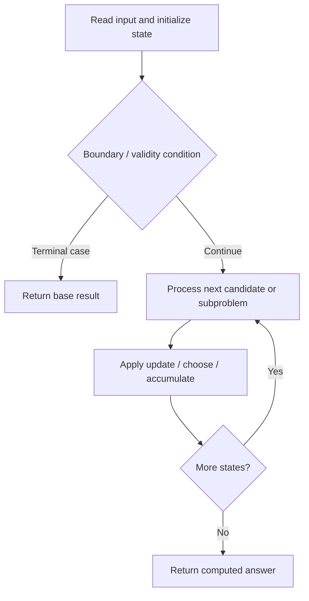

# 773. Sliding Puzzle

**Difficulty:** Hard  
**Concept family:** [Bitmask, Assignment and Subset DP](https://github.com/gaurav1kr/Miscellaneous/blob/main/DSA/DP/DP_Mathematics_Master_Guide_Illustrated/Theory/Chapter-09.md)  
**Problem:** https://leetcode.com/problems/sliding-puzzle/  
**Original submission:** https://leetcode.com/submissions/detail/1590173923/

## Understand the mathematics first

This problem belongs to the study family **Bitmask, Assignment and Subset DP**. Start by defining the objective and minimal sufficient state; inspect the code to identify the actual transitions.

### Problem-specific recurrence

Refer to the source-grounded algorithm walkthrough below for the state transitions used by your implementation. The generic family recurrence has been removed because it may not apply to this problem.

## Code landmarks

- `while (!q.empty()) {`

## Source-grounded algorithm walkthrough (expanded coverage)

> **Verification level:** The observations below are extracted from your actual Accepted C++ implementation. The symbolic trace is a **code-reading dry-run worksheet**, not a fabricated numerical run. The generic family formula above is not necessarily this problem's recurrence.

### 1. Identify the actual state and algorithm

**Problem:** 773. Sliding Puzzle. This solution does not expose an obvious `dp` or `memo` variable. Derive the algorithmic invariant from the code rather than assuming a DP recurrence.

| Role | C++ source line | Evidence from your solution |
|---|---:|---|
| Candidate state / accumulator | 20 | `unordered_set<string> visited;` |
| Boundary / termination | 28 | `if (curr == goal) return moves;` |
| Boundary / termination | 34 | `if (!visited.count(newState)) {` |
| Traversal order | 12 | `for (auto& row : board) {` |
| Traversal order | 13 | `for (int num : row) {` |
| Traversal order | 24 | `while (!q.empty()) {` |
| Transition / update | 22 | `visited.insert(start);` |
| Transition / update | 35 | `visited.insert(newState);` |
| Return / result | 28 | `if (curr == goal) return moves;` |
| Return / result | 40 | `return -1;` |

### 2. Trace the dependency chain



This is a **control-flow reading diagram**, not a claim about the exact shape of the mathematical state graph. Follow the code line numbers above to draw the actual dependency arrows.

### 3. Symbolic dry-run worksheet

| Stage | State to record | Mathematical question to answer |
|---|---|---|
| Initialize | Inputs, initialized containers/accumulators | What does the initial value mean? |
| First iteration / recursive call | Loop indices, branch, current state | Which predecessor states are available? |
| First update | Before → after for the updated variable | Why is this transition legal? Does it add, minimize, maximize, or overwrite? |
| Next iteration | Updated state and next candidate | Can a value be reused in this traversal order? |
| Finish | Return expression and its value | Why does this correspond to the problem's requested result? |

### 4. Mathematical explanation checklist

1. Define the exact meaning of each state variable, including all indices and constraints.
2. Translate the update expression into a mathematical equation **only after** establishing the state invariant.
3. Prove the transitions are exhaustive and do not double-count or reuse forbidden elements.
4. Check empty input, smallest input, impossible cases, and overflow/modulo behavior.
5. Compute a small numerical example using the actual problem constraints, then compare each row to the original C++.


---

## Your original Accepted C++ submission (unaltered)

```cpp
#include <vector>
#include <queue>
#include <string>
#include <unordered_set>
using namespace std;

class Solution {
public:
    int slidingPuzzle(vector<vector<int>>& board) {
        string goal = "123450";
        string start = "";
        for (auto& row : board) {
            for (int num : row) {
                start += to_string(num);
            }
        }

        vector<vector<int>> neighbors = {{1, 3}, {0, 2, 4}, {1, 5}, {0, 4}, {1, 3, 5}, {2, 4}};
        queue<pair<string, int>> q;
        unordered_set<string> visited;
        q.push({start, 0});
        visited.insert(start);

        while (!q.empty()) {
            auto [curr, moves] = q.front();
            q.pop();

            if (curr == goal) return moves;

            int zeroPos = curr.find('0');
            for (int n : neighbors[zeroPos]) {
                string newState = curr;
                swap(newState[zeroPos], newState[n]);
                if (!visited.count(newState)) {
                    visited.insert(newState);
                    q.push({newState, moves + 1});
                }
            }
        }
        return -1;
    }
};
```

## Time and Space Complexity

- **Time:** `Depends on operations (typically O(log n) per ordered-container operation)`
- **Auxiliary space:** `Depends on number of stored entries`

**Reasoning:** An ordered container or heap introduces logarithmic insertion, lookup, or removal costs; multiply by operation count.

**Status:** Code-informed complexity guidance; exact tight bounds have not been individually verified.
