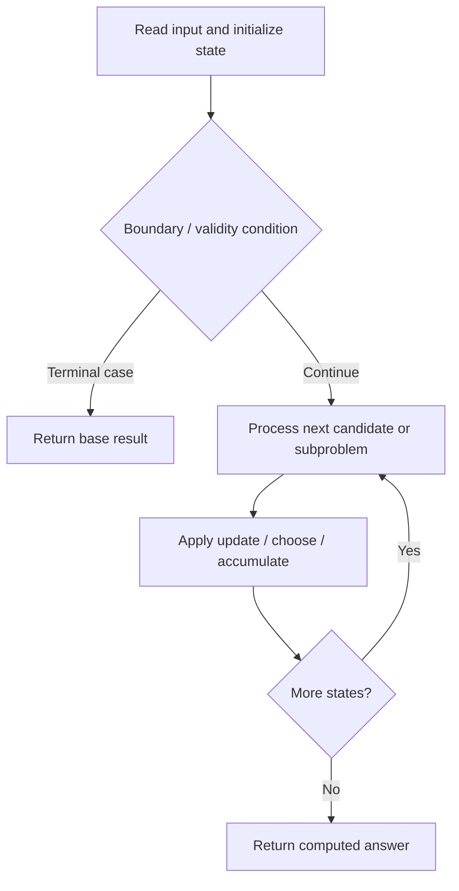

# 787. Cheapest Flights Within K Stops

**Difficulty:** Medium  
**Concept family:** [Tree, Graph and DAG DP](https://github.com/gaurav1kr/Miscellaneous/blob/main/DSA/DP/DP_Mathematics_Master_Guide_Illustrated/Theory/Chapter-10.md)  
**Problem:** https://leetcode.com/problems/cheapest-flights-within-k-stops/  
**Original submission:** https://leetcode.com/submissions/detail/1538659578/

## Understand the mathematics first

This problem belongs to the study family **Tree, Graph and DAG DP**. Start by defining the objective and minimal sufficient state; inspect the code to identify the actual transitions.

### Mathematical starting point

This family includes tree DP, DAG DP, shortest paths, and graph traversal. **There is no single recurrence for all these problems.** Identify the exact state and invariant from the algorithm below. For tree paths, distinguish the value returned to the parent from a complete answer within the subtree; for graph problems, establish whether edges form a DAG or whether shortest-path processing is required.

## Code landmarks

- `priority_queue<tuple<int, int, int>, vector<tuple<int, int, int>>, greater<>> pq;`
- `while (!pq.empty()) {`

## Source-grounded algorithm walkthrough (expanded coverage)

> **Verification level:** The observations below are extracted from your actual Accepted C++ implementation. The symbolic trace is a **code-reading dry-run worksheet**, not a fabricated numerical run. The generic family formula above is not necessarily this problem's recurrence.

### 1. Identify the actual state and algorithm

**Problem:** 787. Cheapest Flights Within K Stops. Heap/selection operations are present. Explain why the selection order is safe; a DP recurrence may not be necessary.

| Role | C++ source line | Evidence from your solution |
|---|---:|---|
| Candidate state / accumulator | — | No obvious matching statement; inspect the original C++ below. |
| Boundary / termination | 21 | `if (node == dst) return cost; // Destination reached with minimum cost` |
| Boundary / termination | 22 | `if (stops > 0) {` |
| Boundary / termination | 25 | `if (newCost < minCost[nextNode][stops - 1]) {` |
| Traversal order | 6 | `for (auto& flight : flights)` |
| Traversal order | 17 | `while (!pq.empty()) {` |
| Traversal order | 23 | `for (auto& [nextNode, price] : graph[node]) {` |
| Transition / update | — | No obvious matching statement; inspect the original C++ below. |
| Return / result | 21 | `if (node == dst) return cost; // Destination reached with minimum cost` |
| Return / result | 32 | `return -1; // No valid route found` |

### 2. Trace the dependency chain



This is a **control-flow reading diagram**, not a claim about the exact shape of the mathematical state graph. Follow the code line numbers above to draw the actual dependency arrows.

### 3. Symbolic dry-run worksheet

| Stage | State to record | Mathematical question to answer |
|---|---|---|
| Initialize | Inputs, initialized containers/accumulators | What does the initial value mean? |
| First iteration / recursive call | Loop indices, branch, current state | Which predecessor states are available? |
| First update | Before → after for the updated variable | Why is this transition legal? Does it add, minimize, maximize, or overwrite? |
| Next iteration | Updated state and next candidate | Can a value be reused in this traversal order? |
| Finish | Return expression and its value | Why does this correspond to the problem's requested result? |

### 4. Mathematical explanation checklist

1. Define the exact meaning of each state variable, including all indices and constraints.
2. Translate the update expression into a mathematical equation **only after** establishing the state invariant.
3. Prove the transitions are exhaustive and do not double-count or reuse forbidden elements.
4. Check empty input, smallest input, impossible cases, and overflow/modulo behavior.
5. Compute a small numerical example using the actual problem constraints, then compare each row to the original C++.


---

## Your original Accepted C++ submission (unaltered)

```cpp
class Solution {
public:
    int findCheapestPrice(int n, vector<vector<int>>& flights, int src, int dst, int k) {
    // Adjacency list to store graph: {destination, cost}
    vector<vector<pair<int, int>>> graph(n);
    for (auto& flight : flights)
        graph[flight[0]].emplace_back(flight[1], flight[2]);

    // Priority queue: {cost, current_node, stops_remaining}
    priority_queue<tuple<int, int, int>, vector<tuple<int, int, int>>, greater<>> pq;
    pq.emplace(0, src, k + 1);

    // Minimum cost to reach each node with specific stops remaining
    vector<vector<int>> minCost(n, vector<int>(k + 2, INT_MAX));
    minCost[src][k + 1] = 0;

    while (!pq.empty()) {
        auto [cost, node, stops] = pq.top();
        pq.pop();

        if (node == dst) return cost; // Destination reached with minimum cost
        if (stops > 0) {
            for (auto& [nextNode, price] : graph[node]) {
                int newCost = cost + price;
                if (newCost < minCost[nextNode][stops - 1]) {
                    minCost[nextNode][stops - 1] = newCost;
                    pq.emplace(newCost, nextNode, stops - 1);
                }
            }
        }
    }
    return -1; // No valid route found
}
};
```

## Time and Space Complexity

- **Time:** `Depends on operations (typically O(log n) per ordered-container operation)`
- **Auxiliary space:** `Depends on number of stored entries`

**Reasoning:** An ordered container or heap introduces logarithmic insertion, lookup, or removal costs; multiply by operation count.

**Status:** Code-informed complexity guidance; exact tight bounds have not been individually verified.
