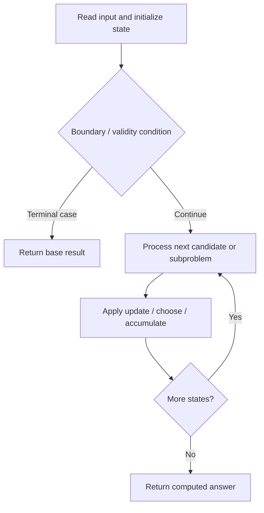

# 790. Domino and Tromino Tiling

**Difficulty:** Medium  
**Concept family:** [State Machines and Stock DP](https://github.com/gaurav1kr/Miscellaneous/blob/main/DSA/DP/DP_Mathematics_Master_Guide_Illustrated/Theory/Chapter-08.md)  
**Problem:** https://leetcode.com/problems/domino-and-tromino-tiling/  
**Original submission:** https://leetcode.com/submissions/detail/1590177677/

## Understand the mathematics first

This problem belongs to the study family **State Machines and Stock DP**. Start by defining the objective and minimal sufficient state; inspect the code to identify the actual transitions.

### Problem-specific recurrence

Refer to the source-grounded algorithm walkthrough below for the state transitions used by your implementation. The generic family recurrence has been removed because it may not apply to this problem.

## Code landmarks

- `dp[1] = 1; dp[2] = 2; dp[3] = 5;`
- `dp[i] = (2 * dp[i - 1] + dp[i - 3]) % MOD;`
- `return dp[n];`

## Source-grounded algorithm walkthrough (expanded coverage)

> **Verification level:** The observations below are extracted from your actual Accepted C++ implementation. The symbolic trace is a **code-reading dry-run worksheet**, not a fabricated numerical run. The generic family formula above is not necessarily this problem's recurrence.

### 1. Identify the actual state and algorithm

**Problem:** 790. Domino and Tromino Tiling. An explicit state table or memo is present. Interpret each index as a mathematical state and every update as a transition.

| Role | C++ source line | Evidence from your solution |
|---|---:|---|
| Candidate state / accumulator | 11 | `vector<long long> dp(n + 1);` |
| Candidate state / accumulator | 12 | `dp[1] = 1; dp[2] = 2; dp[3] = 5;` |
| Candidate state / accumulator | 16 | `dp[i] = (2 * dp[i - 1] + dp[i - 3]) % MOD;` |
| Boundary / termination | 7 | `if (n == 1) return 1;` |
| Boundary / termination | 8 | `if (n == 2) return 2;` |
| Boundary / termination | 9 | `if (n == 3) return 5;` |
| Traversal order | 15 | `for (int i = 4; i <= n; i++) {` |
| Transition / update | 12 | `dp[1] = 1; dp[2] = 2; dp[3] = 5;` |
| Transition / update | 16 | `dp[i] = (2 * dp[i - 1] + dp[i - 3]) % MOD;` |
| Return / result | 7 | `if (n == 1) return 1;` |
| Return / result | 8 | `if (n == 2) return 2;` |

### 2. Trace the dependency chain



This is a **control-flow reading diagram**, not a claim about the exact shape of the mathematical state graph. Follow the code line numbers above to draw the actual dependency arrows.

### 3. Symbolic dry-run worksheet

| Stage | State to record | Mathematical question to answer |
|---|---|---|
| Initialize | Inputs, initialized containers/accumulators | What does the initial value mean? |
| First iteration / recursive call | Loop indices, branch, current state | Which predecessor states are available? |
| First update | Before → after for the updated variable | Why is this transition legal? Does it add, minimize, maximize, or overwrite? |
| Next iteration | Updated state and next candidate | Can a value be reused in this traversal order? |
| Finish | Return expression and its value | Why does this correspond to the problem's requested result? |

### 4. Mathematical explanation checklist

1. Define the exact meaning of each state variable, including all indices and constraints.
2. Translate the update expression into a mathematical equation **only after** establishing the state invariant.
3. Prove the transitions are exhaustive and do not double-count or reuse forbidden elements.
4. Check empty input, smallest input, impossible cases, and overflow/modulo behavior.
5. Compute a small numerical example using the actual problem constraints, then compare each row to the original C++.


---

## Your original Accepted C++ submission (unaltered)

```cpp
#include <vector>
using namespace std;

class Solution {
public:
    int numTilings(int n) {
        if (n == 1) return 1;
        if (n == 2) return 2;
        if (n == 3) return 5;
        
        vector<long long> dp(n + 1);
        dp[1] = 1; dp[2] = 2; dp[3] = 5;
        int MOD = 1e9 + 7;
        
        for (int i = 4; i <= n; i++) {
            dp[i] = (2 * dp[i - 1] + dp[i - 3]) % MOD;
        }
        return dp[n];
    }
};
```

## Time and Space Complexity

- **Time:** `Depends on loop nesting and bounds`
- **Auxiliary space:** `Depends on auxiliary arrays/containers`

**Reasoning:** Count how many iterations each loop executes and whether loops are nested; do not assume all nested loops are quadratic.

**Status:** Code-informed complexity guidance; exact tight bounds have not been individually verified.
