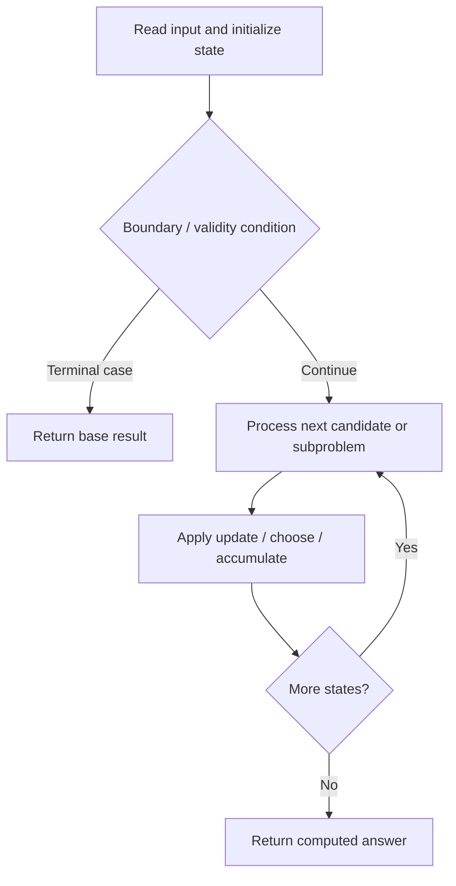

# 805. Split Array With Same Average

**Difficulty:** Hard  
**Concept family:** [Take-or-Skip and Knapsack](https://github.com/gaurav1kr/Miscellaneous/blob/main/DSA/DP/DP_Mathematics_Master_Guide_Illustrated/Theory/Chapter-02.md)  
**Problem:** https://leetcode.com/problems/split-array-with-same-average/  
**Original submission:** https://leetcode.com/submissions/detail/1593853023/

## Understand the mathematics first

This problem belongs to the study family **Take-or-Skip and Knapsack**. Start by defining the objective and minimal sufficient state; inspect the code to identify the actual transitions.

### Related concept template (not necessarily this problem’s recurrence)

$$
F(i,c)=\max(F(i-1,c),v_i+F(i-1,c-w_i))
$$

**What this template illustrates:** Only use the take branch when the remaining capacity is feasible. Counting versions use addition; feasibility versions use logical OR.

**Derivation exercise:** Define exactly what each state variable means for this problem; list valid choices, base cases, and forbidden transitions. Check the submitted code against that invariant. The family template alone is not a substitute for a problem-specific proof.

## Code landmarks

- `dp[0].insert(0);`
- `for (int s : dp[i])`
- `dp[i + 1].insert(s + a);`

## Source-grounded algorithm walkthrough (expanded coverage)

> **Verification level:** The observations below are extracted from your actual Accepted C++ implementation. The symbolic trace is a **code-reading dry-run worksheet**, not a fabricated numerical run. The generic family formula above is not necessarily this problem's recurrence.

### 1. Identify the actual state and algorithm

**Problem:** 805. Split Array With Same Average. An explicit state table or memo is present. Interpret each index as a mathematical state and every update as a transition.

| Role | C++ source line | Evidence from your solution |
|---|---:|---|
| Candidate state / accumulator | 10 | `vector<unordered_set<int>> dp(n + 1);` |
| Candidate state / accumulator | 11 | `dp[0].insert(0);` |
| Candidate state / accumulator | 15 | `for (int s : dp[i])` |
| Boundary / termination | 19 | `if (total * k % n == 0 && dp[k].count(total * k / n))` |
| Boundary / termination | 20 | `return true;` |
| Boundary / termination | 22 | `return false;` |
| Traversal order | 13 | `for (int a : nums)` |
| Traversal order | 14 | `for (int i = n - 1; i >= 0; --i)` |
| Traversal order | 15 | `for (int s : dp[i])` |
| Transition / update | 11 | `dp[0].insert(0);` |
| Transition / update | 16 | `dp[i + 1].insert(s + a);` |
| Return / result | 20 | `return true;` |
| Return / result | 22 | `return false;` |

### 2. Trace the dependency chain



This is a **control-flow reading diagram**, not a claim about the exact shape of the mathematical state graph. Follow the code line numbers above to draw the actual dependency arrows.

### 3. Symbolic dry-run worksheet

| Stage | State to record | Mathematical question to answer |
|---|---|---|
| Initialize | Inputs, initialized containers/accumulators | What does the initial value mean? |
| First iteration / recursive call | Loop indices, branch, current state | Which predecessor states are available? |
| First update | Before → after for the updated variable | Why is this transition legal? Does it add, minimize, maximize, or overwrite? |
| Next iteration | Updated state and next candidate | Can a value be reused in this traversal order? |
| Finish | Return expression and its value | Why does this correspond to the problem's requested result? |

### 4. Mathematical explanation checklist

1. Define the exact meaning of each state variable, including all indices and constraints.
2. Translate the update expression into a mathematical equation **only after** establishing the state invariant.
3. Prove the transitions are exhaustive and do not double-count or reuse forbidden elements.
4. Check empty input, smallest input, impossible cases, and overflow/modulo behavior.
5. Compute a small numerical example using the actual problem constraints, then compare each row to the original C++.


---

## Your original Accepted C++ submission (unaltered)

```cpp
#include <vector>
#include <unordered_set>

using namespace std;

class Solution {
public:
    bool splitArraySameAverage(vector<int>& nums) {
        int n = nums.size(), total = accumulate(nums.begin(), nums.end(), 0);
        vector<unordered_set<int>> dp(n + 1);
        dp[0].insert(0);

        for (int a : nums)
            for (int i = n - 1; i >= 0; --i)
                for (int s : dp[i])
                    dp[i + 1].insert(s + a);

        for (int k = 1; k < n; ++k)
            if (total * k % n == 0 && dp[k].count(total * k / n))
                return true;

        return false;
    }
};
```

## Time and Space Complexity

- **Time:** `Depends on operations (typically O(log n) per ordered-container operation)`
- **Auxiliary space:** `Depends on number of stored entries`

**Reasoning:** An ordered container or heap introduces logarithmic insertion, lookup, or removal costs; multiply by operation count.

**Status:** Code-informed complexity guidance; exact tight bounds have not been individually verified.
