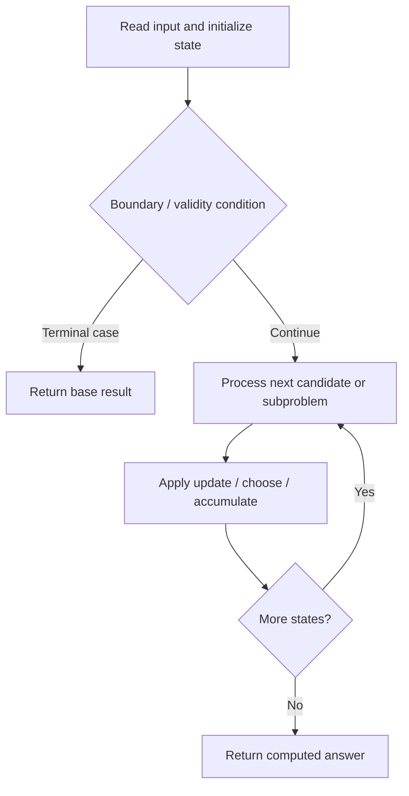

# 808. Soup Servings

**Difficulty:** Medium  
**Concept family:** [Digit DP, Counting and Probability](https://github.com/gaurav1kr/Miscellaneous/blob/main/DSA/DP/DP_Mathematics_Master_Guide_Illustrated/Theory/Chapter-11.md)  
**Problem:** https://leetcode.com/problems/soup-servings/  
**Original submission:** https://leetcode.com/submissions/detail/1610655262/

## Understand the mathematics first

This problem belongs to the study family **Digit DP, Counting and Probability**. Start by defining the objective and minimal sufficient state; inspect the code to identify the actual transitions.

### Problem-specific recurrence

Refer to the source-grounded algorithm walkthrough below for the state transitions used by your implementation. The generic family recurrence has been removed because it may not apply to this problem.

## Code landmarks

- `if (memo[A][B]) return memo[A][B];`
- `memo[A][B] = 0.25 * (`
- `return memo[A][B];`

## Source-grounded algorithm walkthrough (expanded coverage)

> **Verification level:** The observations below are extracted from your actual Accepted C++ implementation. The symbolic trace is a **code-reading dry-run worksheet**, not a fabricated numerical run. The generic family formula above is not necessarily this problem's recurrence.

### 1. Identify the actual state and algorithm

**Problem:** 808. Soup Servings. Recursive state transitions are present. Check memoization, state identity, termination, and whether branches are mutually exclusive.

| Role | C++ source line | Evidence from your solution |
|---|---:|---|
| Candidate state / accumulator | 5 | `unordered_map<int, unordered_map<int, double>> memo;` |
| Candidate state / accumulator | 11 | `if (memo[A][B]) return memo[A][B];` |
| Candidate state / accumulator | 13 | `memo[A][B] = 0.25 * (` |
| Boundary / termination | 8 | `if (A <= 0 && B <= 0) return 0.5;` |
| Boundary / termination | 9 | `if (A <= 0) return 1;` |
| Boundary / termination | 10 | `if (B <= 0) return 0;` |
| Traversal order | — | No obvious matching statement; inspect the original C++ below. |
| Transition / update | 13 | `memo[A][B] = 0.25 * (` |
| Return / result | 8 | `if (A <= 0 && B <= 0) return 0.5;` |
| Return / result | 9 | `if (A <= 0) return 1;` |

### 2. Trace the dependency chain



This is a **control-flow reading diagram**, not a claim about the exact shape of the mathematical state graph. Follow the code line numbers above to draw the actual dependency arrows.

### 3. Symbolic dry-run worksheet

| Stage | State to record | Mathematical question to answer |
|---|---|---|
| Initialize | Inputs, initialized containers/accumulators | What does the initial value mean? |
| First iteration / recursive call | Loop indices, branch, current state | Which predecessor states are available? |
| First update | Before → after for the updated variable | Why is this transition legal? Does it add, minimize, maximize, or overwrite? |
| Next iteration | Updated state and next candidate | Can a value be reused in this traversal order? |
| Finish | Return expression and its value | Why does this correspond to the problem's requested result? |

### 4. Mathematical explanation checklist

1. Define the exact meaning of each state variable, including all indices and constraints.
2. Translate the update expression into a mathematical equation **only after** establishing the state invariant.
3. Prove the transitions are exhaustive and do not double-count or reuse forbidden elements.
4. Check empty input, smallest input, impossible cases, and overflow/modulo behavior.
5. Compute a small numerical example using the actual problem constraints, then compare each row to the original C++.


---

## Your original Accepted C++ submission (unaltered)

```cpp
#include <unordered_map>
using namespace std;

class Solution {
    unordered_map<int, unordered_map<int, double>> memo;

    double dfs(int A, int B) {
        if (A <= 0 && B <= 0) return 0.5;
        if (A <= 0) return 1;
        if (B <= 0) return 0;
        if (memo[A][B]) return memo[A][B];

        memo[A][B] = 0.25 * (
            dfs(A - 100, B) + dfs(A - 75, B - 25) +
            dfs(A - 50, B - 50) + dfs(A - 25, B - 75)
        );
        return memo[A][B];
    }

public:
    double soupServings(int N) {
        if (N >= 5000) return 1.0;
        return dfs(N, N);
    }
};
```

## Time and Space Complexity

- **Time:** `Depends on operations (typically O(log n) per ordered-container operation)`
- **Auxiliary space:** `Depends on number of stored entries`

**Reasoning:** An ordered container or heap introduces logarithmic insertion, lookup, or removal costs; multiply by operation count.

**Status:** Code-informed complexity guidance; exact tight bounds have not been individually verified.
