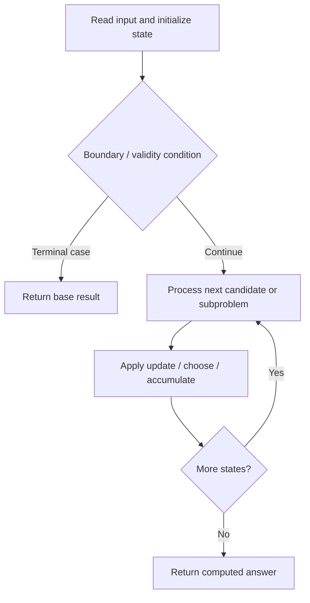

# 834. Sum of Distances in Tree

**Difficulty:** Hard  
**Concept family:** [Tree, Graph and DAG DP](https://github.com/gaurav1kr/Miscellaneous/blob/main/DSA/DP/DP_Mathematics_Master_Guide_Illustrated/Theory/Chapter-10.md)  
**Problem:** https://leetcode.com/problems/sum-of-distances-in-tree/  
**Original submission:** https://leetcode.com/submissions/detail/1473586256/

## Understand the mathematics first

This problem belongs to the study family **Tree, Graph and DAG DP**. Start by defining the objective and minimal sufficient state; inspect the code to identify the actual transitions.

### Mathematical starting point

This family includes tree DP, DAG DP, shortest paths, and graph traversal. **There is no single recurrence for all these problems.** Identify the exact state and invariant from the algorithm below. For tree paths, distinguish the value returned to the parent from a complete answer within the subtree; for graph problems, establish whether edges form a DAG or whether shortest-path processing is required.

## Code landmarks

Read the loops, recursion, and boundary conditions in the original code.

## Source-grounded algorithm walkthrough (expanded coverage)

> **Verification level:** The observations below are extracted from your actual Accepted C++ implementation. The symbolic trace is a **code-reading dry-run worksheet**, not a fabricated numerical run. The generic family formula above is not necessarily this problem's recurrence.

### 1. Identify the actual state and algorithm

**Problem:** 834. Sum of Distances in Tree. This solution does not expose an obvious `dp` or `memo` variable. Derive the algorithmic invariant from the code rather than assuming a DP recurrence.

| Role | C++ source line | Evidence from your solution |
|---|---:|---|
| Candidate state / accumulator | 4 | `vector<int> res; // to keep track distance of each node` |
| Candidate state / accumulator | 5 | `vector<int> count;` |
| Candidate state / accumulator | 33 | `int sum = 0;` |
| Boundary / termination | 10 | `if (it != parent)` |
| Boundary / termination | 23 | `if (parent != it)` |
| Traversal order | 8 | `for (int it : adj[node])` |
| Traversal order | 21 | `for (int it : adj[node])` |
| Traversal order | 38 | `for (auto& it : edges)` |
| Transition / update | 13 | `count[node] += count[it];` |
| Transition / update | 14 | `res[node] += res[it] + count[it];` |
| Transition / update | 25 | `res[it] = res[node] - count[it] + (n - count[it]);` |
| Transition / update | 33 | `int sum = 0;` |
| Return / result | 48 | `return res;` |

### 2. Trace the dependency chain



This is a **control-flow reading diagram**, not a claim about the exact shape of the mathematical state graph. Follow the code line numbers above to draw the actual dependency arrows.

### 3. Symbolic dry-run worksheet

| Stage | State to record | Mathematical question to answer |
|---|---|---|
| Initialize | Inputs, initialized containers/accumulators | What does the initial value mean? |
| First iteration / recursive call | Loop indices, branch, current state | Which predecessor states are available? |
| First update | Before → after for the updated variable | Why is this transition legal? Does it add, minimize, maximize, or overwrite? |
| Next iteration | Updated state and next candidate | Can a value be reused in this traversal order? |
| Finish | Return expression and its value | Why does this correspond to the problem's requested result? |

### 4. Mathematical explanation checklist

1. Define the exact meaning of each state variable, including all indices and constraints.
2. Translate the update expression into a mathematical equation **only after** establishing the state invariant.
3. Prove the transitions are exhaustive and do not double-count or reuse forbidden elements.
4. Check empty input, smallest input, impossible cases, and overflow/modulo behavior.
5. Compute a small numerical example using the actual problem constraints, then compare each row to the original C++.


---

## Your original Accepted C++ submission (unaltered)

```cpp
class Solution 
{
public:
    vector<int> res; // to keep track distance of each node
    vector<int> count;
    void fun(int node, int parent, vector<int> adj[]) 
    {
        for (int it : adj[node]) 
        {
            if (it != parent) 
            {
                fun(it, node, adj);
                count[node] += count[it];
                res[node] += res[it] + count[it];
            }
        }
    }
        //pos-Order to calculate root dis from left and right
    void fun2(int node, int parent, vector<int> adj[],int n) 
    {
        for (int it : adj[node]) 
        {
            if (parent != it) 
            {
                res[it] = res[node] - count[it] + (n - count[it]);
                fun2(it, node, adj,n);
            }
        }
    }

    vector<int> sumOfDistancesInTree(int n, vector<vector<int>>& edges)
    {
        int sum = 0;
        int m = edges.size();
        vector<int> adj[n];
        count = vector<int>(n, 1);
        res = vector<int>(n, 0);
        for (auto& it : edges) 
        {
            int u = it[0];
            int v = it[1];
            adj[u].push_back(v);
            adj[v].push_back(u);
        }
        fun(0, -1, adj);
        fun2(0, -1, adj,n);

        return res;
    }
};
```

## Time and Space Complexity

- **Time:** `Depends on table dimensions and transitions per cell`
- **Auxiliary space:** `O(rows × columns) for the allocated table`

**Reasoning:** The two-dimensional table determines memory; time is its state count multiplied by work per state.

**Status:** Code-informed complexity guidance; exact tight bounds have not been individually verified.
