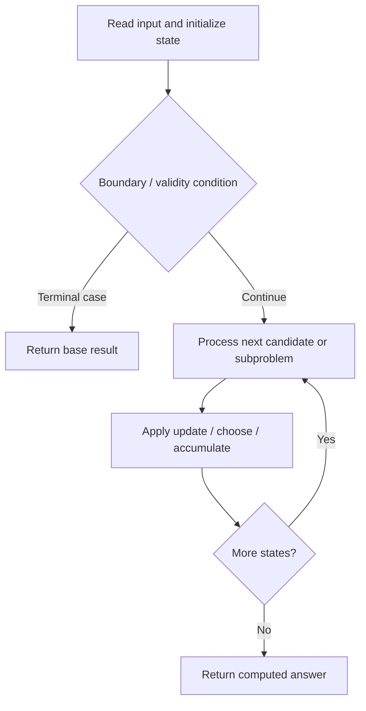

# 837. New 21 Game

**Difficulty:** Medium  
**Concept family:** [Digit DP, Counting and Probability](https://github.com/gaurav1kr/Miscellaneous/blob/main/DSA/DP/DP_Mathematics_Master_Guide_Illustrated/Theory/Chapter-11.md)  
**Problem:** https://leetcode.com/problems/new-21-game/  
**Original submission:** https://leetcode.com/submissions/detail/1593827590/

## Understand the mathematics first

This problem belongs to the study family **Digit DP, Counting and Probability**. Start by defining the objective and minimal sufficient state; inspect the code to identify the actual transitions.

### Related concept template (not necessarily this problem’s recurrence)

$$
bestEnding(i)=\max(a_i,a_i+bestEnding(i-1))
$$

**What this template illustrates:** This is Kadane’s recurrence; other problems in this group may use greedy, stacks, two pointers, prefix sums, or a specialized optimization—not necessarily DP.

**Derivation exercise:** Define exactly what each state variable means for this problem; list valid choices, base cases, and forbidden transitions. Check the submitted code against that invariant. The family template alone is not a substitute for a problem-specific proof.

## Code landmarks

- `dp[0] = 1.0;`
- `dp[i] = windowSum / maxPts;`
- `if (i < k) windowSum += dp[i];`

## Source-grounded algorithm walkthrough (expanded coverage)

> **Verification level:** The observations below are extracted from your actual Accepted C++ implementation. The symbolic trace is a **code-reading dry-run worksheet**, not a fabricated numerical run. The generic family formula above is not necessarily this problem's recurrence.

### 1. Identify the actual state and algorithm

**Problem:** 837. New 21 Game. An explicit state table or memo is present. Interpret each index as a mathematical state and every update as a transition.

| Role | C++ source line | Evidence from your solution |
|---|---:|---|
| Candidate state / accumulator | 9 | `vector<double> dp(n + 1);` |
| Candidate state / accumulator | 10 | `dp[0] = 1.0;` |
| Candidate state / accumulator | 11 | `double windowSum = 1.0, res = 0.0;` |
| Boundary / termination | 8 | `if (k == 0 \|\| n >= k + maxPts) return 1.0;` |
| Boundary / termination | 10 | `dp[0] = 1.0;` |
| Boundary / termination | 15 | `if (i < k) windowSum += dp[i];` |
| Traversal order | 13 | `for (int i = 1; i <= n; ++i) {` |
| Transition / update | 10 | `dp[0] = 1.0;` |
| Transition / update | 11 | `double windowSum = 1.0, res = 0.0;` |
| Transition / update | 14 | `dp[i] = windowSum / maxPts;` |
| Transition / update | 16 | `else res += dp[i];` |
| Return / result | 8 | `if (k == 0 \|\| n >= k + maxPts) return 1.0;` |
| Return / result | 20 | `return res;` |

### 2. Trace the dependency chain



This is a **control-flow reading diagram**, not a claim about the exact shape of the mathematical state graph. Follow the code line numbers above to draw the actual dependency arrows.

### 3. Symbolic dry-run worksheet

| Stage | State to record | Mathematical question to answer |
|---|---|---|
| Initialize | Inputs, initialized containers/accumulators | What does the initial value mean? |
| First iteration / recursive call | Loop indices, branch, current state | Which predecessor states are available? |
| First update | Before → after for the updated variable | Why is this transition legal? Does it add, minimize, maximize, or overwrite? |
| Next iteration | Updated state and next candidate | Can a value be reused in this traversal order? |
| Finish | Return expression and its value | Why does this correspond to the problem's requested result? |

### 4. Mathematical explanation checklist

1. Define the exact meaning of each state variable, including all indices and constraints.
2. Translate the update expression into a mathematical equation **only after** establishing the state invariant.
3. Prove the transitions are exhaustive and do not double-count or reuse forbidden elements.
4. Check empty input, smallest input, impossible cases, and overflow/modulo behavior.
5. Compute a small numerical example using the actual problem constraints, then compare each row to the original C++.


---

## Your original Accepted C++ submission (unaltered)

```cpp
#include <vector>

using namespace std;

class Solution {
public:
    double new21Game(int n, int k, int maxPts) {
        if (k == 0 || n >= k + maxPts) return 1.0;
        vector<double> dp(n + 1);
        dp[0] = 1.0;
        double windowSum = 1.0, res = 0.0;

        for (int i = 1; i <= n; ++i) {
            dp[i] = windowSum / maxPts;
            if (i < k) windowSum += dp[i];
            else res += dp[i];
            if (i - maxPts >= 0) windowSum -= dp[i - maxPts];
        }

        return res;
    }
};
```

## Time and Space Complexity

- **Time:** `Depends on loop nesting and bounds`
- **Auxiliary space:** `Depends on auxiliary arrays/containers`

**Reasoning:** Count how many iterations each loop executes and whether loops are nested; do not assume all nested loops are quadratic.

**Status:** Code-informed complexity guidance; exact tight bounds have not been individually verified.
