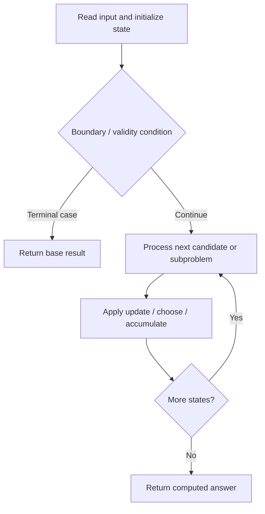

# 85. Maximal Rectangle

**Difficulty:** Hard  
**Concept family:** [Digit DP, Counting and Probability](https://github.com/gaurav1kr/Miscellaneous/blob/main/DSA/DP/DP_Mathematics_Master_Guide_Illustrated/Theory/Chapter-11.md)  
**Problem:** https://leetcode.com/problems/maximal-rectangle/  
**Original submission:** https://leetcode.com/submissions/detail/1541831536/

## Understand the mathematics first

This problem belongs to the study family **Digit DP, Counting and Probability**. Start by defining the objective and minimal sufficient state; inspect the code to identify the actual transitions.

### Related concept template (not necessarily this problem’s recurrence)

$$
bestEnding(i)=\max(a_i,a_i+bestEnding(i-1))
$$

**What this template illustrates:** This is Kadane’s recurrence; other problems in this group may use greedy, stacks, two pointers, prefix sums, or a specialized optimization—not necessarily DP.

**Derivation exercise:** Define exactly what each state variable means for this problem; list valid choices, base cases, and forbidden transitions. Check the submitted code against that invariant. The family template alone is not a substitute for a problem-specific proof.

## Code landmarks

- `maxArea = max(maxArea, largestRectangleArea(heights));`
- `stack<int> st;`
- `while (!st.empty() && heights[st.top()] > heights[i]) {`

## Source-grounded algorithm walkthrough (expanded coverage)

> **Verification level:** The observations below are extracted from your actual Accepted C++ implementation. The symbolic trace is a **code-reading dry-run worksheet**, not a fabricated numerical run. The generic family formula above is not necessarily this problem's recurrence.

### 1. Identify the actual state and algorithm

**Problem:** 85. Maximal Rectangle. This solution does not expose an obvious `dp` or `memo` variable. Derive the algorithmic invariant from the code rather than assuming a DP recurrence.

| Role | C++ source line | Evidence from your solution |
|---|---:|---|
| Candidate state / accumulator | — | No obvious matching statement; inspect the original C++ below. |
| Boundary / termination | 4 | `if (matrix.empty()) return 0;` |
| Traversal order | 11 | `for (int i = 0; i < rows; ++i) {` |
| Traversal order | 12 | `for (int j = 0; j < cols; ++j) {` |
| Traversal order | 29 | `for (int i = 0; i < heights.size(); ++i) {` |
| Transition / update | 17 | `maxArea = max(maxArea, largestRectangleArea(heights));` |
| Transition / update | 26 | `heights.push_back(0); // Add a sentinel value for easier calculation` |
| Transition / update | 34 | `maxArea = max(maxArea, height * width);` |
| Return / result | 4 | `if (matrix.empty()) return 0;` |
| Return / result | 20 | `return maxArea;` |

### 2. Trace the dependency chain



This is a **control-flow reading diagram**, not a claim about the exact shape of the mathematical state graph. Follow the code line numbers above to draw the actual dependency arrows.

### 3. Symbolic dry-run worksheet

| Stage | State to record | Mathematical question to answer |
|---|---|---|
| Initialize | Inputs, initialized containers/accumulators | What does the initial value mean? |
| First iteration / recursive call | Loop indices, branch, current state | Which predecessor states are available? |
| First update | Before → after for the updated variable | Why is this transition legal? Does it add, minimize, maximize, or overwrite? |
| Next iteration | Updated state and next candidate | Can a value be reused in this traversal order? |
| Finish | Return expression and its value | Why does this correspond to the problem's requested result? |

### 4. Mathematical explanation checklist

1. Define the exact meaning of each state variable, including all indices and constraints.
2. Translate the update expression into a mathematical equation **only after** establishing the state invariant.
3. Prove the transitions are exhaustive and do not double-count or reuse forbidden elements.
4. Check empty input, smallest input, impossible cases, and overflow/modulo behavior.
5. Compute a small numerical example using the actual problem constraints, then compare each row to the original C++.


---

## Your original Accepted C++ submission (unaltered)

```cpp
class Solution {
public:
    int maximalRectangle(vector<vector<char>>& matrix) {
        if (matrix.empty()) return 0;

        int rows = matrix.size();
        int cols = matrix[0].size();
        vector<int> heights(cols, 0); // Histogram heights for each column
        int maxArea = 0;

        for (int i = 0; i < rows; ++i) {
            for (int j = 0; j < cols; ++j) {
                // Update histogram heights: if '1', increment; if '0', reset to 0
                heights[j] = (matrix[i][j] == '1') ? heights[j] + 1 : 0;
            }
            // Calculate max rectangle in this row's histogram
            maxArea = max(maxArea, largestRectangleArea(heights));
        }

        return maxArea;
    }

private:
    int largestRectangleArea(vector<int>& heights) {
        stack<int> st;
        heights.push_back(0); // Add a sentinel value for easier calculation
        int maxArea = 0;

        for (int i = 0; i < heights.size(); ++i) {
            while (!st.empty() && heights[st.top()] > heights[i]) {
                int height = heights[st.top()];
                st.pop();
                int width = st.empty() ? i : i - st.top() - 1;
                maxArea = max(maxArea, height * width);
            }
            st.push(i);
        }

        heights.pop_back(); // Restore the heights vector
        return maxArea;
    }
};
```

## Time and Space Complexity

- **Time:** `Depends on table dimensions and transitions per cell`
- **Auxiliary space:** `O(rows × columns) for the allocated table`

**Reasoning:** The two-dimensional table determines memory; time is its state count multiplied by work per state.

**Status:** Code-informed complexity guidance; exact tight bounds have not been individually verified.
