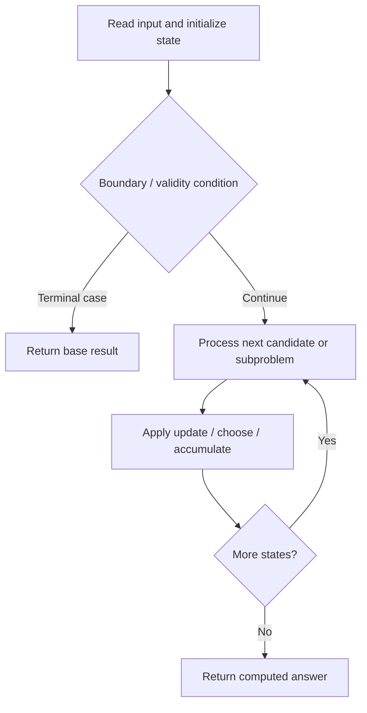

# 873. Length of Longest Fibonacci Subsequence

**Difficulty:** Medium  
**Concept family:** [Mathematical Recurrences and Combinatorics](https://github.com/gaurav1kr/Miscellaneous/blob/main/DSA/DP/DP_Mathematics_Master_Guide_Illustrated/Theory/Chapter-01.md)  
**Problem:** https://leetcode.com/problems/length-of-longest-fibonacci-subsequence/  
**Original submission:** https://leetcode.com/submissions/detail/1617069502/

## Understand the mathematics first

This problem belongs to the study family **Mathematical Recurrences and Combinatorics**. Start by defining the objective and minimal sufficient state; inspect the code to identify the actual transitions.

### Related concept template (not necessarily this problem’s recurrence)

$$
F(n)=\sum_{c\in Choices(n)}F(next(n,c))
$$

**What this template illustrates:** For counting, add disjoint cases. For optimization, replace sum with min or max. Base cases must express empty structures correctly.

**Derivation exercise:** Define exactly what each state variable means for this problem; list valid choices, base cases, and forbidden transitions. Check the submitted code against that invariant. The family template alone is not a substitute for a problem-specific proof.

## Code landmarks

- `while (start < end) {`
- `dp[end][curr] = dp[start][end] + 1;`
- `maxLen = max(dp[end][curr], maxLen);`

## Source-grounded algorithm walkthrough (expanded coverage)

> **Verification level:** The observations below are extracted from your actual Accepted C++ implementation. The symbolic trace is a **code-reading dry-run worksheet**, not a fabricated numerical run. The generic family formula above is not necessarily this problem's recurrence.

### 1. Identify the actual state and algorithm

**Problem:** 873. Length of Longest Fibonacci Subsequence. An explicit state table or memo is present. Interpret each index as a mathematical state and every update as a transition.

| Role | C++ source line | Evidence from your solution |
|---|---:|---|
| Candidate state / accumulator | 5 | `vector<vector<int>> dp(n, vector<int>(n, 0));` |
| Candidate state / accumulator | 17 | `dp[end][curr] = dp[start][end] + 1;` |
| Candidate state / accumulator | 18 | `maxLen = max(dp[end][curr], maxLen);` |
| Boundary / termination | 12 | `if (pairSum > arr[curr]) {` |
| Boundary / termination | 14 | `} else if (pairSum < arr[curr]) {` |
| Boundary / termination | 24 | `return maxLen == 0 ? 0 : maxLen + 2;` |
| Traversal order | 8 | `for (int curr = 2; curr < n; curr++) {` |
| Traversal order | 10 | `while (start < end) {` |
| Transition / update | 17 | `dp[end][curr] = dp[start][end] + 1;` |
| Transition / update | 18 | `maxLen = max(dp[end][curr], maxLen);` |
| Return / result | 24 | `return maxLen == 0 ? 0 : maxLen + 2;` |

### 2. Trace the dependency chain



This is a **control-flow reading diagram**, not a claim about the exact shape of the mathematical state graph. Follow the code line numbers above to draw the actual dependency arrows.

### 3. Symbolic dry-run worksheet

| Stage | State to record | Mathematical question to answer |
|---|---|---|
| Initialize | Inputs, initialized containers/accumulators | What does the initial value mean? |
| First iteration / recursive call | Loop indices, branch, current state | Which predecessor states are available? |
| First update | Before → after for the updated variable | Why is this transition legal? Does it add, minimize, maximize, or overwrite? |
| Next iteration | Updated state and next candidate | Can a value be reused in this traversal order? |
| Finish | Return expression and its value | Why does this correspond to the problem's requested result? |

### 4. Mathematical explanation checklist

1. Define the exact meaning of each state variable, including all indices and constraints.
2. Translate the update expression into a mathematical equation **only after** establishing the state invariant.
3. Prove the transitions are exhaustive and do not double-count or reuse forbidden elements.
4. Check empty input, smallest input, impossible cases, and overflow/modulo behavior.
5. Compute a small numerical example using the actual problem constraints, then compare each row to the original C++.


---

## Your original Accepted C++ submission (unaltered)

```cpp
class Solution {
public:
    int lenLongestFibSubseq(vector<int>& arr) {
        int n = arr.size();
        vector<vector<int>> dp(n, vector<int>(n, 0));
        int maxLen = 0;

        for (int curr = 2; curr < n; curr++) {
            int start = 0, end = curr - 1;
            while (start < end) {
                int pairSum = arr[start] + arr[end];
                if (pairSum > arr[curr]) {
                    end--;
                } else if (pairSum < arr[curr]) {
                    start++;
                } else {
                    dp[end][curr] = dp[start][end] + 1;
                    maxLen = max(dp[end][curr], maxLen);
                    end--;
                    start++;
                }
            }
        }
        return maxLen == 0 ? 0 : maxLen + 2;
    }
};
```

## Time and Space Complexity

- **Time:** `Depends on table dimensions and transitions per cell`
- **Auxiliary space:** `O(rows × columns) for the allocated table`

**Reasoning:** The two-dimensional table determines memory; time is its state count multiplied by work per state.

**Status:** Code-informed complexity guidance; exact tight bounds have not been individually verified.
