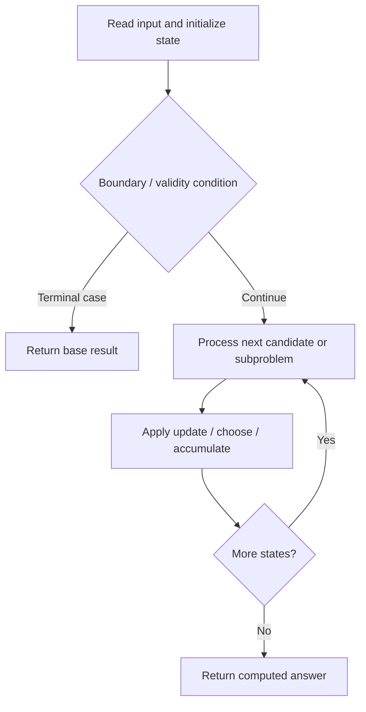

# 887. Super Egg Drop

**Difficulty:** Hard  
**Concept family:** [Interval and Partition DP](https://github.com/gaurav1kr/Miscellaneous/blob/main/DSA/DP/DP_Mathematics_Master_Guide_Illustrated/Theory/Chapter-06.md)  
**Problem:** https://leetcode.com/problems/super-egg-drop/  
**Original submission:** https://leetcode.com/submissions/detail/1405888490/

## Understand the mathematics first

This problem belongs to the study family **Interval and Partition DP**. Start by defining the objective and minimal sufficient state; inspect the code to identify the actual transitions.

### Related concept template (not necessarily this problem’s recurrence)

$$
F(l,r)=\min_{l\le k<r}(F(l,k)+F(k+1,r)+cost(l,k,r))
$$

**What this template illustrates:** Some interval problems maximize rather than minimize. Choosing the last operation can make otherwise interacting subproblems independent.

**Derivation exercise:** Define exactly what each state variable means for this problem; list valid choices, base cases, and forbidden transitions. Check the submitted code against that invariant. The family template alone is not a substitute for a problem-specific proof.

## Code landmarks

- `if(memo[k][n] != -1) return memo[k][n];`
- `temp = 1 + max(left, right);`
- `mn = min(mn, temp);`

## Source-grounded algorithm walkthrough (expanded coverage)

> **Verification level:** The observations below are extracted from your actual Accepted C++ implementation. The symbolic trace is a **code-reading dry-run worksheet**, not a fabricated numerical run. The generic family formula above is not necessarily this problem's recurrence.

### 1. Identify the actual state and algorithm

**Problem:** 887. Super Egg Drop. Recursive state transitions are present. Check memoization, state identity, termination, and whether branches are mutually exclusive.

| Role | C++ source line | Evidence from your solution |
|---|---:|---|
| Candidate state / accumulator | 6 | `int helper(int k, int n, vector<vector<int>>& memo)` |
| Candidate state / accumulator | 12 | `if(memo[k][n] != -1) return memo[k][n];` |
| Candidate state / accumulator | 20 | `int left = helper(k-1, mid-1, memo);` |
| Boundary / termination | 8 | `if(n == 0 \|\| n == 1) return n;` |
| Boundary / termination | 10 | `if(k == 1) return n;` |
| Boundary / termination | 12 | `if(memo[k][n] != -1) return memo[k][n];` |
| Traversal order | 16 | `while(low<=high){` |
| Transition / update | 23 | `temp = 1 + max(left, right);` |
| Transition / update | 30 | `mn = min(mn, temp);` |
| Transition / update | 32 | `return memo[k][n] = mn;` |
| Return / result | 8 | `if(n == 0 \|\| n == 1) return n;` |
| Return / result | 10 | `if(k == 1) return n;` |

### 2. Trace the dependency chain



This is a **control-flow reading diagram**, not a claim about the exact shape of the mathematical state graph. Follow the code line numbers above to draw the actual dependency arrows.

### 3. Symbolic dry-run worksheet

| Stage | State to record | Mathematical question to answer |
|---|---|---|
| Initialize | Inputs, initialized containers/accumulators | What does the initial value mean? |
| First iteration / recursive call | Loop indices, branch, current state | Which predecessor states are available? |
| First update | Before → after for the updated variable | Why is this transition legal? Does it add, minimize, maximize, or overwrite? |
| Next iteration | Updated state and next candidate | Can a value be reused in this traversal order? |
| Finish | Return expression and its value | Why does this correspond to the problem's requested result? |

### 4. Mathematical explanation checklist

1. Define the exact meaning of each state variable, including all indices and constraints.
2. Translate the update expression into a mathematical equation **only after** establishing the state invariant.
3. Prove the transitions are exhaustive and do not double-count or reuse forbidden elements.
4. Check empty input, smallest input, impossible cases, and overflow/modulo behavior.
5. Compute a small numerical example using the actual problem constraints, then compare each row to the original C++.


---

## Your original Accepted C++ submission (unaltered)

```cpp
//Memoization + Binary Search
class Solution 
{
public:
    //Time: O(n*k*logn), Space: O(n*k)
    int helper(int k, int n, vector<vector<int>>& memo)
	{
        if(n == 0 || n == 1) return n;
		
        if(k == 1) return n;
        
        if(memo[k][n] != -1) return memo[k][n];
        
        int mn = INT_MAX, low = 0, high = n, temp = 0;
        
        while(low<=high){
            
            int mid = (low + high)/2;
            
            int left = helper(k-1, mid-1, memo);
            int right = helper(k, n-mid, memo);
            
            temp = 1 + max(left, right);
            
            if(left < right) 
                low = mid+1;
            else 
                high = mid-1;     
    
            mn = min(mn, temp); 
        }
        return memo[k][n] = mn;
    }
    
    int superEggDrop(int k, int n) 
	{
        vector<vector<int>> memo(k+1, vector<int>(n+1, -1));
        return helper(k, n, memo);
    }
};
```

## Time and Space Complexity

- **Time:** `Depends on table dimensions and transitions per cell`
- **Auxiliary space:** `O(rows × columns) for the allocated table`

**Reasoning:** The two-dimensional table determines memory; time is its state count multiplied by work per state.

**Status:** Code-informed complexity guidance; exact tight bounds have not been individually verified.
