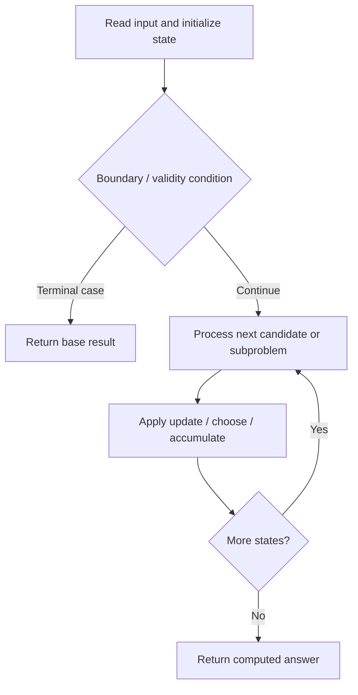

# 903. Valid Permutations for DI Sequence

**Difficulty:** Hard  
**Concept family:** [Digit DP, Counting and Probability](https://github.com/gaurav1kr/Miscellaneous/blob/main/DSA/DP/DP_Mathematics_Master_Guide_Illustrated/Theory/Chapter-11.md)  
**Problem:** https://leetcode.com/problems/valid-permutations-for-di-sequence/  
**Original submission:** https://leetcode.com/submissions/detail/1617065901/

## Understand the mathematics first

This problem belongs to the study family **Digit DP, Counting and Probability**. Start by defining the objective and minimal sufficient state; inspect the code to identify the actual transitions.

### Problem-specific recurrence

Refer to the source-grounded algorithm walkthrough below for the state transitions used by your implementation. The generic family recurrence has been removed because it may not apply to this problem.

## Code landmarks

- `if(dp[ind][prev]!=-1)return dp[ind][prev];`
- `return dp[ind][prev]=ans%mod;`

## Source-grounded algorithm walkthrough (expanded coverage)

> **Verification level:** The observations below are extracted from your actual Accepted C++ implementation. The symbolic trace is a **code-reading dry-run worksheet**, not a fabricated numerical run. The generic family formula above is not necessarily this problem's recurrence.

### 1. Identify the actual state and algorithm

**Problem:** 903. Valid Permutations for DI Sequence. Recursive state transitions are present. Check memoization, state identity, termination, and whether branches are mutually exclusive.

| Role | C++ source line | Evidence from your solution |
|---|---:|---|
| Candidate state / accumulator | 5 | `int solve(int ind, int prev, string s, int n,vector<int>&vis,vector<vector<int>>&dp){` |
| Candidate state / accumulator | 7 | `if(dp[ind][prev]!=-1)return dp[ind][prev];` |
| Candidate state / accumulator | 24 | `return dp[ind][prev]=ans%mod;` |
| Boundary / termination | 6 | `if(ind>=n)return 1;` |
| Boundary / termination | 7 | `if(dp[ind][prev]!=-1)return dp[ind][prev];` |
| Boundary / termination | 11 | `if(i!=prev && vis[i]==0){` |
| Traversal order | 10 | `for(int i=0;i<=n;i++){` |
| Traversal order | 31 | `for(int i=0;i<=n;i++){` |
| Transition / update | 9 | `ll ans=0;` |
| Transition / update | 14 | `ans=(ans+solve(ind+1,i,s,n,vis,dp))%mod;` |
| Transition / update | 19 | `ans= (ans+solve(ind+1,i,s,n,vis,dp))%mod;` |
| Transition / update | 24 | `return dp[ind][prev]=ans%mod;` |
| Return / result | 6 | `if(ind>=n)return 1;` |
| Return / result | 7 | `if(dp[ind][prev]!=-1)return dp[ind][prev];` |

### 2. Trace the dependency chain



This is a **control-flow reading diagram**, not a claim about the exact shape of the mathematical state graph. Follow the code line numbers above to draw the actual dependency arrows.

### 3. Symbolic dry-run worksheet

| Stage | State to record | Mathematical question to answer |
|---|---|---|
| Initialize | Inputs, initialized containers/accumulators | What does the initial value mean? |
| First iteration / recursive call | Loop indices, branch, current state | Which predecessor states are available? |
| First update | Before → after for the updated variable | Why is this transition legal? Does it add, minimize, maximize, or overwrite? |
| Next iteration | Updated state and next candidate | Can a value be reused in this traversal order? |
| Finish | Return expression and its value | Why does this correspond to the problem's requested result? |

### 4. Mathematical explanation checklist

1. Define the exact meaning of each state variable, including all indices and constraints.
2. Translate the update expression into a mathematical equation **only after** establishing the state invariant.
3. Prove the transitions are exhaustive and do not double-count or reuse forbidden elements.
4. Check empty input, smallest input, impossible cases, and overflow/modulo behavior.
5. Compute a small numerical example using the actual problem constraints, then compare each row to the original C++.


---

## Your original Accepted C++ submission (unaltered)

```cpp
class Solution {
public:
    #define ll long long
    const int mod = 1e9+7;
    int solve(int ind, int prev, string s, int n,vector<int>&vis,vector<vector<int>>&dp){
        if(ind>=n)return 1;
        if(dp[ind][prev]!=-1)return dp[ind][prev];

        ll ans=0;
        for(int i=0;i<=n;i++){
            if(i!=prev && vis[i]==0){
                if(s[ind]=='D' && i<prev){
                    vis[i]=1;
                    ans=(ans+solve(ind+1,i,s,n,vis,dp))%mod;
                    vis[i]=0;
                }
                if(s[ind]=='I' && i>prev){
                    vis[i]=1;
                    ans= (ans+solve(ind+1,i,s,n,vis,dp))%mod;
                    vis[i]=0;
                }
            }
        }
        return dp[ind][prev]=ans%mod;
    }
    int numPermsDISequence(string s) {
        
        int n = s.length();
        ll ans=0;
        vector<vector<int>>dp(n+1,vector<int>(n+1,-1));
        for(int i=0;i<=n;i++){
            vector<int>vis(n+2,0);
            vis[i]=1;
            
            ans= (ans+solve(0,i,s,n,vis, dp))%mod;
        }
        return ans;

    }
};
```

## Time and Space Complexity

- **Time:** `Depends on table dimensions and transitions per cell`
- **Auxiliary space:** `O(rows × columns) for the allocated table`

**Reasoning:** The two-dimensional table determines memory; time is its state count multiplied by work per state.

**Status:** Code-informed complexity guidance; exact tight bounds have not been individually verified.
