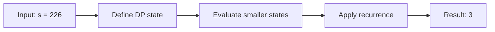

# 91. Decode Ways

**Difficulty:** Medium  
**Concept family:** [Mathematical Recurrences and Combinatorics](https://github.com/gaurav1kr/Miscellaneous/blob/main/DSA/DP/DP_Mathematics_Master_Guide_Illustrated/Theory/Chapter-01.md)  
**Problem:** https://leetcode.com/problems/decode-ways/  
**Original submission:** https://leetcode.com/submissions/detail/1541843695/

## Understand the mathematics first

This problem belongs to the study family **Mathematical Recurrences and Combinatorics**. Start by defining the objective and minimal sufficient state; inspect the code to identify the actual transitions.

### Problem-specific recurrence

Refer to the source-grounded algorithm walkthrough below for the state transitions used by your implementation. The generic family recurrence has been removed because it may not apply to this problem.

## Code landmarks

- `dp[0] = 1; // Base case: empty string has one way to decode`
- `dp[1] = 1; // Single character (non-'0') has one way to decode`
- `dp[i] += dp[i - 1];`

## Detailed dry run — Decode Ways: count valid last token

### Start from the mathematical question

Let W(i) count decodings of the first i characters. W(0)=1, since the empty prefix has one valid completion.

### Derive the recurrence

```math
W(i)=[single\ valid]W(i-1)+[pair\ valid]W(i-2)
```

**Why the transition is correct:** Every decoding ends with exactly one token of length one or two. Validity tests avoid interpreting 0 alone or values outside 10..26.

### Concrete example

**Input:** `s = "226"`



**Evaluate the states in dependency order:**

| Prefix | Single last digit | Pair last digits | Ways |
|---|---|---|---:|
| empty | — | — | 1 |
| "2" | 2 | — | 1 |
| "22" | 2 | 22 | 1+1=2 |
| "226" | 6 | 26 | 2+1=3 |

**Expected result:** `3`.

### What to remember six months later

Explain (1) what one state means, (2) which earlier states it needs, (3) why those cases are exhaustive, and (4) why the answer is `3` for this input. Then inspect your preserved C++ solution below and match its variables to the mathematical states.

---

## Your original Accepted C++ submission (unaltered)

```cpp
class Solution {
public:
    int numDecodings(string s) {
        int n = s.size();
        if (n == 0 || s[0] == '0') return 0; // Edge case: invalid starting character
        
        vector<int> dp(n + 1, 0);
        dp[0] = 1; // Base case: empty string has one way to decode
        dp[1] = 1; // Single character (non-'0') has one way to decode
        
        for (int i = 2; i <= n; ++i) {
            // Check if single-digit decode is valid
            if (s[i - 1] != '0') {
                dp[i] += dp[i - 1];
            }
            
            // Check if two-digit decode is valid
            int twoDigit = stoi(s.substr(i - 2, 2));
            if (twoDigit >= 10 && twoDigit <= 26) {
                dp[i] += dp[i - 2];
            }
        }
        
        return dp[n];
    }
};
```

## Time and Space Complexity

- **Time:** `Depends on loop nesting and bounds`
- **Auxiliary space:** `Depends on auxiliary arrays/containers`

**Reasoning:** Count how many iterations each loop executes and whether loops are nested; do not assume all nested loops are quadratic.

**Status:** Code-informed complexity guidance; exact tight bounds have not been individually verified.
