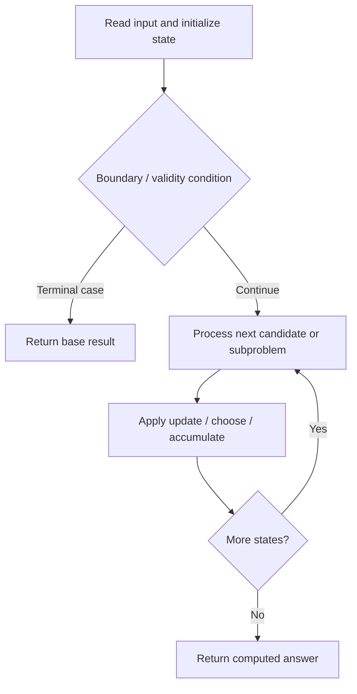

# 960. Delete Columns to Make Sorted III

**Difficulty:** Hard  
**Concept family:** [Subsequence and Ordering DP](https://github.com/gaurav1kr/Miscellaneous/blob/main/DSA/DP/DP_Mathematics_Master_Guide_Illustrated/Theory/Chapter-05.md)  
**Problem:** https://leetcode.com/problems/delete-columns-to-make-sorted-iii/  
**Original submission:** https://leetcode.com/submissions/detail/1610605855/

## Understand the mathematics first

This problem belongs to the study family **Subsequence and Ordering DP**. Start by defining the objective and minimal sufficient state; inspect the code to identify the actual transitions.

### Related concept template (not necessarily this problem’s recurrence)

$$
L(i)=1+\max_{j<i,\;a_j<a_i}L(j)
$$

**What this template illustrates:** When there is no predecessor, length is one. More advanced variants add dimensions such as last difference or number of chosen elements.

**Derivation exercise:** Define exactly what each state variable means for this problem; list valid choices, base cases, and forbidden transitions. Check the submitted code against that invariant. The family template alone is not a substitute for a problem-specific proof.

## Code landmarks

- `if (valid) dp[j] = max(dp[j], dp[i] + 1);`

## Source-grounded algorithm walkthrough (expanded coverage)

> **Verification level:** The observations below are extracted from your actual Accepted C++ implementation. The symbolic trace is a **code-reading dry-run worksheet**, not a fabricated numerical run. The generic family formula above is not necessarily this problem's recurrence.

### 1. Identify the actual state and algorithm

**Problem:** 960. Delete Columns to Make Sorted III. An explicit state table or memo is present. Interpret each index as a mathematical state and every update as a transition.

| Role | C++ source line | Evidence from your solution |
|---|---:|---|
| Candidate state / accumulator | 11 | `vector<int> dp(m, 1);` |
| Candidate state / accumulator | 12 | `int res = m - 1;` |
| Candidate state / accumulator | 22 | `if (valid) dp[j] = max(dp[j], dp[i] + 1);` |
| Boundary / termination | 18 | `if (strs[k][i] > strs[k][j]) {` |
| Boundary / termination | 22 | `if (valid) dp[j] = max(dp[j], dp[i] + 1);` |
| Traversal order | 14 | `for (int j = 1; j < m; ++j)` |
| Traversal order | 15 | `for (int i = 0; i < j; ++i) {` |
| Traversal order | 17 | `for (int k = 0; k < n; ++k)` |
| Transition / update | 12 | `int res = m - 1;` |
| Transition / update | 22 | `if (valid) dp[j] = max(dp[j], dp[i] + 1);` |
| Return / result | 25 | `return m - *max_element(dp.begin(), dp.end());` |

### 2. Trace the dependency chain



This is a **control-flow reading diagram**, not a claim about the exact shape of the mathematical state graph. Follow the code line numbers above to draw the actual dependency arrows.

### 3. Symbolic dry-run worksheet

| Stage | State to record | Mathematical question to answer |
|---|---|---|
| Initialize | Inputs, initialized containers/accumulators | What does the initial value mean? |
| First iteration / recursive call | Loop indices, branch, current state | Which predecessor states are available? |
| First update | Before → after for the updated variable | Why is this transition legal? Does it add, minimize, maximize, or overwrite? |
| Next iteration | Updated state and next candidate | Can a value be reused in this traversal order? |
| Finish | Return expression and its value | Why does this correspond to the problem's requested result? |

### 4. Mathematical explanation checklist

1. Define the exact meaning of each state variable, including all indices and constraints.
2. Translate the update expression into a mathematical equation **only after** establishing the state invariant.
3. Prove the transitions are exhaustive and do not double-count or reuse forbidden elements.
4. Check empty input, smallest input, impossible cases, and overflow/modulo behavior.
5. Compute a small numerical example using the actual problem constraints, then compare each row to the original C++.


---

## Your original Accepted C++ submission (unaltered)

```cpp
#include <vector>
#include <string>
#include <algorithm>

using namespace std;

class Solution {
public:
    int minDeletionSize(vector<string>& strs) {
        int n = strs.size(), m = strs[0].size();
        vector<int> dp(m, 1);
        int res = m - 1;

        for (int j = 1; j < m; ++j)
            for (int i = 0; i < j; ++i) {
                bool valid = true;
                for (int k = 0; k < n; ++k)
                    if (strs[k][i] > strs[k][j]) {
                        valid = false;
                        break;
                    }
                if (valid) dp[j] = max(dp[j], dp[i] + 1);
            }

        return m - *max_element(dp.begin(), dp.end());
    }
};
```

## Time and Space Complexity

- **Time:** `Depends on loop nesting and bounds`
- **Auxiliary space:** `Depends on auxiliary arrays/containers`

**Reasoning:** Count how many iterations each loop executes and whether loops are nested; do not assume all nested loops are quadratic.

**Status:** Code-informed complexity guidance; exact tight bounds have not been individually verified.
