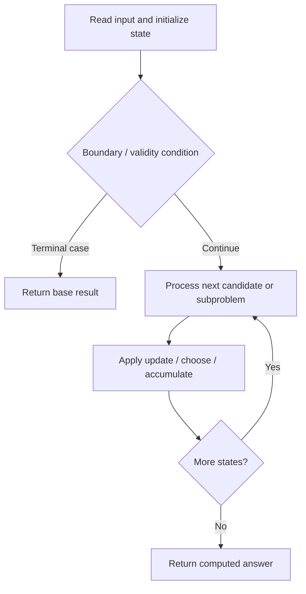

# 964. Least Operators to Express Number

**Difficulty:** Hard  
**Concept family:** [Mathematical Recurrences and Combinatorics](https://github.com/gaurav1kr/Miscellaneous/blob/main/DSA/DP/DP_Mathematics_Master_Guide_Illustrated/Theory/Chapter-01.md)  
**Problem:** https://leetcode.com/problems/least-operators-to-express-number/  
**Original submission:** https://leetcode.com/submissions/detail/1617063513/

## Understand the mathematics first

This problem belongs to the study family **Mathematical Recurrences and Combinatorics**. Start by defining the objective and minimal sufficient state; inspect the code to identify the actual transitions.

### Problem-specific recurrence

Refer to the source-grounded algorithm walkthrough below for the state transitions used by your implementation. The generic family recurrence has been removed because it may not apply to this problem.

## Code landmarks

- `return min(opsAdd, opsSub);`
- `return memo[t];  // return cached result if already computed`
- `while (p * x <= t) {`

## Source-grounded algorithm walkthrough (expanded coverage)

> **Verification level:** The observations below are extracted from your actual Accepted C++ implementation. The symbolic trace is a **code-reading dry-run worksheet**, not a fabricated numerical run. The generic family formula above is not necessarily this problem's recurrence.

### 1. Identify the actual state and algorithm

**Problem:** 964. Least Operators to Express Number. Recursive state transitions are present. Check memoization, state identity, termination, and whether branches are mutually exclusive.

| Role | C++ source line | Evidence from your solution |
|---|---:|---|
| Candidate state / accumulator | 6 | `unordered_map<long long, int> memo;` |
| Candidate state / accumulator | 21 | `return memo[t];  // return cached result if already computed` |
| Candidate state / accumulator | 34 | `memo[t] = k - 1;` |
| Boundary / termination | 10 | `if (t == 0) {` |
| Boundary / termination | 11 | `return 0;  // 0 can be formed as x - x, but we count that in the caller context` |
| Boundary / termination | 13 | `if (t < x) {` |
| Traversal order | 27 | `while (p * x <= t) {` |
| Transition / update | 18 | `return min(opsAdd, opsSub);` |
| Transition / update | 34 | `memo[t] = k - 1;` |
| Transition / update | 51 | `int result = min(costUseLower, costUseHigher);` |
| Transition / update | 52 | `memo[t] = result;` |
| Return / result | 11 | `return 0;  // 0 can be formed as x - x, but we count that in the caller context` |
| Return / result | 18 | `return min(opsAdd, opsSub);` |

### 2. Trace the dependency chain



This is a **control-flow reading diagram**, not a claim about the exact shape of the mathematical state graph. Follow the code line numbers above to draw the actual dependency arrows.

### 3. Symbolic dry-run worksheet

| Stage | State to record | Mathematical question to answer |
|---|---|---|
| Initialize | Inputs, initialized containers/accumulators | What does the initial value mean? |
| First iteration / recursive call | Loop indices, branch, current state | Which predecessor states are available? |
| First update | Before → after for the updated variable | Why is this transition legal? Does it add, minimize, maximize, or overwrite? |
| Next iteration | Updated state and next candidate | Can a value be reused in this traversal order? |
| Finish | Return expression and its value | Why does this correspond to the problem's requested result? |

### 4. Mathematical explanation checklist

1. Define the exact meaning of each state variable, including all indices and constraints.
2. Translate the update expression into a mathematical equation **only after** establishing the state invariant.
3. Prove the transitions are exhaustive and do not double-count or reuse forbidden elements.
4. Check empty input, smallest input, impossible cases, and overflow/modulo behavior.
5. Compute a small numerical example using the actual problem constraints, then compare each row to the original C++.


---

## Your original Accepted C++ submission (unaltered)

```cpp
// Your solution here
class Solution {
public:
    int leastOpsExpressTarget(int x, int target) {
        // Memoization table to store results for sub-targets
        unordered_map<long long, int> memo;
        
        // Recursive lambda function (DFS with memo) to compute cost for a given value t
        function<int(long long)> dfs = [&](long long t) -> int {
            if (t == 0) {
                return 0;  // 0 can be formed as x - x, but we count that in the caller context
            }
            if (t < x) {
                // If t is smaller than x, choose the cheaper between:
                // adding 1 (x/x) t times vs. subtracting from x.
                int opsAdd = 2 * (int)t - 1;       // cost = t divisions for 1's + (t-1) additions
                int opsSub = 2 * (int)(x - t);    // cost = (x-t) divisions for 1's + (x-t) - 1 additions + 1 subtraction
                return min(opsAdd, opsSub);
            }
            if (memo.count(t)) {
                return memo[t];  // return cached result if already computed
            }
            
            // Find largest power of x (say x^k) that is <= t
            long long p = 1;
            int k = 0;
            while (p * x <= t) {
                p *= x;
                ++k;
            }
            
            if (p == t) {
                // t is exactly x^k, needs k-1 multiplications (e.g., x*x*...*x with k terms has k-1 operators)
                memo[t] = k - 1;
                return k - 1;
            }
            
            // Compute cost if we use p = x^k as part of the expression
            long long remainder = t - p;
            int costUseLower = dfs(remainder) + k;  
            // (k includes k-1 multiplications for x^k and 1 addition to add the remainder)
            
            // Compute cost if we use the next power p*x = x^(k+1) and subtract the excess
            long long leftOver = p * x - t;  // this is the difference we would subtract
            int costUseHigher = INT_MAX;
            if (leftOver < t) {
                costUseHigher = dfs(leftOver) + k + 1;  
                // (k+1 includes k multiplications for x^(k+1) and 1 subtraction operator)
            }
            
            int result = min(costUseLower, costUseHigher);
            memo[t] = result;
            return result;
        };
        
        return dfs(target);
    }
};
```

## Time and Space Complexity

- **Time:** `Depends on operations (typically O(log n) per ordered-container operation)`
- **Auxiliary space:** `Depends on number of stored entries`

**Reasoning:** An ordered container or heap introduces logarithmic insertion, lookup, or removal costs; multiply by operation count.

**Status:** Code-informed complexity guidance; exact tight bounds have not been individually verified.
