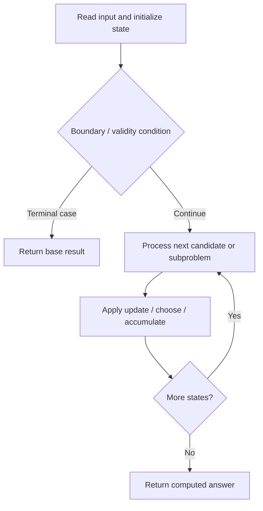

# 97. Interleaving String

**Difficulty:** Medium  
**Concept family:** [String Matching and Sequence Alignment](https://github.com/gaurav1kr/Miscellaneous/blob/main/DSA/DP/DP_Mathematics_Master_Guide_Illustrated/Theory/Chapter-04.md)  
**Problem:** https://leetcode.com/problems/interleaving-string/  
**Original submission:** https://leetcode.com/submissions/detail/1528674128/

## Understand the mathematics first

This problem belongs to the study family **String Matching and Sequence Alignment**. Start by defining the objective and minimal sufficient state; inspect the code to identify the actual transitions.

### Related concept template (not necessarily this problem’s recurrence)

$$
D(i,j)=\min(D(i-1,j)+1,D(i,j-1)+1,D(i-1,j-1)+[a_i\ne b_j])
$$

**What this template illustrates:** The three alternatives correspond to delete, insert and substitute. In matching/counting variants, the aggregation changes.

**Derivation exercise:** Define exactly what each state variable means for this problem; list valid choices, base cases, and forbidden transitions. Check the submitted code against that invariant. The family template alone is not a substitute for a problem-specific proof.

## Code landmarks

- `dp[0][0] = true;`
- `dp[i][j] = dp[i - 1][j];`
- `dp[i][j] = dp[i][j] || dp[i][j - 1];`

## Source-grounded algorithm walkthrough (expanded coverage)

> **Verification level:** The observations below are extracted from your actual Accepted C++ implementation. The symbolic trace is a **code-reading dry-run worksheet**, not a fabricated numerical run. The generic family formula above is not necessarily this problem's recurrence.

### 1. Identify the actual state and algorithm

**Problem:** 97. Interleaving String. An explicit state table or memo is present. Interpret each index as a mathematical state and every update as a transition.

| Role | C++ source line | Evidence from your solution |
|---|---:|---|
| Candidate state / accumulator | 9 | `vector<vector<bool>> dp(n1 + 1, vector<bool>(n2 + 1, false));` |
| Candidate state / accumulator | 10 | `dp[0][0] = true;` |
| Candidate state / accumulator | 18 | `dp[i][j] = dp[i - 1][j];` |
| Boundary / termination | 7 | `if (n1 + n2 != n3) return false;` |
| Boundary / termination | 10 | `dp[0][0] = true;` |
| Boundary / termination | 16 | `if (i > 0 && s1[i - 1] == s3[i + j - 1])` |
| Traversal order | 12 | `for (int i = 0; i <= n1; ++i)` |
| Traversal order | 14 | `for (int j = 0; j <= n2; ++j)` |
| Transition / update | 10 | `dp[0][0] = true;` |
| Transition / update | 18 | `dp[i][j] = dp[i - 1][j];` |
| Transition / update | 23 | `dp[i][j] = dp[i][j] \|\| dp[i][j - 1];` |
| Return / result | 7 | `if (n1 + n2 != n3) return false;` |
| Return / result | 27 | `return dp[n1][n2];` |

### 2. Trace the dependency chain



This is a **control-flow reading diagram**, not a claim about the exact shape of the mathematical state graph. Follow the code line numbers above to draw the actual dependency arrows.

### 3. Symbolic dry-run worksheet

| Stage | State to record | Mathematical question to answer |
|---|---|---|
| Initialize | Inputs, initialized containers/accumulators | What does the initial value mean? |
| First iteration / recursive call | Loop indices, branch, current state | Which predecessor states are available? |
| First update | Before → after for the updated variable | Why is this transition legal? Does it add, minimize, maximize, or overwrite? |
| Next iteration | Updated state and next candidate | Can a value be reused in this traversal order? |
| Finish | Return expression and its value | Why does this correspond to the problem's requested result? |

### 4. Mathematical explanation checklist

1. Define the exact meaning of each state variable, including all indices and constraints.
2. Translate the update expression into a mathematical equation **only after** establishing the state invariant.
3. Prove the transitions are exhaustive and do not double-count or reuse forbidden elements.
4. Check empty input, smallest input, impossible cases, and overflow/modulo behavior.
5. Compute a small numerical example using the actual problem constraints, then compare each row to the original C++.


---

## Your original Accepted C++ submission (unaltered)

```cpp
class Solution 
{
public:
    bool isInterleave(string s1, string s2, string s3) 
    {
        int n1 = s1.length(), n2 = s2.length(), n3 = s3.length();
        if (n1 + n2 != n3) return false;

        vector<vector<bool>> dp(n1 + 1, vector<bool>(n2 + 1, false));
        dp[0][0] = true;

        for (int i = 0; i <= n1; ++i) 
        {
            for (int j = 0; j <= n2; ++j) 
            {
                if (i > 0 && s1[i - 1] == s3[i + j - 1]) 
                {
                    dp[i][j] = dp[i - 1][j];
                }

                if (j > 0 && s2[j - 1] == s3[i + j - 1])
                {
                    dp[i][j] = dp[i][j] || dp[i][j - 1];
                }
            }
        }
        return dp[n1][n2];
    }
};
```

## Time and Space Complexity

- **Time:** `Depends on table dimensions and transitions per cell`
- **Auxiliary space:** `O(rows × columns) for the allocated table`

**Reasoning:** The two-dimensional table determines memory; time is its state count multiplied by work per state.

**Status:** Code-informed complexity guidance; exact tight bounds have not been individually verified.
