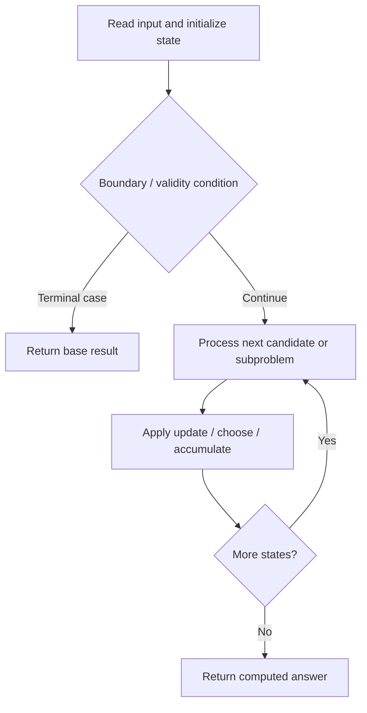

# 975. Odd Even Jump

**Difficulty:** Hard  
**Concept family:** [State Machines and Stock DP](https://github.com/gaurav1kr/Miscellaneous/blob/main/DSA/DP/DP_Mathematics_Master_Guide_Illustrated/Theory/Chapter-08.md)  
**Problem:** https://leetcode.com/problems/odd-even-jump/  
**Original submission:** https://leetcode.com/submissions/detail/1591362358/

## Understand the mathematics first

This problem belongs to the study family **State Machines and Stock DP**. Start by defining the objective and minimal sufficient state; inspect the code to identify the actual transitions.

### Problem-specific recurrence

Refer to the source-grounded algorithm walkthrough below for the state transitions used by your implementation. The generic family recurrence has been removed because it may not apply to this problem.

## Code landmarks

- `auto hi = indexMap.lower_bound(arr[i]);  // Find smallest >= arr[i]`
- `auto lo = indexMap.upper_bound(arr[i]);  // Find largest < arr[i]`

## Source-grounded algorithm walkthrough (expanded coverage)

> **Verification level:** The observations below are extracted from your actual Accepted C++ implementation. The symbolic trace is a **code-reading dry-run worksheet**, not a fabricated numerical run. The generic family formula above is not necessarily this problem's recurrence.

### 1. Identify the actual state and algorithm

**Problem:** 975. Odd Even Jump. Ordered search / boundary calculation is present. Identify the monotonic or ordering invariant before deriving a recurrence.

| Role | C++ source line | Evidence from your solution |
|---|---:|---|
| Candidate state / accumulator | 10 | `int res = 1;` |
| Boundary / termination | 15 | `if (hi != indexMap.end()) odd[i] = even[hi->second];` |
| Boundary / termination | 16 | `if (lo != indexMap.begin()) even[i] = odd[prev(lo)->second];` |
| Boundary / termination | 17 | `if (odd[i]) res++;` |
| Traversal order | 12 | `for (int i = n - 2; i >= 0; --i) {` |
| Transition / update | 10 | `int res = 1;` |
| Transition / update | 13 | `auto hi = indexMap.lower_bound(arr[i]);  // Find smallest >= arr[i]` |
| Transition / update | 14 | `auto lo = indexMap.upper_bound(arr[i]);  // Find largest < arr[i]` |
| Return / result | 21 | `return res;` |

### 2. Trace the dependency chain



This is a **control-flow reading diagram**, not a claim about the exact shape of the mathematical state graph. Follow the code line numbers above to draw the actual dependency arrows.

### 3. Symbolic dry-run worksheet

| Stage | State to record | Mathematical question to answer |
|---|---|---|
| Initialize | Inputs, initialized containers/accumulators | What does the initial value mean? |
| First iteration / recursive call | Loop indices, branch, current state | Which predecessor states are available? |
| First update | Before → after for the updated variable | Why is this transition legal? Does it add, minimize, maximize, or overwrite? |
| Next iteration | Updated state and next candidate | Can a value be reused in this traversal order? |
| Finish | Return expression and its value | Why does this correspond to the problem's requested result? |

### 4. Mathematical explanation checklist

1. Define the exact meaning of each state variable, including all indices and constraints.
2. Translate the update expression into a mathematical equation **only after** establishing the state invariant.
3. Prove the transitions are exhaustive and do not double-count or reuse forbidden elements.
4. Check empty input, smallest input, impossible cases, and overflow/modulo behavior.
5. Compute a small numerical example using the actual problem constraints, then compare each row to the original C++.


---

## Your original Accepted C++ submission (unaltered)

```cpp
class Solution {
public:
    int oddEvenJumps(vector<int>& arr) {
        int n = arr.size();
        vector<bool> odd(n, false), even(n, false);
        odd[n - 1] = even[n - 1] = true;
        
        map<int, int> indexMap; // Ordered map to store indices
        indexMap[arr[n - 1]] = n - 1;
        int res = 1;

        for (int i = n - 2; i >= 0; --i) {
            auto hi = indexMap.lower_bound(arr[i]);  // Find smallest >= arr[i]
            auto lo = indexMap.upper_bound(arr[i]);  // Find largest < arr[i]
            if (hi != indexMap.end()) odd[i] = even[hi->second]; 
            if (lo != indexMap.begin()) even[i] = odd[prev(lo)->second]; 
            if (odd[i]) res++; 
            
            indexMap[arr[i]] = i;  // Store index for future jumps
        }
        return res;
    }
};
```

## Time and Space Complexity

- **Time:** `Depends on operations (typically O(log n) per ordered-container operation)`
- **Auxiliary space:** `Depends on number of stored entries`

**Reasoning:** An ordered container or heap introduces logarithmic insertion, lookup, or removal costs; multiply by operation count.

**Status:** Code-informed complexity guidance; exact tight bounds have not been individually verified.
