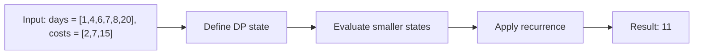

# 983. Minimum Cost For Tickets

**Difficulty:** Medium  
**Concept family:** [Scheduling and Weighted Intervals](https://github.com/gaurav1kr/Miscellaneous/blob/main/DSA/DP/DP_Mathematics_Master_Guide_Illustrated/Theory/Chapter-07.md)  
**Problem:** https://leetcode.com/problems/minimum-cost-for-tickets/  
**Original submission:** https://leetcode.com/submissions/detail/1536127483/

## Understand the mathematics first

This problem belongs to the study family **Scheduling and Weighted Intervals**. Start by defining the objective and minimal sufficient state; inspect the code to identify the actual transitions.

### Related concept template (not necessarily this problem’s recurrence)

$$
F(i,k)=\max(F(i+1,k),w_i+F(next(i),k-1))
$$

**What this template illustrates:** For inclusive intervals, compatibility requires next.start > current.end. Binary search can find next(i).

**Derivation exercise:** Define exactly what each state variable means for this problem; list valid choices, base cases, and forbidden transitions. Check the submitted code against that invariant. The family template alone is not a substitute for a problem-specific proof.

## Code landmarks

- `dp[i] = dp[i - 1];`
- `dp[i] = min({`
- `dp[i - 1] + costs[0], // 1-day pass`

## Detailed dry run — Tickets: choose the first covering pass

### Start from the mathematical question

Let C(d) be the cheapest total cost to cover all travel days from day d onward. Skip nontravel days for free.

### Derive the recurrence

```math
C(d)=\min_{p\in\{1,7,30\}}(price_p+C(d+p))
```

**Why the transition is correct:** At the earliest uncovered travel day, every valid schedule must buy a pass that covers that day. Try each duration and optimize the remainder.

### Concrete example

**Input:** `days = [1,4,6,7,8,20], costs = [2,7,15]`



**Evaluate the states in dependency order:**

| Choice from day 1 | Immediate cost | Remaining decision |
|---|---:|---|
| 1-day pass | 2 | cover day 4 onward |
| 7-day pass | 7 | cover day 8 onward |
| 30-day pass | 15 | no travel days remain |
| **Optimal plan** | **11** | 7-day at day 1 + 1-day at day 8 + 1-day at day 20 |

**Expected result:** `11`.

### What to remember six months later

Explain (1) what one state means, (2) which earlier states it needs, (3) why those cases are exhaustive, and (4) why the answer is `11` for this input. Then inspect your preserved C++ solution below and match its variables to the mathematical states.

---

## Your original Accepted C++ submission (unaltered)

```cpp
class Solution {
public:
    
int mincostTickets(vector<int>& days, vector<int>& costs) {
    // Last travel day
    int lastDay = days.back();
    // Create a set for quick lookup of travel days
    unordered_set<int> travelDays(days.begin(), days.end());
    
    // DP array to store minimum cost up to each day
    vector<int> dp(lastDay + 1, 0);
    
    // Iterate through all days up to the last travel day
    for (int i = 1; i <= lastDay; ++i) {
        if (travelDays.count(i) == 0) {
            // If not a travel day, cost remains the same as the previous day
            dp[i] = dp[i - 1];
        } else {
            // Calculate minimum cost for a travel day
            dp[i] = min({
                dp[i - 1] + costs[0], // 1-day pass
                dp[max(0, i - 7)] + costs[1], // 7-day pass
                dp[max(0, i - 30)] + costs[2] // 30-day pass
            });
        }
    }
    
    // The answer is the cost up to the last travel day
    return dp[lastDay];
}
};
```

## Interview self-check

1. What is the smallest state that determines the remaining answer?
2. Why are the transitions exhaustive and valid?
3. What is the exact base case, including empty and impossible cases?
4. What is the time complexity (states × work per state)?
5. Can the memory be compressed without overwriting needed dependencies?
