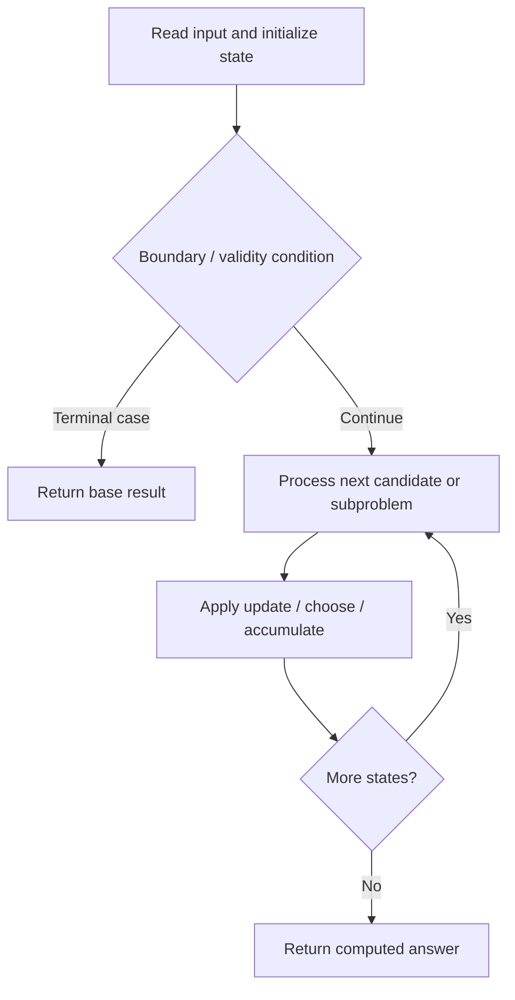

# 996. Number of Squareful Arrays

**Difficulty:** Hard  
**Concept family:** [Bitmask, Assignment and Subset DP](https://github.com/gaurav1kr/Miscellaneous/blob/main/DSA/DP/DP_Mathematics_Master_Guide_Illustrated/Theory/Chapter-09.md)  
**Problem:** https://leetcode.com/problems/number-of-squareful-arrays/  
**Original submission:** https://leetcode.com/submissions/detail/1595400783/

## Understand the mathematics first

This problem belongs to the study family **Bitmask, Assignment and Subset DP**. Start by defining the objective and minimal sufficient state; inspect the code to identify the actual transitions.

### Related concept template (not necessarily this problem’s recurrence)

$$
F(mask)=\operatorname{opt}_{i\notin mask}(cost(mask,i)+F(mask\cup\{i\}))
$$

**What this template illustrates:** There are 2^n subsets. Each transition adds or removes one element, subject to feasibility.

**Derivation exercise:** Define exactly what each state variable means for this problem; list valid choices, base cases, and forbidden transitions. Check the submitted code against that invariant. The family template alone is not a substitute for a problem-specific proof.

## Code landmarks

- `sort(nums.begin(), nums.end());`

## Source-grounded algorithm walkthrough (expanded coverage)

> **Verification level:** The observations below are extracted from your actual Accepted C++ implementation. The symbolic trace is a **code-reading dry-run worksheet**, not a fabricated numerical run. The generic family formula above is not necessarily this problem's recurrence.

### 1. Identify the actual state and algorithm

**Problem:** 996. Number of Squareful Arrays. Recursive state transitions are present. Check memoization, state identity, termination, and whether branches are mutually exclusive.

| Role | C++ source line | Evidence from your solution |
|---|---:|---|
| Candidate state / accumulator | 8 | `int res = 0;` |
| Candidate state / accumulator | 27 | `int sum = path.back() + nums[i];` |
| Candidate state / accumulator | 28 | `int root = sqrt(sum);` |
| Boundary / termination | 19 | `if (depth == nums.size()) {` |
| Boundary / termination | 25 | `if (used[i] \|\| (i > 0 && nums[i] == nums[i - 1] && !used[i - 1])) continue;` |
| Boundary / termination | 26 | `if (!path.empty()) {` |
| Traversal order | 24 | `for (int i = 0; i < nums.size(); ++i) {` |
| Transition / update | 8 | `int res = 0;` |
| Transition / update | 27 | `int sum = path.back() + nums[i];` |
| Transition / update | 32 | `path.push_back(nums[i]);` |
| Return / result | 15 | `return res;` |
| Return / result | 21 | `return;` |

### 2. Trace the dependency chain



This is a **control-flow reading diagram**, not a claim about the exact shape of the mathematical state graph. Follow the code line numbers above to draw the actual dependency arrows.

### 3. Symbolic dry-run worksheet

| Stage | State to record | Mathematical question to answer |
|---|---|---|
| Initialize | Inputs, initialized containers/accumulators | What does the initial value mean? |
| First iteration / recursive call | Loop indices, branch, current state | Which predecessor states are available? |
| First update | Before → after for the updated variable | Why is this transition legal? Does it add, minimize, maximize, or overwrite? |
| Next iteration | Updated state and next candidate | Can a value be reused in this traversal order? |
| Finish | Return expression and its value | Why does this correspond to the problem's requested result? |

### 4. Mathematical explanation checklist

1. Define the exact meaning of each state variable, including all indices and constraints.
2. Translate the update expression into a mathematical equation **only after** establishing the state invariant.
3. Prove the transitions are exhaustive and do not double-count or reuse forbidden elements.
4. Check empty input, smallest input, impossible cases, and overflow/modulo behavior.
5. Compute a small numerical example using the actual problem constraints, then compare each row to the original C++.


---

## Your original Accepted C++ submission (unaltered)

```cpp
#include <vector>
#include <cmath>
#include <algorithm>

using namespace std;

class Solution {
    int res = 0;

public:
    int numSquarefulPerms(vector<int>& nums) {
        sort(nums.begin(), nums.end());
        vector<bool> used(nums.size(), false);
        backtrack(nums, used, {}, 0);
        return res;
    }

    void backtrack(vector<int>& nums, vector<bool>& used, vector<int> path, int depth) {
        if (depth == nums.size()) {
            res++;
            return;
        }

        for (int i = 0; i < nums.size(); ++i) {
            if (used[i] || (i > 0 && nums[i] == nums[i - 1] && !used[i - 1])) continue;
            if (!path.empty()) {
                int sum = path.back() + nums[i];
                int root = sqrt(sum);
                if (root * root != sum) continue;
            }
            used[i] = true;
            path.push_back(nums[i]);
            backtrack(nums, used, path, depth + 1);
            path.pop_back();
            used[i] = false;
        }
    }
};
```

## Time and Space Complexity

- **Time:** `At least O(n log n) for sorting; total depends on later work`
- **Auxiliary space:** `Depends on auxiliary containers`

**Reasoning:** Sorting alone costs O(n log n); inspect any subsequent nested passes for a tighter bound.

**Status:** Code-informed complexity guidance; exact tight bounds have not been individually verified.
