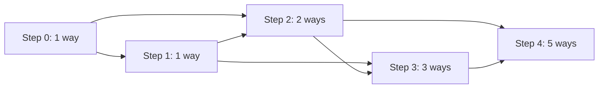

# Chapter 01 — Counting paths and recurrence

> **Study goal:** Reconstruct the reasoning from the problem constraints. The example below is a teaching derivation; the linked original submission may use an equivalent optimized algorithm.

## 1. Start with a concrete question

**Worked example:** [70. Climbing Stairs](https://github.com/gaurav1kr/Miscellaneous/blob/main/DSA/DP/DP_Mathematics_Master_Guide_Illustrated/Problems/70.md)

**State meaning:** Ways to reach step i.

## 2. Why this recurrence follows

Every valid path ends in a one-step or two-step move. These endings are disjoint, so add the counts.

**Mathematical recurrence:**

```text
W(i)=W(i-1)+W(i-2)
```

Before using the equation, identify the empty or impossible states, and check whether alternatives should be **added**, **maximized**, **minimized**, or **OR-ed**.

## 3. Draw the decision and trace it



**Trace:** n=4: W(0)=1, W(1)=1, W(2)=2, W(3)=3, W(4)=5

### How to reproduce the trace on paper

1. Write down the state definition, including exactly what the indices mean.
2. Mark the base cases before any recursive calls.
3. List the legal predecessor states or choices.
4. Compute small states first; annotate each arrow with its reason.
5. Compare the final result with a small manual enumeration.

## 4. Connect mathematics to your C++

Open [70. Climbing Stairs](https://github.com/gaurav1kr/Miscellaneous/blob/main/DSA/DP/DP_Mathematics_Master_Guide_Illustrated/Problems/70.md) and find the line that performs the transition. If it is optimized, first imagine a full DP table, then explain why only a smaller number of previous states are required.

**Interview questions:** Why are the cases exhaustive? Why do they not double-count? What invariant does each variable maintain? Which changes in the problem would require another state dimension?

## 5. Related problems to compare

The following links group problems for study. **Do not assume they all use the same recurrence**: compare the constraints and the submitted algorithm before transferring a technique.

## Problems in this family (33)

- [62. Unique Paths](https://github.com/gaurav1kr/Miscellaneous/blob/main/DSA/DP/DP_Mathematics_Master_Guide_Illustrated/Problems/62.md) — Medium
- [70. Climbing Stairs](https://github.com/gaurav1kr/Miscellaneous/blob/main/DSA/DP/DP_Mathematics_Master_Guide_Illustrated/Problems/70.md) — Easy
- [91. Decode Ways](https://github.com/gaurav1kr/Miscellaneous/blob/main/DSA/DP/DP_Mathematics_Master_Guide_Illustrated/Problems/91.md) — Medium
- [95. Unique Binary Search Trees II](https://github.com/gaurav1kr/Miscellaneous/blob/main/DSA/DP/DP_Mathematics_Master_Guide_Illustrated/Problems/95.md) — Medium
- [96. Unique Binary Search Trees](https://github.com/gaurav1kr/Miscellaneous/blob/main/DSA/DP/DP_Mathematics_Master_Guide_Illustrated/Problems/96.md) — Medium
- [118. Pascal's Triangle](https://github.com/gaurav1kr/Miscellaneous/blob/main/DSA/DP/DP_Mathematics_Master_Guide_Illustrated/Problems/118.md) — Easy
- [119. Pascal's Triangle II](https://github.com/gaurav1kr/Miscellaneous/blob/main/DSA/DP/DP_Mathematics_Master_Guide_Illustrated/Problems/119.md) — Easy
- [241. Different Ways to Add Parentheses](https://github.com/gaurav1kr/Miscellaneous/blob/main/DSA/DP/DP_Mathematics_Master_Guide_Illustrated/Problems/241.md) — Medium
- [264. Ugly Number II](https://github.com/gaurav1kr/Miscellaneous/blob/main/DSA/DP/DP_Mathematics_Master_Guide_Illustrated/Problems/264.md) — Medium
- [313. Super Ugly Number](https://github.com/gaurav1kr/Miscellaneous/blob/main/DSA/DP/DP_Mathematics_Master_Guide_Illustrated/Problems/313.md) — Medium
- [338. Counting Bits](https://github.com/gaurav1kr/Miscellaneous/blob/main/DSA/DP/DP_Mathematics_Master_Guide_Illustrated/Problems/338.md) — Easy
- [397. Integer Replacement](https://github.com/gaurav1kr/Miscellaneous/blob/main/DSA/DP/DP_Mathematics_Master_Guide_Illustrated/Problems/397.md) — Medium
- [509. Fibonacci Number](https://github.com/gaurav1kr/Miscellaneous/blob/main/DSA/DP/DP_Mathematics_Master_Guide_Illustrated/Problems/509.md) — Easy
- [639. Decode Ways II](https://github.com/gaurav1kr/Miscellaneous/blob/main/DSA/DP/DP_Mathematics_Master_Guide_Illustrated/Problems/639.md) — Hard
- [650. 2 Keys Keyboard](https://github.com/gaurav1kr/Miscellaneous/blob/main/DSA/DP/DP_Mathematics_Master_Guide_Illustrated/Problems/650.md) — Medium
- [746. Min Cost Climbing Stairs](https://github.com/gaurav1kr/Miscellaneous/blob/main/DSA/DP/DP_Mathematics_Master_Guide_Illustrated/Problems/746.md) — Easy
- [823. Binary Trees With Factors](https://github.com/gaurav1kr/Miscellaneous/blob/main/DSA/DP/DP_Mathematics_Master_Guide_Illustrated/Problems/823.md) — Medium
- [873. Length of Longest Fibonacci Subsequence](https://github.com/gaurav1kr/Miscellaneous/blob/main/DSA/DP/DP_Mathematics_Master_Guide_Illustrated/Problems/873.md) — Medium
- [894. All Possible Full Binary Trees](https://github.com/gaurav1kr/Miscellaneous/blob/main/DSA/DP/DP_Mathematics_Master_Guide_Illustrated/Problems/894.md) — Medium
- [920. Number of Music Playlists](https://github.com/gaurav1kr/Miscellaneous/blob/main/DSA/DP/DP_Mathematics_Master_Guide_Illustrated/Problems/920.md) — Hard
- [964. Least Operators to Express Number](https://github.com/gaurav1kr/Miscellaneous/blob/main/DSA/DP/DP_Mathematics_Master_Guide_Illustrated/Problems/964.md) — Hard
- [1137. N-th Tribonacci Number](https://github.com/gaurav1kr/Miscellaneous/blob/main/DSA/DP/DP_Mathematics_Master_Guide_Illustrated/Problems/1137.md) — Easy
- [1155. Number of Dice Rolls With Target Sum](https://github.com/gaurav1kr/Miscellaneous/blob/main/DSA/DP/DP_Mathematics_Master_Guide_Illustrated/Problems/1155.md) — Medium
- [1359. Count All Valid Pickup and Delivery Options](https://github.com/gaurav1kr/Miscellaneous/blob/main/DSA/DP/DP_Mathematics_Master_Guide_Illustrated/Problems/1359.md) — Hard
- [1387. Sort Integers by The Power Value](https://github.com/gaurav1kr/Miscellaneous/blob/main/DSA/DP/DP_Mathematics_Master_Guide_Illustrated/Problems/1387.md) — Medium
- [1420. Build Array Where You Can Find The Maximum Exactly K Comparisons](https://github.com/gaurav1kr/Miscellaneous/blob/main/DSA/DP/DP_Mathematics_Master_Guide_Illustrated/Problems/1420.md) — Hard
- [1434. Number of Ways to Wear Different Hats to Each Other](https://github.com/gaurav1kr/Miscellaneous/blob/main/DSA/DP/DP_Mathematics_Master_Guide_Illustrated/Problems/1434.md) — Hard
- [1569. Number of Ways to Reorder Array to Get Same BST](https://github.com/gaurav1kr/Miscellaneous/blob/main/DSA/DP/DP_Mathematics_Master_Guide_Illustrated/Problems/1569.md) — Hard
- [1611. Minimum One Bit Operations to Make Integers Zero](https://github.com/gaurav1kr/Miscellaneous/blob/main/DSA/DP/DP_Mathematics_Master_Guide_Illustrated/Problems/1611.md) — Hard
- [1621. Number of Sets of K Non-Overlapping Line Segments](https://github.com/gaurav1kr/Miscellaneous/blob/main/DSA/DP/DP_Mathematics_Master_Guide_Illustrated/Problems/1621.md) — Medium
- [1641. Count Sorted Vowel Strings](https://github.com/gaurav1kr/Miscellaneous/blob/main/DSA/DP/DP_Mathematics_Master_Guide_Illustrated/Problems/1641.md) — Medium
- [1866. Number of Ways to Rearrange Sticks With K Sticks Visible](https://github.com/gaurav1kr/Miscellaneous/blob/main/DSA/DP/DP_Mathematics_Master_Guide_Illustrated/Problems/1866.md) — Hard
- [1997. First Day Where You Have Been in All the Rooms](https://github.com/gaurav1kr/Miscellaneous/blob/main/DSA/DP/DP_Mathematics_Master_Guide_Illustrated/Problems/1997.md) — Medium

