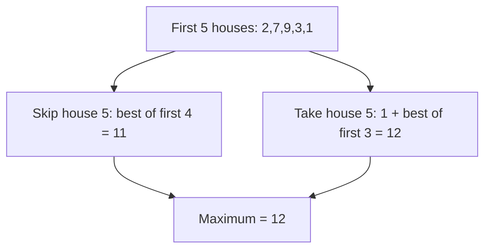

# Chapter 02 — Take or skip

> **Study goal:** Reconstruct the reasoning from the problem constraints. The example below is a teaching derivation; the linked original submission may use an equivalent optimized algorithm.

## 1. Start with a concrete question

**Worked example:** [198. House Robber](https://github.com/gaurav1kr/Miscellaneous/blob/main/DSA/DP/DP_Mathematics_Master_Guide_Illustrated/Problems/198.md)

**State meaning:** Maximum money from first i houses.

## 2. Why this recurrence follows

Every optimum either excludes the last house or includes it; inclusion forbids its neighbor. Take the larger of these two exhaustive cases.

**Mathematical recurrence:**

```text
F(i)=max(F(i-1), a[i]+F(i-2))
```

Before using the equation, identify the empty or impossible states, and check whether alternatives should be **added**, **maximized**, **minimized**, or **OR-ed**.

## 3. Draw the decision and trace it



**Trace:** Values [2,7,9,3,1]: F(0)=0, F(1)=2, F(2)=7, F(3)=11, F(4)=11, F(5)=12

### How to reproduce the trace on paper

1. Write down the state definition, including exactly what the indices mean.
2. Mark the base cases before any recursive calls.
3. List the legal predecessor states or choices.
4. Compute small states first; annotate each arrow with its reason.
5. Compare the final result with a small manual enumeration.

## 4. Connect mathematics to your C++

Open [198. House Robber](https://github.com/gaurav1kr/Miscellaneous/blob/main/DSA/DP/DP_Mathematics_Master_Guide_Illustrated/Problems/198.md) and find the line that performs the transition. If it is optimized, first imagine a full DP table, then explain why only a smaller number of previous states are required.

**Interview questions:** Why are the cases exhaustive? Why do they not double-count? What invariant does each variable maintain? Which changes in the problem would require another state dimension?

## 5. Related problems to compare

The following links group problems for study. **Do not assume they all use the same recurrence**: compare the constraints and the submitted algorithm before transferring a technique.

## Problems in this family (27)

- [198. House Robber](https://github.com/gaurav1kr/Miscellaneous/blob/main/DSA/DP/DP_Mathematics_Master_Guide_Illustrated/Problems/198.md) — Medium
- [213. House Robber II](https://github.com/gaurav1kr/Miscellaneous/blob/main/DSA/DP/DP_Mathematics_Master_Guide_Illustrated/Problems/213.md) — Medium
- [279. Perfect Squares](https://github.com/gaurav1kr/Miscellaneous/blob/main/DSA/DP/DP_Mathematics_Master_Guide_Illustrated/Problems/279.md) — Medium
- [322. Coin Change](https://github.com/gaurav1kr/Miscellaneous/blob/main/DSA/DP/DP_Mathematics_Master_Guide_Illustrated/Problems/322.md) — Medium
- [337. House Robber III](https://github.com/gaurav1kr/Miscellaneous/blob/main/DSA/DP/DP_Mathematics_Master_Guide_Illustrated/Problems/337.md) — Medium
- [343. Integer Break](https://github.com/gaurav1kr/Miscellaneous/blob/main/DSA/DP/DP_Mathematics_Master_Guide_Illustrated/Problems/343.md) — Medium
- [377. Combination Sum IV](https://github.com/gaurav1kr/Miscellaneous/blob/main/DSA/DP/DP_Mathematics_Master_Guide_Illustrated/Problems/377.md) — Medium
- [416. Partition Equal Subset Sum](https://github.com/gaurav1kr/Miscellaneous/blob/main/DSA/DP/DP_Mathematics_Master_Guide_Illustrated/Problems/416.md) — Medium
- [474. Ones and Zeroes](https://github.com/gaurav1kr/Miscellaneous/blob/main/DSA/DP/DP_Mathematics_Master_Guide_Illustrated/Problems/474.md) — Medium
- [494. Target Sum](https://github.com/gaurav1kr/Miscellaneous/blob/main/DSA/DP/DP_Mathematics_Master_Guide_Illustrated/Problems/494.md) — Medium
- [518. Coin Change II](https://github.com/gaurav1kr/Miscellaneous/blob/main/DSA/DP/DP_Mathematics_Master_Guide_Illustrated/Problems/518.md) — Medium
- [638. Shopping Offers](https://github.com/gaurav1kr/Miscellaneous/blob/main/DSA/DP/DP_Mathematics_Master_Guide_Illustrated/Problems/638.md) — Medium
- [691. Stickers to Spell Word](https://github.com/gaurav1kr/Miscellaneous/blob/main/DSA/DP/DP_Mathematics_Master_Guide_Illustrated/Problems/691.md) — Hard
- [740. Delete and Earn](https://github.com/gaurav1kr/Miscellaneous/blob/main/DSA/DP/DP_Mathematics_Master_Guide_Illustrated/Problems/740.md) — Medium
- [805. Split Array With Same Average](https://github.com/gaurav1kr/Miscellaneous/blob/main/DSA/DP/DP_Mathematics_Master_Guide_Illustrated/Problems/805.md) — Hard
- [879. Profitable Schemes](https://github.com/gaurav1kr/Miscellaneous/blob/main/DSA/DP/DP_Mathematics_Master_Guide_Illustrated/Problems/879.md) — Hard
- [956. Tallest Billboard](https://github.com/gaurav1kr/Miscellaneous/blob/main/DSA/DP/DP_Mathematics_Master_Guide_Illustrated/Problems/956.md) — Hard
- [1049. Last Stone Weight II](https://github.com/gaurav1kr/Miscellaneous/blob/main/DSA/DP/DP_Mathematics_Master_Guide_Illustrated/Problems/1049.md) — Medium
- [1262. Greatest Sum Divisible by Three](https://github.com/gaurav1kr/Miscellaneous/blob/main/DSA/DP/DP_Mathematics_Master_Guide_Illustrated/Problems/1262.md) — Medium
- [1449. Form Largest Integer With Digits That Add up to Target](https://github.com/gaurav1kr/Miscellaneous/blob/main/DSA/DP/DP_Mathematics_Master_Guide_Illustrated/Problems/1449.md) — Hard
- [1477. Find Two Non-overlapping Sub-arrays Each With Target Sum](https://github.com/gaurav1kr/Miscellaneous/blob/main/DSA/DP/DP_Mathematics_Master_Guide_Illustrated/Problems/1477.md) — Medium
- [1655. Distribute Repeating Integers](https://github.com/gaurav1kr/Miscellaneous/blob/main/DSA/DP/DP_Mathematics_Master_Guide_Illustrated/Problems/1655.md) — Hard
- [1981. Minimize the Difference Between Target and Chosen Elements](https://github.com/gaurav1kr/Miscellaneous/blob/main/DSA/DP/DP_Mathematics_Master_Guide_Illustrated/Problems/1981.md) — Medium
- [3444. Minimum Increments for Target Multiples in an Array](https://github.com/gaurav1kr/Miscellaneous/blob/main/DSA/DP/DP_Mathematics_Master_Guide_Illustrated/Problems/3444.md) — Hard
- [4040. Minimum Operations to Form Subset Sum I](https://github.com/gaurav1kr/Miscellaneous/blob/main/DSA/DP/DP_Mathematics_Master_Guide_Illustrated/Problems/4040.md) — Medium
- [4041. Minimum Operations to Form Subset Sum II](https://github.com/gaurav1kr/Miscellaneous/blob/main/DSA/DP/DP_Mathematics_Master_Guide_Illustrated/Problems/4041.md) — Hard
- [4050. Minimum Days to Score Exactly N Points](https://github.com/gaurav1kr/Miscellaneous/blob/main/DSA/DP/DP_Mathematics_Master_Guide_Illustrated/Problems/4050.md) — Medium

