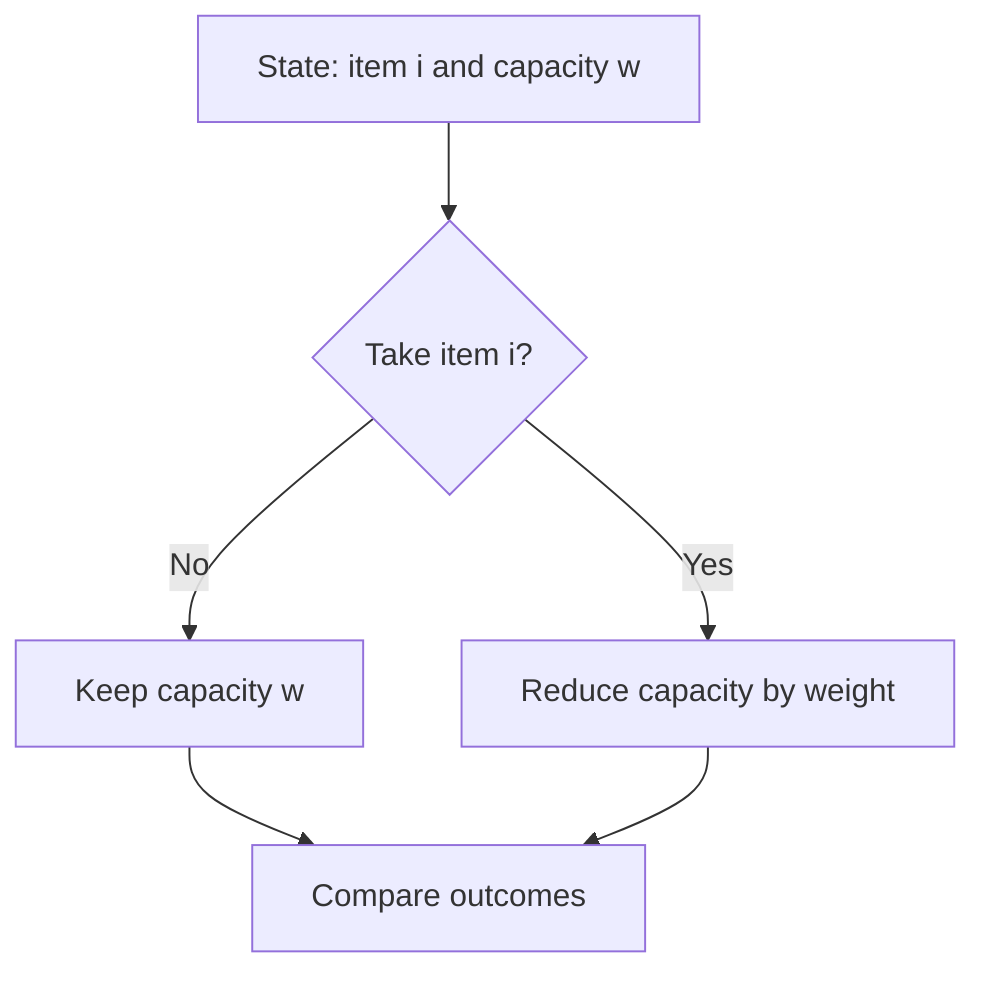

# Chapter 02 — Take-or-Skip and Knapsack

## Core mathematical idea

Each item creates a decision: select or reject .

## A representative mathematical model

`F(i,c)=\max(F(i-1,c),v_i+F(i-1,c-w_i))`

Only use the take branch when the remaining capacity is feasible. Counting versions use addition; feasibility versions use logical OR.

**Important:** This formula is a pattern template. The precise recurrence for a listed problem must be derived from that problem’s constraints and code.

## State-transition picture

## How to study the linked problems

For each problem: read the mathematical template, articulate its state and decision, inspect the submitted implementation, then justify why its transitions are correct. Compare with the previous problem: which constraint forced a new state dimension?

## Problems in this family (27)

- [198. House Robber](https://github.com/gaurav1kr/Miscellaneous/blob/main/DSA/DP/DP_Mathematics_Master_Guide_Illustrated/Problems/198.md) — Medium
- [213. House Robber II](https://github.com/gaurav1kr/Miscellaneous/blob/main/DSA/DP/DP_Mathematics_Master_Guide_Illustrated/Problems/213.md) — Medium
- [279. Perfect Squares](https://github.com/gaurav1kr/Miscellaneous/blob/main/DSA/DP/DP_Mathematics_Master_Guide_Illustrated/Problems/279.md) — Medium
- [322. Coin Change](https://github.com/gaurav1kr/Miscellaneous/blob/main/DSA/DP/DP_Mathematics_Master_Guide_Illustrated/Problems/322.md) — Medium
- [337. House Robber III](https://github.com/gaurav1kr/Miscellaneous/blob/main/DSA/DP/DP_Mathematics_Master_Guide_Illustrated/Problems/337.md) — Medium
- [343. Integer Break](https://github.com/gaurav1kr/Miscellaneous/blob/main/DSA/DP/DP_Mathematics_Master_Guide_Illustrated/Problems/343.md) — Medium
- [377. Combination Sum IV](https://github.com/gaurav1kr/Miscellaneous/blob/main/DSA/DP/DP_Mathematics_Master_Guide_Illustrated/Problems/377.md) — Medium
- [416. Partition Equal Subset Sum](https://github.com/gaurav1kr/Miscellaneous/blob/main/DSA/DP/DP_Mathematics_Master_Guide_Illustrated/Problems/416.md) — Medium
- [474. Ones and Zeroes](https://github.com/gaurav1kr/Miscellaneous/blob/main/DSA/DP/DP_Mathematics_Master_Guide_Illustrated/Problems/474.md) — Medium
- [494. Target Sum](https://github.com/gaurav1kr/Miscellaneous/blob/main/DSA/DP/DP_Mathematics_Master_Guide_Illustrated/Problems/494.md) — Medium
- [518. Coin Change II](https://github.com/gaurav1kr/Miscellaneous/blob/main/DSA/DP/DP_Mathematics_Master_Guide_Illustrated/Problems/518.md) — Medium
- [638. Shopping Offers](https://github.com/gaurav1kr/Miscellaneous/blob/main/DSA/DP/DP_Mathematics_Master_Guide_Illustrated/Problems/638.md) — Medium
- [691. Stickers to Spell Word](https://github.com/gaurav1kr/Miscellaneous/blob/main/DSA/DP/DP_Mathematics_Master_Guide_Illustrated/Problems/691.md) — Hard
- [740. Delete and Earn](https://github.com/gaurav1kr/Miscellaneous/blob/main/DSA/DP/DP_Mathematics_Master_Guide_Illustrated/Problems/740.md) — Medium
- [805. Split Array With Same Average](https://github.com/gaurav1kr/Miscellaneous/blob/main/DSA/DP/DP_Mathematics_Master_Guide_Illustrated/Problems/805.md) — Hard
- [879. Profitable Schemes](https://github.com/gaurav1kr/Miscellaneous/blob/main/DSA/DP/DP_Mathematics_Master_Guide_Illustrated/Problems/879.md) — Hard
- [956. Tallest Billboard](https://github.com/gaurav1kr/Miscellaneous/blob/main/DSA/DP/DP_Mathematics_Master_Guide_Illustrated/Problems/956.md) — Hard
- [1049. Last Stone Weight II](https://github.com/gaurav1kr/Miscellaneous/blob/main/DSA/DP/DP_Mathematics_Master_Guide_Illustrated/Problems/1049.md) — Medium
- [1262. Greatest Sum Divisible by Three](https://github.com/gaurav1kr/Miscellaneous/blob/main/DSA/DP/DP_Mathematics_Master_Guide_Illustrated/Problems/1262.md) — Medium
- [1449. Form Largest Integer With Digits That Add up to Target](https://github.com/gaurav1kr/Miscellaneous/blob/main/DSA/DP/DP_Mathematics_Master_Guide_Illustrated/Problems/1449.md) — Hard
- [1477. Find Two Non-overlapping Sub-arrays Each With Target Sum](https://github.com/gaurav1kr/Miscellaneous/blob/main/DSA/DP/DP_Mathematics_Master_Guide_Illustrated/Problems/1477.md) — Medium
- [1655. Distribute Repeating Integers](https://github.com/gaurav1kr/Miscellaneous/blob/main/DSA/DP/DP_Mathematics_Master_Guide_Illustrated/Problems/1655.md) — Hard
- [1981. Minimize the Difference Between Target and Chosen Elements](https://github.com/gaurav1kr/Miscellaneous/blob/main/DSA/DP/DP_Mathematics_Master_Guide_Illustrated/Problems/1981.md) — Medium
- [3444. Minimum Increments for Target Multiples in an Array](https://github.com/gaurav1kr/Miscellaneous/blob/main/DSA/DP/DP_Mathematics_Master_Guide_Illustrated/Problems/3444.md) — Hard
- [4040. Minimum Operations to Form Subset Sum I](https://github.com/gaurav1kr/Miscellaneous/blob/main/DSA/DP/DP_Mathematics_Master_Guide_Illustrated/Problems/4040.md) — Medium
- [4041. Minimum Operations to Form Subset Sum II](https://github.com/gaurav1kr/Miscellaneous/blob/main/DSA/DP/DP_Mathematics_Master_Guide_Illustrated/Problems/4041.md) — Hard
- [4050. Minimum Days to Score Exactly N Points](https://github.com/gaurav1kr/Miscellaneous/blob/main/DSA/DP/DP_Mathematics_Master_Guide_Illustrated/Problems/4050.md) — Medium
