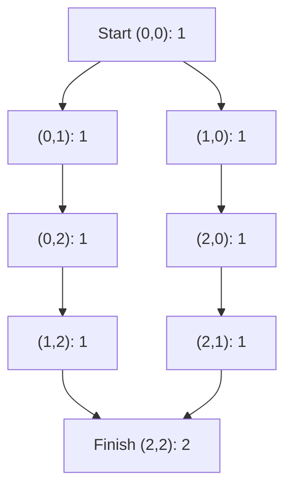

# Chapter 03 — Paths on a grid

> **Study goal:** Reconstruct the reasoning from the problem constraints. The example below is a teaching derivation; the linked original submission may use an equivalent optimized algorithm.

## 1. Start with a concrete question

**Worked example:** [63. Unique Paths II](https://github.com/gaurav1kr/Miscellaneous/blob/main/DSA/DP/DP_Mathematics_Master_Guide_Illustrated/Problems/63.md)

**State meaning:** Number of valid routes ending at cell r,c.

## 2. Why this recurrence follows

Every arrival comes from above or left. Since the last move is different, the two sets of paths do not overlap. Blocked cells contribute zero.

**Mathematical recurrence:**

```text
P(r,c)=P(r-1,c)+P(r,c-1) for unblocked cells; otherwise 0
```

Before using the equation, identify the empty or impossible states, and check whether alternatives should be **added**, **maximized**, **minimized**, or **OR-ed**.

## 3. Draw the decision and trace it



**Trace:** 3×3 grid with obstacle at (1,1): row 0 = [1,1,1]; row 1 = [1,0,1]; row 2 = [1,1,2]. Answer 2.

### How to reproduce the trace on paper

1. Write down the state definition, including exactly what the indices mean.
2. Mark the base cases before any recursive calls.
3. List the legal predecessor states or choices.
4. Compute small states first; annotate each arrow with its reason.
5. Compare the final result with a small manual enumeration.

## 4. Connect mathematics to your C++

Open [63. Unique Paths II](https://github.com/gaurav1kr/Miscellaneous/blob/main/DSA/DP/DP_Mathematics_Master_Guide_Illustrated/Problems/63.md) and find the line that performs the transition. If it is optimized, first imagine a full DP table, then explain why only a smaller number of previous states are required.

**Interview questions:** Why are the cases exhaustive? Why do they not double-count? What invariant does each variable maintain? Which changes in the problem would require another state dimension?

## 5. Related problems to compare

The following links group problems for study. **Do not assume they all use the same recurrence**: compare the constraints and the submitted algorithm before transferring a technique.

## Problems in this family (30)

- [63. Unique Paths II](https://github.com/gaurav1kr/Miscellaneous/blob/main/DSA/DP/DP_Mathematics_Master_Guide_Illustrated/Problems/63.md) — Medium
- [64. Minimum Path Sum](https://github.com/gaurav1kr/Miscellaneous/blob/main/DSA/DP/DP_Mathematics_Master_Guide_Illustrated/Problems/64.md) — Medium
- [120. Triangle](https://github.com/gaurav1kr/Miscellaneous/blob/main/DSA/DP/DP_Mathematics_Master_Guide_Illustrated/Problems/120.md) — Medium
- [174. Dungeon Game](https://github.com/gaurav1kr/Miscellaneous/blob/main/DSA/DP/DP_Mathematics_Master_Guide_Illustrated/Problems/174.md) — Hard
- [221. Maximal Square](https://github.com/gaurav1kr/Miscellaneous/blob/main/DSA/DP/DP_Mathematics_Master_Guide_Illustrated/Problems/221.md) — Medium
- [403. Frog Jump](https://github.com/gaurav1kr/Miscellaneous/blob/main/DSA/DP/DP_Mathematics_Master_Guide_Illustrated/Problems/403.md) — Hard
- [514. Freedom Trail](https://github.com/gaurav1kr/Miscellaneous/blob/main/DSA/DP/DP_Mathematics_Master_Guide_Illustrated/Problems/514.md) — Hard
- [576. Out of Boundary Paths](https://github.com/gaurav1kr/Miscellaneous/blob/main/DSA/DP/DP_Mathematics_Master_Guide_Illustrated/Problems/576.md) — Medium
- [741. Cherry Pickup](https://github.com/gaurav1kr/Miscellaneous/blob/main/DSA/DP/DP_Mathematics_Master_Guide_Illustrated/Problems/741.md) — Hard
- [764. Largest Plus Sign](https://github.com/gaurav1kr/Miscellaneous/blob/main/DSA/DP/DP_Mathematics_Master_Guide_Illustrated/Problems/764.md) — Medium
- [931. Minimum Falling Path Sum](https://github.com/gaurav1kr/Miscellaneous/blob/main/DSA/DP/DP_Mathematics_Master_Guide_Illustrated/Problems/931.md) — Medium
- [935. Knight Dialer](https://github.com/gaurav1kr/Miscellaneous/blob/main/DSA/DP/DP_Mathematics_Master_Guide_Illustrated/Problems/935.md) — Medium
- [1139. Largest 1-Bordered Square](https://github.com/gaurav1kr/Miscellaneous/blob/main/DSA/DP/DP_Mathematics_Master_Guide_Illustrated/Problems/1139.md) — Medium
- [1269. Number of Ways to Stay in the Same Place After Some Steps](https://github.com/gaurav1kr/Miscellaneous/blob/main/DSA/DP/DP_Mathematics_Master_Guide_Illustrated/Problems/1269.md) — Hard
- [1277. Count Square Submatrices with All Ones](https://github.com/gaurav1kr/Miscellaneous/blob/main/DSA/DP/DP_Mathematics_Master_Guide_Illustrated/Problems/1277.md) — Medium
- [1289. Minimum Falling Path Sum II](https://github.com/gaurav1kr/Miscellaneous/blob/main/DSA/DP/DP_Mathematics_Master_Guide_Illustrated/Problems/1289.md) — Hard
- [1301. Number of Paths with Max Score](https://github.com/gaurav1kr/Miscellaneous/blob/main/DSA/DP/DP_Mathematics_Master_Guide_Illustrated/Problems/1301.md) — Hard
- [1444. Number of Ways of Cutting a Pizza](https://github.com/gaurav1kr/Miscellaneous/blob/main/DSA/DP/DP_Mathematics_Master_Guide_Illustrated/Problems/1444.md) — Hard
- [1463. Cherry Pickup II](https://github.com/gaurav1kr/Miscellaneous/blob/main/DSA/DP/DP_Mathematics_Master_Guide_Illustrated/Problems/1463.md) — Hard
- [1473. Paint House III](https://github.com/gaurav1kr/Miscellaneous/blob/main/DSA/DP/DP_Mathematics_Master_Guide_Illustrated/Problems/1473.md) — Hard
- [1594. Maximum Non Negative Product in a Matrix](https://github.com/gaurav1kr/Miscellaneous/blob/main/DSA/DP/DP_Mathematics_Master_Guide_Illustrated/Problems/1594.md) — Medium
- [1659. Maximize Grid Happiness](https://github.com/gaurav1kr/Miscellaneous/blob/main/DSA/DP/DP_Mathematics_Master_Guide_Illustrated/Problems/1659.md) — Hard
- [1824. Minimum Sideway Jumps](https://github.com/gaurav1kr/Miscellaneous/blob/main/DSA/DP/DP_Mathematics_Master_Guide_Illustrated/Problems/1824.md) — Medium
- [1931. Painting a Grid With Three Different Colors](https://github.com/gaurav1kr/Miscellaneous/blob/main/DSA/DP/DP_Mathematics_Master_Guide_Illustrated/Problems/1931.md) — Hard
- [1937. Maximum Number of Points with Cost](https://github.com/gaurav1kr/Miscellaneous/blob/main/DSA/DP/DP_Mathematics_Master_Guide_Illustrated/Problems/1937.md) — Medium
- [3393. Count Paths With the Given XOR Value](https://github.com/gaurav1kr/Miscellaneous/blob/main/DSA/DP/DP_Mathematics_Master_Guide_Illustrated/Problems/3393.md) — Medium
- [3418. Maximum Amount of Money Robot Can Earn](https://github.com/gaurav1kr/Miscellaneous/blob/main/DSA/DP/DP_Mathematics_Master_Guide_Illustrated/Problems/3418.md) — Medium
- [3429. Paint House IV](https://github.com/gaurav1kr/Miscellaneous/blob/main/DSA/DP/DP_Mathematics_Master_Guide_Illustrated/Problems/3429.md) — Medium
- [3459. Length of Longest V-Shaped Diagonal Segment](https://github.com/gaurav1kr/Miscellaneous/blob/main/DSA/DP/DP_Mathematics_Master_Guide_Illustrated/Problems/3459.md) — Hard
- [4016. Maximum Area of Two Non-Overlapping Square Submatrices](https://github.com/gaurav1kr/Miscellaneous/blob/main/DSA/DP/DP_Mathematics_Master_Guide_Illustrated/Problems/4016.md) — Medium

