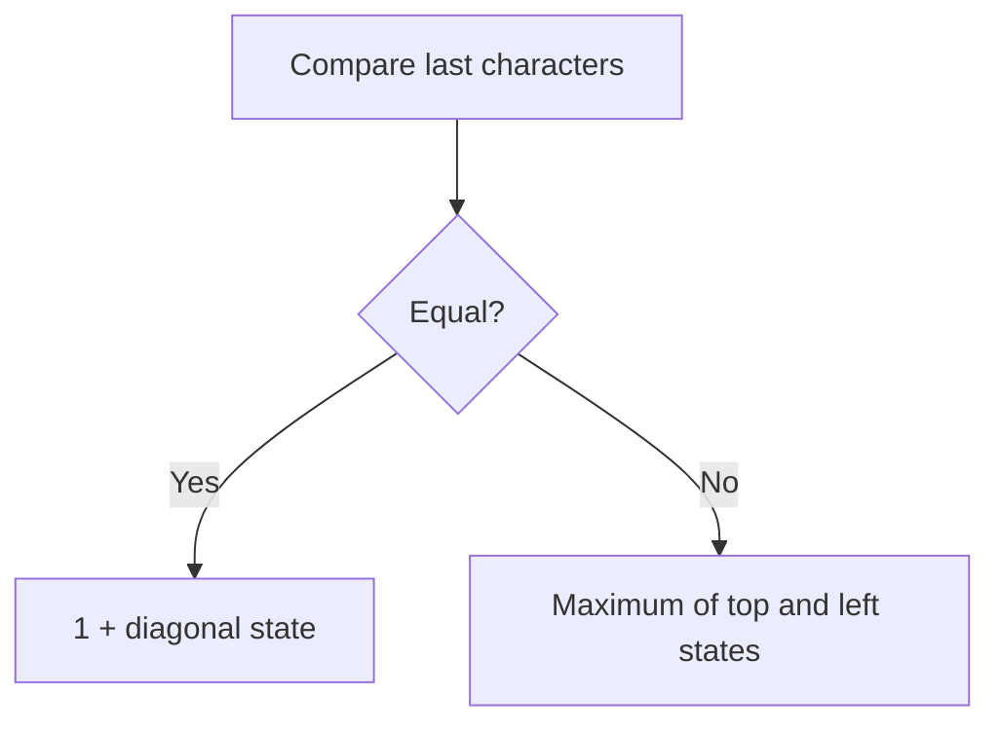

# Chapter 04 — Sequence alignment

> **Study goal:** Reconstruct the reasoning from the problem constraints. The example below is a teaching derivation; the linked original submission may use an equivalent optimized algorithm.

## 1. Start with a concrete question

**Worked example:** [1143. Longest Common Subsequence](https://github.com/gaurav1kr/Miscellaneous/blob/main/DSA/DP/DP_Mathematics_Master_Guide_Illustrated/Problems/1143.md)

**State meaning:** L(i,j): LCS length of first i chars of A and first j of B.

## 2. Why this recurrence follows

If last characters match, extend a smaller optimal match. Otherwise at least one of the last characters is unused in an optimal common subsequence.

**Mathematical recurrence:**

```text
If A[i-1]=B[j-1]: L(i,j)=1+L(i-1,j-1); else max(L(i-1,j),L(i,j-1))
```

Before using the equation, identify the empty or impossible states, and check whether alternatives should be **added**, **maximized**, **minimized**, or **OR-ed**.

## 3. Draw the decision and trace it



**Trace:** A="abc", B="ac": row for empty A [0,0,0]; a [0,1,1]; ab [0,1,1]; abc [0,1,2]. Answer 2.

### How to reproduce the trace on paper

1. Write down the state definition, including exactly what the indices mean.
2. Mark the base cases before any recursive calls.
3. List the legal predecessor states or choices.
4. Compute small states first; annotate each arrow with its reason.
5. Compare the final result with a small manual enumeration.

## 4. Connect mathematics to your C++

Open [1143. Longest Common Subsequence](https://github.com/gaurav1kr/Miscellaneous/blob/main/DSA/DP/DP_Mathematics_Master_Guide_Illustrated/Problems/1143.md) and find the line that performs the transition. If it is optimized, first imagine a full DP table, then explain why only a smaller number of previous states are required.

**Interview questions:** Why are the cases exhaustive? Why do they not double-count? What invariant does each variable maintain? Which changes in the problem would require another state dimension?

## 5. Related problems to compare

The following links group problems for study. **Do not assume they all use the same recurrence**: compare the constraints and the submitted algorithm before transferring a technique.

## Problems in this family (25)

- [10. Regular Expression Matching](https://github.com/gaurav1kr/Miscellaneous/blob/main/DSA/DP/DP_Mathematics_Master_Guide_Illustrated/Problems/10.md) — Hard
- [44. Wildcard Matching](https://github.com/gaurav1kr/Miscellaneous/blob/main/DSA/DP/DP_Mathematics_Master_Guide_Illustrated/Problems/44.md) — Hard
- [72. Edit Distance](https://github.com/gaurav1kr/Miscellaneous/blob/main/DSA/DP/DP_Mathematics_Master_Guide_Illustrated/Problems/72.md) — Medium
- [87. Scramble String](https://github.com/gaurav1kr/Miscellaneous/blob/main/DSA/DP/DP_Mathematics_Master_Guide_Illustrated/Problems/87.md) — Hard
- [97. Interleaving String](https://github.com/gaurav1kr/Miscellaneous/blob/main/DSA/DP/DP_Mathematics_Master_Guide_Illustrated/Problems/97.md) — Medium
- [115. Distinct Subsequences](https://github.com/gaurav1kr/Miscellaneous/blob/main/DSA/DP/DP_Mathematics_Master_Guide_Illustrated/Problems/115.md) — Hard
- [139. Word Break](https://github.com/gaurav1kr/Miscellaneous/blob/main/DSA/DP/DP_Mathematics_Master_Guide_Illustrated/Problems/139.md) — Medium
- [140. Word Break II](https://github.com/gaurav1kr/Miscellaneous/blob/main/DSA/DP/DP_Mathematics_Master_Guide_Illustrated/Problems/140.md) — Hard
- [466. Count The Repetitions](https://github.com/gaurav1kr/Miscellaneous/blob/main/DSA/DP/DP_Mathematics_Master_Guide_Illustrated/Problems/466.md) — Hard
- [472. Concatenated Words](https://github.com/gaurav1kr/Miscellaneous/blob/main/DSA/DP/DP_Mathematics_Master_Guide_Illustrated/Problems/472.md) — Hard
- [583. Delete Operation for Two Strings](https://github.com/gaurav1kr/Miscellaneous/blob/main/DSA/DP/DP_Mathematics_Master_Guide_Illustrated/Problems/583.md) — Medium
- [718. Maximum Length of Repeated Subarray](https://github.com/gaurav1kr/Miscellaneous/blob/main/DSA/DP/DP_Mathematics_Master_Guide_Illustrated/Problems/718.md) — Medium
- [940. Distinct Subsequences II](https://github.com/gaurav1kr/Miscellaneous/blob/main/DSA/DP/DP_Mathematics_Master_Guide_Illustrated/Problems/940.md) — Hard
- [1035. Uncrossed Lines](https://github.com/gaurav1kr/Miscellaneous/blob/main/DSA/DP/DP_Mathematics_Master_Guide_Illustrated/Problems/1035.md) — Medium
- [1092. Shortest Common Supersequence](https://github.com/gaurav1kr/Miscellaneous/blob/main/DSA/DP/DP_Mathematics_Master_Guide_Illustrated/Problems/1092.md) — Hard
- [1143. Longest Common Subsequence](https://github.com/gaurav1kr/Miscellaneous/blob/main/DSA/DP/DP_Mathematics_Master_Guide_Illustrated/Problems/1143.md) — Medium
- [1320. Minimum Distance to Type a Word Using Two Fingers](https://github.com/gaurav1kr/Miscellaneous/blob/main/DSA/DP/DP_Mathematics_Master_Guide_Illustrated/Problems/1320.md) — Hard
- [1458. Max Dot Product of Two Subsequences](https://github.com/gaurav1kr/Miscellaneous/blob/main/DSA/DP/DP_Mathematics_Master_Guide_Illustrated/Problems/1458.md) — Hard
- [1531. String Compression II](https://github.com/gaurav1kr/Miscellaneous/blob/main/DSA/DP/DP_Mathematics_Master_Guide_Illustrated/Problems/1531.md) — Hard
- [1638. Count Substrings That Differ by One Character](https://github.com/gaurav1kr/Miscellaneous/blob/main/DSA/DP/DP_Mathematics_Master_Guide_Illustrated/Problems/1638.md) — Medium
- [1639. Number of Ways to Form a Target String Given a Dictionary](https://github.com/gaurav1kr/Miscellaneous/blob/main/DSA/DP/DP_Mathematics_Master_Guide_Illustrated/Problems/1639.md) — Hard
- [1987. Number of Unique Good Subsequences](https://github.com/gaurav1kr/Miscellaneous/blob/main/DSA/DP/DP_Mathematics_Master_Guide_Illustrated/Problems/1987.md) — Hard
- [3441. Minimum Cost Good Caption](https://github.com/gaurav1kr/Miscellaneous/blob/main/DSA/DP/DP_Mathematics_Master_Guide_Illustrated/Problems/3441.md) — Hard
- [3981. Count Distinct Ways to Form Target from Two Strings](https://github.com/gaurav1kr/Miscellaneous/blob/main/DSA/DP/DP_Mathematics_Master_Guide_Illustrated/Problems/3981.md) — Hard
- [3995. Minimum Cost to Convert String III](https://github.com/gaurav1kr/Miscellaneous/blob/main/DSA/DP/DP_Mathematics_Master_Guide_Illustrated/Problems/3995.md) — Hard

