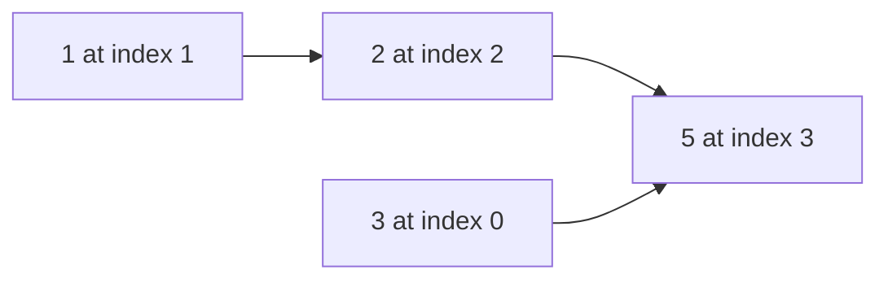

# Chapter 05 — Increasing subsequences

> **Study goal:** Reconstruct the reasoning from the problem constraints. The example below is a teaching derivation; the linked original submission may use an equivalent optimized algorithm.

## 1. Start with a concrete question

**Worked example:** [300. Longest Increasing Subsequence](https://github.com/gaurav1kr/Miscellaneous/blob/main/DSA/DP/DP_Mathematics_Master_Guide_Illustrated/Problems/300.md)

**State meaning:** L(i): best increasing subsequence ending exactly at i.

## 2. Why this recurrence follows

Choose the previous element of the subsequence. The strict inequality makes the transition legal; taking the maximum finds the best predecessor.

**Mathematical recurrence:**

```text
L(i)=1+max(L(j) for j<i and a[j]<a[i]); empty maximum=0
```

Before using the equation, identify the empty or impossible states, and check whether alternatives should be **added**, **maximized**, **minimized**, or **OR-ed**.

## 3. Draw the decision and trace it



**Trace:** [3,1,2,5]: L = [1,1,2,3]. The LIS is [1,2,5], length 3.

### How to reproduce the trace on paper

1. Write down the state definition, including exactly what the indices mean.
2. Mark the base cases before any recursive calls.
3. List the legal predecessor states or choices.
4. Compute small states first; annotate each arrow with its reason.
5. Compare the final result with a small manual enumeration.

## 4. Connect mathematics to your C++

Open [300. Longest Increasing Subsequence](https://github.com/gaurav1kr/Miscellaneous/blob/main/DSA/DP/DP_Mathematics_Master_Guide_Illustrated/Problems/300.md) and find the line that performs the transition. If it is optimized, first imagine a full DP table, then explain why only a smaller number of previous states are required.

**Interview questions:** Why are the cases exhaustive? Why do they not double-count? What invariant does each variable maintain? Which changes in the problem would require another state dimension?

## 5. Related problems to compare

The following links group problems for study. **Do not assume they all use the same recurrence**: compare the constraints and the submitted algorithm before transferring a technique.

## Problems in this family (23)

- [300. Longest Increasing Subsequence](https://github.com/gaurav1kr/Miscellaneous/blob/main/DSA/DP/DP_Mathematics_Master_Guide_Illustrated/Problems/300.md) — Medium
- [354. Russian Doll Envelopes](https://github.com/gaurav1kr/Miscellaneous/blob/main/DSA/DP/DP_Mathematics_Master_Guide_Illustrated/Problems/354.md) — Hard
- [368. Largest Divisible Subset](https://github.com/gaurav1kr/Miscellaneous/blob/main/DSA/DP/DP_Mathematics_Master_Guide_Illustrated/Problems/368.md) — Medium
- [376. Wiggle Subsequence](https://github.com/gaurav1kr/Miscellaneous/blob/main/DSA/DP/DP_Mathematics_Master_Guide_Illustrated/Problems/376.md) — Medium
- [392. Is Subsequence](https://github.com/gaurav1kr/Miscellaneous/blob/main/DSA/DP/DP_Mathematics_Master_Guide_Illustrated/Problems/392.md) — Easy
- [413. Arithmetic Slices](https://github.com/gaurav1kr/Miscellaneous/blob/main/DSA/DP/DP_Mathematics_Master_Guide_Illustrated/Problems/413.md) — Medium
- [446. Arithmetic Slices II - Subsequence](https://github.com/gaurav1kr/Miscellaneous/blob/main/DSA/DP/DP_Mathematics_Master_Guide_Illustrated/Problems/446.md) — Hard
- [467. Unique Substrings in Wraparound String](https://github.com/gaurav1kr/Miscellaneous/blob/main/DSA/DP/DP_Mathematics_Master_Guide_Illustrated/Problems/467.md) — Medium
- [646. Maximum Length of Pair Chain](https://github.com/gaurav1kr/Miscellaneous/blob/main/DSA/DP/DP_Mathematics_Master_Guide_Illustrated/Problems/646.md) — Medium
- [673. Number of Longest Increasing Subsequence](https://github.com/gaurav1kr/Miscellaneous/blob/main/DSA/DP/DP_Mathematics_Master_Guide_Illustrated/Problems/673.md) — Medium
- [792. Number of Matching Subsequences](https://github.com/gaurav1kr/Miscellaneous/blob/main/DSA/DP/DP_Mathematics_Master_Guide_Illustrated/Problems/792.md) — Medium
- [960. Delete Columns to Make Sorted III](https://github.com/gaurav1kr/Miscellaneous/blob/main/DSA/DP/DP_Mathematics_Master_Guide_Illustrated/Problems/960.md) — Hard
- [978. Longest Turbulent Subarray](https://github.com/gaurav1kr/Miscellaneous/blob/main/DSA/DP/DP_Mathematics_Master_Guide_Illustrated/Problems/978.md) — Medium
- [1027. Longest Arithmetic Subsequence](https://github.com/gaurav1kr/Miscellaneous/blob/main/DSA/DP/DP_Mathematics_Master_Guide_Illustrated/Problems/1027.md) — Medium
- [1048. Longest String Chain](https://github.com/gaurav1kr/Miscellaneous/blob/main/DSA/DP/DP_Mathematics_Master_Guide_Illustrated/Problems/1048.md) — Medium
- [1218. Longest Arithmetic Subsequence of Given Difference](https://github.com/gaurav1kr/Miscellaneous/blob/main/DSA/DP/DP_Mathematics_Master_Guide_Illustrated/Problems/1218.md) — Medium
- [1395. Count Number of Teams](https://github.com/gaurav1kr/Miscellaneous/blob/main/DSA/DP/DP_Mathematics_Master_Guide_Illustrated/Problems/1395.md) — Medium
- [1402. Reducing Dishes](https://github.com/gaurav1kr/Miscellaneous/blob/main/DSA/DP/DP_Mathematics_Master_Guide_Illustrated/Problems/1402.md) — Hard
- [1626. Best Team With No Conflicts](https://github.com/gaurav1kr/Miscellaneous/blob/main/DSA/DP/DP_Mathematics_Master_Guide_Illustrated/Problems/1626.md) — Medium
- [1691. Maximum Height by Stacking Cuboids](https://github.com/gaurav1kr/Miscellaneous/blob/main/DSA/DP/DP_Mathematics_Master_Guide_Illustrated/Problems/1691.md) — Hard
- [1770. Maximum Score from Performing Multiplication Operations](https://github.com/gaurav1kr/Miscellaneous/blob/main/DSA/DP/DP_Mathematics_Master_Guide_Illustrated/Problems/1770.md) — Hard
- [1911. Maximum Alternating Subsequence Sum](https://github.com/gaurav1kr/Miscellaneous/blob/main/DSA/DP/DP_Mathematics_Master_Guide_Illustrated/Problems/1911.md) — Medium
- [3409. Longest Subsequence With Decreasing Adjacent Difference](https://github.com/gaurav1kr/Miscellaneous/blob/main/DSA/DP/DP_Mathematics_Master_Guide_Illustrated/Problems/3409.md) — Medium

