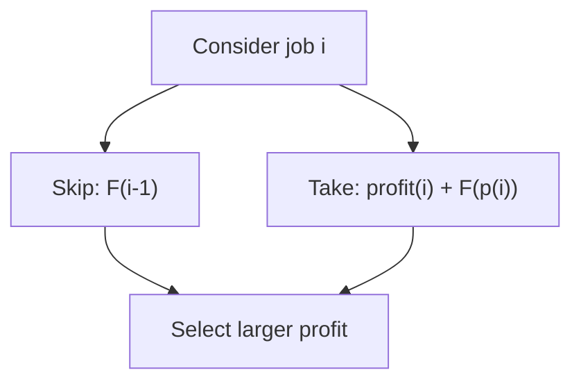

# Chapter 07 — Weighted interval scheduling

> **Study goal:** Reconstruct the reasoning from the problem constraints. The example below is a teaching derivation; the linked original submission may use an equivalent optimized algorithm.

## 1. Start with a concrete question

**Worked example:** [1235. Maximum Profit in Job Scheduling](https://github.com/gaurav1kr/Miscellaneous/blob/main/DSA/DP/DP_Mathematics_Master_Guide_Illustrated/Problems/1235.md)

**State meaning:** F(i): maximum profit using first i jobs sorted by finish time.

## 2. Why this recurrence follows

For each job, skip it or include it and combine with the best compatible prefix. Sorting makes that prefix well-defined.

**Mathematical recurrence:**

```text
F(i)=max(F(i-1),profit[i]+F(p(i))) where p(i) is the last compatible job
```

Before using the equation, identify the empty or impossible states, and check whether alternatives should be **added**, **maximized**, **minimized**, or **OR-ed**.

## 3. Draw the decision and trace it



**Trace:** Jobs (1,3,$50), (2,4,$10), (3,5,$40): F(1)=50, F(2)=50, F(3)=90.

### How to reproduce the trace on paper

1. Write down the state definition, including exactly what the indices mean.
2. Mark the base cases before any recursive calls.
3. List the legal predecessor states or choices.
4. Compute small states first; annotate each arrow with its reason.
5. Compare the final result with a small manual enumeration.

## 4. Connect mathematics to your C++

Open [1235. Maximum Profit in Job Scheduling](https://github.com/gaurav1kr/Miscellaneous/blob/main/DSA/DP/DP_Mathematics_Master_Guide_Illustrated/Problems/1235.md) and find the line that performs the transition. If it is optimized, first imagine a full DP table, then explain why only a smaller number of previous states are required.

**Interview questions:** Why are the cases exhaustive? Why do they not double-count? What invariant does each variable maintain? Which changes in the problem would require another state dimension?

## 5. Related problems to compare

The following links group problems for study. **Do not assume they all use the same recurrence**: compare the constraints and the submitted algorithm before transferring a technique.

## Problems in this family (12)

- [121. Best Time to Buy and Sell Stock](https://github.com/gaurav1kr/Miscellaneous/blob/main/DSA/DP/DP_Mathematics_Master_Guide_Illustrated/Problems/121.md) — Easy
- [689. Maximum Sum of 3 Non-Overlapping Subarrays](https://github.com/gaurav1kr/Miscellaneous/blob/main/DSA/DP/DP_Mathematics_Master_Guide_Illustrated/Problems/689.md) — Hard
- [983. Minimum Cost For Tickets](https://github.com/gaurav1kr/Miscellaneous/blob/main/DSA/DP/DP_Mathematics_Master_Guide_Illustrated/Problems/983.md) — Medium
- [1031. Maximum Sum of Two Non-Overlapping Subarrays](https://github.com/gaurav1kr/Miscellaneous/blob/main/DSA/DP/DP_Mathematics_Master_Guide_Illustrated/Problems/1031.md) — Medium
- [1235. Maximum Profit in Job Scheduling](https://github.com/gaurav1kr/Miscellaneous/blob/main/DSA/DP/DP_Mathematics_Master_Guide_Illustrated/Problems/1235.md) — Hard
- [1687. Delivering Boxes from Storage to Ports](https://github.com/gaurav1kr/Miscellaneous/blob/main/DSA/DP/DP_Mathematics_Master_Guide_Illustrated/Problems/1687.md) — Hard
- [1751. Maximum Number of Events That Can Be Attended II](https://github.com/gaurav1kr/Miscellaneous/blob/main/DSA/DP/DP_Mathematics_Master_Guide_Illustrated/Problems/1751.md) — Hard
- [2008. Maximum Earnings From Taxi](https://github.com/gaurav1kr/Miscellaneous/blob/main/DSA/DP/DP_Mathematics_Master_Guide_Illustrated/Problems/2008.md) — Medium
- [2054. Two Best Non-Overlapping Events](https://github.com/gaurav1kr/Miscellaneous/blob/main/DSA/DP/DP_Mathematics_Master_Guide_Illustrated/Problems/2054.md) — Medium
- [4023. Elevator Requests II](https://github.com/gaurav1kr/Miscellaneous/blob/main/DSA/DP/DP_Mathematics_Master_Guide_Illustrated/Problems/4023.md) — Hard
- [4027. Elevator Requests III](https://github.com/gaurav1kr/Miscellaneous/blob/main/DSA/DP/DP_Mathematics_Master_Guide_Illustrated/Problems/4027.md) — Hard
- [4068. Maximize Meeting Earnings with Idle Gaps](https://github.com/gaurav1kr/Miscellaneous/blob/main/DSA/DP/DP_Mathematics_Master_Guide_Illustrated/Problems/4068.md) — Hard

