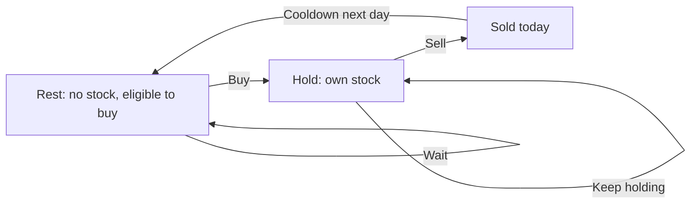

# Chapter 08 — Finite-state transitions

> **Study goal:** Reconstruct the reasoning from the problem constraints. The example below is a teaching derivation; the linked original submission may use an equivalent optimized algorithm.

## 1. Start with a concrete question

**Worked example:** [309. Best Time to Buy and Sell Stock with Cooldown](https://github.com/gaurav1kr/Miscellaneous/blob/main/DSA/DP/DP_Mathematics_Master_Guide_Illustrated/Problems/309.md)

**State meaning:** Hold(i), Sold(i), Rest(i): best profit by end of day i in each state.

## 2. Why this recurrence follows

The cooldown rule is encoded as forbidden transitions: after selling, you cannot immediately buy. State names describe legal histories, not just numbers.

**Mathematical recurrence:**

```text
Hold(i)=max(Hold(i-1),Rest(i-1)-price[i]); Sold(i)=Hold(i-1)+price[i]; Rest(i)=max(Rest(i-1),Sold(i-1))
```

Before using the equation, identify the empty or impossible states, and check whether alternatives should be **added**, **maximized**, **minimized**, or **OR-ed**.

## 3. Draw the decision and trace it



**Trace:** Prices [1,2,3,0,2]: buy at 1, sell at 2, cooldown at 3, buy at 0, sell at 2: profit 3.

### How to reproduce the trace on paper

1. Write down the state definition, including exactly what the indices mean.
2. Mark the base cases before any recursive calls.
3. List the legal predecessor states or choices.
4. Compute small states first; annotate each arrow with its reason.
5. Compare the final result with a small manual enumeration.

## 4. Connect mathematics to your C++

Open [309. Best Time to Buy and Sell Stock with Cooldown](https://github.com/gaurav1kr/Miscellaneous/blob/main/DSA/DP/DP_Mathematics_Master_Guide_Illustrated/Problems/309.md) and find the line that performs the transition. If it is optimized, first imagine a full DP table, then explain why only a smaller number of previous states are required.

**Interview questions:** Why are the cases exhaustive? Why do they not double-count? What invariant does each variable maintain? Which changes in the problem would require another state dimension?

## 5. Related problems to compare

The following links group problems for study. **Do not assume they all use the same recurrence**: compare the constraints and the submitted algorithm before transferring a technique.

## Problems in this family (22)

- [123. Best Time to Buy and Sell Stock III](https://github.com/gaurav1kr/Miscellaneous/blob/main/DSA/DP/DP_Mathematics_Master_Guide_Illustrated/Problems/123.md) — Hard
- [188. Best Time to Buy and Sell Stock IV](https://github.com/gaurav1kr/Miscellaneous/blob/main/DSA/DP/DP_Mathematics_Master_Guide_Illustrated/Problems/188.md) — Hard
- [309. Best Time to Buy and Sell Stock with Cooldown](https://github.com/gaurav1kr/Miscellaneous/blob/main/DSA/DP/DP_Mathematics_Master_Guide_Illustrated/Problems/309.md) — Medium
- [552. Student Attendance Record II](https://github.com/gaurav1kr/Miscellaneous/blob/main/DSA/DP/DP_Mathematics_Master_Guide_Illustrated/Problems/552.md) — Hard
- [678. Valid Parenthesis String](https://github.com/gaurav1kr/Miscellaneous/blob/main/DSA/DP/DP_Mathematics_Master_Guide_Illustrated/Problems/678.md) — Medium
- [714. Best Time to Buy and Sell Stock with Transaction Fee](https://github.com/gaurav1kr/Miscellaneous/blob/main/DSA/DP/DP_Mathematics_Master_Guide_Illustrated/Problems/714.md) — Medium
- [790. Domino and Tromino Tiling](https://github.com/gaurav1kr/Miscellaneous/blob/main/DSA/DP/DP_Mathematics_Master_Guide_Illustrated/Problems/790.md) — Medium
- [801. Minimum Swaps To Make Sequences Increasing](https://github.com/gaurav1kr/Miscellaneous/blob/main/DSA/DP/DP_Mathematics_Master_Guide_Illustrated/Problems/801.md) — Hard
- [818. Race Car](https://github.com/gaurav1kr/Miscellaneous/blob/main/DSA/DP/DP_Mathematics_Master_Guide_Illustrated/Problems/818.md) — Hard
- [926. Flip String to Monotone Increasing](https://github.com/gaurav1kr/Miscellaneous/blob/main/DSA/DP/DP_Mathematics_Master_Guide_Illustrated/Problems/926.md) — Medium
- [975. Odd Even Jump](https://github.com/gaurav1kr/Miscellaneous/blob/main/DSA/DP/DP_Mathematics_Master_Guide_Illustrated/Problems/975.md) — Hard
- [1025. Divisor Game](https://github.com/gaurav1kr/Miscellaneous/blob/main/DSA/DP/DP_Mathematics_Master_Guide_Illustrated/Problems/1025.md) — Easy
- [1220. Count Vowels Permutation](https://github.com/gaurav1kr/Miscellaneous/blob/main/DSA/DP/DP_Mathematics_Master_Guide_Illustrated/Problems/1220.md) — Hard
- [1223. Dice Roll Simulation](https://github.com/gaurav1kr/Miscellaneous/blob/main/DSA/DP/DP_Mathematics_Master_Guide_Illustrated/Problems/1223.md) — Hard
- [1255. Maximum Score Words Formed by Letters](https://github.com/gaurav1kr/Miscellaneous/blob/main/DSA/DP/DP_Mathematics_Master_Guide_Illustrated/Problems/1255.md) — Hard
- [1411. Number of Ways to Paint N × 3 Grid](https://github.com/gaurav1kr/Miscellaneous/blob/main/DSA/DP/DP_Mathematics_Master_Guide_Illustrated/Problems/1411.md) — Hard
- [1653. Minimum Deletions to Make String Balanced](https://github.com/gaurav1kr/Miscellaneous/blob/main/DSA/DP/DP_Mathematics_Master_Guide_Illustrated/Problems/1653.md) — Medium
- [1787. Make the XOR of All Segments Equal to Zero](https://github.com/gaurav1kr/Miscellaneous/blob/main/DSA/DP/DP_Mathematics_Master_Guide_Illustrated/Problems/1787.md) — Hard
- [3389. Minimum Operations to Make Character Frequencies Equal](https://github.com/gaurav1kr/Miscellaneous/blob/main/DSA/DP/DP_Mathematics_Master_Guide_Illustrated/Problems/3389.md) — Hard
- [3434. Maximum Frequency After Subarray Operation](https://github.com/gaurav1kr/Miscellaneous/blob/main/DSA/DP/DP_Mathematics_Master_Guide_Illustrated/Problems/3434.md) — Medium
- [3980. Minimum Operations to Transform Binary String](https://github.com/gaurav1kr/Miscellaneous/blob/main/DSA/DP/DP_Mathematics_Master_Guide_Illustrated/Problems/3980.md) — Medium
- [3984. Divisible Game](https://github.com/gaurav1kr/Miscellaneous/blob/main/DSA/DP/DP_Mathematics_Master_Guide_Illustrated/Problems/3984.md) — Medium

