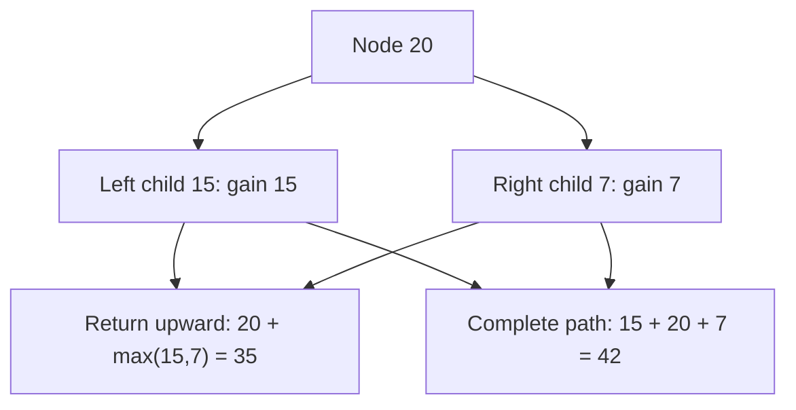

# Chapter 10 — Tree DP and return-value contracts

> **Study goal:** Reconstruct the reasoning from the problem constraints. The example below is a teaching derivation; the linked original submission may use an equivalent optimized algorithm.

## 1. Start with a concrete question

**Worked example:** [124. Binary Tree Maximum Path Sum](https://github.com/gaurav1kr/Miscellaneous/blob/main/DSA/DP/DP_Mathematics_Master_Guide_Illustrated/Problems/124.md)

**State meaning:** Gain(u): maximum downward path beginning at u; Answer: maximum path anywhere.

## 2. Why this recurrence follows

A path returned to the parent cannot branch in two directions. A complete path evaluated at the current node may use both children.

**Mathematical recurrence:**

```text
Gain(u)=value(u)+max(0,Gain(left),Gain(right)); through(u)=value(u)+max(0,Gain(left))+max(0,Gain(right))
```

Before using the equation, identify the empty or impossible states, and check whether alternatives should be **added**, **maximized**, **minimized**, or **OR-ed**.

## 3. Draw the decision and trace it



**Trace:** Tree [-10,9,20,null,null,15,7]: at 20, downward gain is 35, through-node candidate is 42 (=15+20+7).

### How to reproduce the trace on paper

1. Write down the state definition, including exactly what the indices mean.
2. Mark the base cases before any recursive calls.
3. List the legal predecessor states or choices.
4. Compute small states first; annotate each arrow with its reason.
5. Compare the final result with a small manual enumeration.

## 4. Connect mathematics to your C++

Open [124. Binary Tree Maximum Path Sum](https://github.com/gaurav1kr/Miscellaneous/blob/main/DSA/DP/DP_Mathematics_Master_Guide_Illustrated/Problems/124.md) and find the line that performs the transition. If it is optimized, first imagine a full DP table, then explain why only a smaller number of previous states are required.

**Interview questions:** Why are the cases exhaustive? Why do they not double-count? What invariant does each variable maintain? Which changes in the problem would require another state dimension?

## 5. Related problems to compare

The following links group problems for study. **Do not assume they all use the same recurrence**: compare the constraints and the submitted algorithm before transferring a technique.

## Problems in this family (20)

- [124. Binary Tree Maximum Path Sum](https://github.com/gaurav1kr/Miscellaneous/blob/main/DSA/DP/DP_Mathematics_Master_Guide_Illustrated/Problems/124.md) — Hard
- [329. Longest Increasing Path in a Matrix](https://github.com/gaurav1kr/Miscellaneous/blob/main/DSA/DP/DP_Mathematics_Master_Guide_Illustrated/Problems/329.md) — Hard
- [458. Poor Pigs](https://github.com/gaurav1kr/Miscellaneous/blob/main/DSA/DP/DP_Mathematics_Master_Guide_Illustrated/Problems/458.md) — Hard
- [542. 01 Matrix](https://github.com/gaurav1kr/Miscellaneous/blob/main/DSA/DP/DP_Mathematics_Master_Guide_Illustrated/Problems/542.md) — Medium
- [787. Cheapest Flights Within K Stops](https://github.com/gaurav1kr/Miscellaneous/blob/main/DSA/DP/DP_Mathematics_Master_Guide_Illustrated/Problems/787.md) — Medium
- [834. Sum of Distances in Tree](https://github.com/gaurav1kr/Miscellaneous/blob/main/DSA/DP/DP_Mathematics_Master_Guide_Illustrated/Problems/834.md) — Hard
- [968. Binary Tree Cameras](https://github.com/gaurav1kr/Miscellaneous/blob/main/DSA/DP/DP_Mathematics_Master_Guide_Illustrated/Problems/968.md) — Hard
- [1162. As Far from Land as Possible](https://github.com/gaurav1kr/Miscellaneous/blob/main/DSA/DP/DP_Mathematics_Master_Guide_Illustrated/Problems/1162.md) — Medium
- [1334. Find the City With the Smallest Number of Neighbors at a Threshold Distance](https://github.com/gaurav1kr/Miscellaneous/blob/main/DSA/DP/DP_Mathematics_Master_Guide_Illustrated/Problems/1334.md) — Medium
- [1372. Longest ZigZag Path in a Binary Tree](https://github.com/gaurav1kr/Miscellaneous/blob/main/DSA/DP/DP_Mathematics_Master_Guide_Illustrated/Problems/1372.md) — Medium
- [1373. Maximum Sum BST in Binary Tree](https://github.com/gaurav1kr/Miscellaneous/blob/main/DSA/DP/DP_Mathematics_Master_Guide_Illustrated/Problems/1373.md) — Hard
- [1483. Kth Ancestor of a Tree Node](https://github.com/gaurav1kr/Miscellaneous/blob/main/DSA/DP/DP_Mathematics_Master_Guide_Illustrated/Problems/1483.md) — Hard
- [1617. Count Subtrees With Max Distance Between Cities](https://github.com/gaurav1kr/Miscellaneous/blob/main/DSA/DP/DP_Mathematics_Master_Guide_Illustrated/Problems/1617.md) — Hard
- [1786. Number of Restricted Paths From First to Last Node](https://github.com/gaurav1kr/Miscellaneous/blob/main/DSA/DP/DP_Mathematics_Master_Guide_Illustrated/Problems/1786.md) — Medium
- [1857. Largest Color Value in a Directed Graph](https://github.com/gaurav1kr/Miscellaneous/blob/main/DSA/DP/DP_Mathematics_Master_Guide_Illustrated/Problems/1857.md) — Hard
- [1916. Count Ways to Build Rooms in an Ant Colony](https://github.com/gaurav1kr/Miscellaneous/blob/main/DSA/DP/DP_Mathematics_Master_Guide_Illustrated/Problems/1916.md) — Hard
- [1928. Minimum Cost to Reach Destination in Time](https://github.com/gaurav1kr/Miscellaneous/blob/main/DSA/DP/DP_Mathematics_Master_Guide_Illustrated/Problems/1928.md) — Hard
- [1976. Number of Ways to Arrive at Destination](https://github.com/gaurav1kr/Miscellaneous/blob/main/DSA/DP/DP_Mathematics_Master_Guide_Illustrated/Problems/1976.md) — Medium
- [2003. Smallest Missing Genetic Value in Each Subtree](https://github.com/gaurav1kr/Miscellaneous/blob/main/DSA/DP/DP_Mathematics_Master_Guide_Illustrated/Problems/2003.md) — Hard
- [2127. Maximum Employees to Be Invited to a Meeting](https://github.com/gaurav1kr/Miscellaneous/blob/main/DSA/DP/DP_Mathematics_Master_Guide_Illustrated/Problems/2127.md) — Hard

