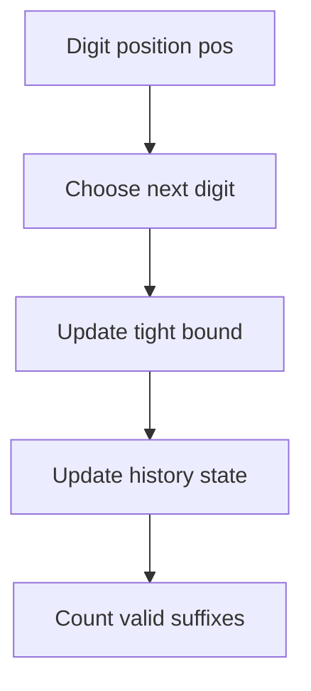

# Chapter 11 — Digit DP, Counting and Probability

## Core mathematical idea: constrained counting and probability

This chapter contains several **different** mathematical techniques; identify the correct one before writing a recurrence.

### Digit DP

Count numbers under an upper bound digit by digit. Typical state: `F(pos, tight, started, history)`. `tight` means the chosen prefix still equals the upper bound. At each position, try valid digits and sum the number of valid suffixes.

### Probability DP

For a random process, use the law of total probability:

`P(state) = sum over choices [ probability(choice) × P(next state) ]`

For example, Knight Probability in Chessboard (688) counts the chance of remaining on the board after a fixed number of random moves.

### Combinatorial contribution counting

Some problems count how often each element contributes rather than enumerate every subsequence. For instance, in Vowels of All Substrings (2063), index `i` (zero based) belongs to `(i+1) × (n-i)` substrings. Add that contribution for every vowel.

**Warning:** a number of linked problems use greedy, monotonic stacks, prefix sums, or other methods, not digit DP or probability DP. Read each submitted solution before selecting a model.

## State-transition picture

## How to study the linked problems

For each problem: read the mathematical template, articulate its state and decision, inspect the submitted implementation, then justify why its transitions are correct. Compare with the previous problem: which constraint forced a new state dimension?

## Problems in this family (56)

- [5. Longest Palindromic Substring](https://github.com/gaurav1kr/Miscellaneous/blob/main/DSA/DP/DP_Mathematics_Master_Guide_Illustrated/Problems/5.md) — Medium
- [22. Generate Parentheses](https://github.com/gaurav1kr/Miscellaneous/blob/main/DSA/DP/DP_Mathematics_Master_Guide_Illustrated/Problems/22.md) — Medium
- [32. Longest Valid Parentheses](https://github.com/gaurav1kr/Miscellaneous/blob/main/DSA/DP/DP_Mathematics_Master_Guide_Illustrated/Problems/32.md) — Hard
- [42. Trapping Rain Water](https://github.com/gaurav1kr/Miscellaneous/blob/main/DSA/DP/DP_Mathematics_Master_Guide_Illustrated/Problems/42.md) — Hard
- [45. Jump Game II](https://github.com/gaurav1kr/Miscellaneous/blob/main/DSA/DP/DP_Mathematics_Master_Guide_Illustrated/Problems/45.md) — Medium
- [53. Maximum Subarray](https://github.com/gaurav1kr/Miscellaneous/blob/main/DSA/DP/DP_Mathematics_Master_Guide_Illustrated/Problems/53.md) — Medium
- [55. Jump Game](https://github.com/gaurav1kr/Miscellaneous/blob/main/DSA/DP/DP_Mathematics_Master_Guide_Illustrated/Problems/55.md) — Medium
- [85. Maximal Rectangle](https://github.com/gaurav1kr/Miscellaneous/blob/main/DSA/DP/DP_Mathematics_Master_Guide_Illustrated/Problems/85.md) — Hard
- [122. Best Time to Buy and Sell Stock II](https://github.com/gaurav1kr/Miscellaneous/blob/main/DSA/DP/DP_Mathematics_Master_Guide_Illustrated/Problems/122.md) — Medium
- [152. Maximum Product Subarray](https://github.com/gaurav1kr/Miscellaneous/blob/main/DSA/DP/DP_Mathematics_Master_Guide_Illustrated/Problems/152.md) — Medium
- [233. Number of Digit One](https://github.com/gaurav1kr/Miscellaneous/blob/main/DSA/DP/DP_Mathematics_Master_Guide_Illustrated/Problems/233.md) — Hard
- [357. Count Numbers with Unique Digits](https://github.com/gaurav1kr/Miscellaneous/blob/main/DSA/DP/DP_Mathematics_Master_Guide_Illustrated/Problems/357.md) — Medium
- [396. Rotate Function](https://github.com/gaurav1kr/Miscellaneous/blob/main/DSA/DP/DP_Mathematics_Master_Guide_Illustrated/Problems/396.md) — Medium
- [435. Non-overlapping Intervals](https://github.com/gaurav1kr/Miscellaneous/blob/main/DSA/DP/DP_Mathematics_Master_Guide_Illustrated/Problems/435.md) — Medium
- [600. Non-negative Integers without Consecutive Ones](https://github.com/gaurav1kr/Miscellaneous/blob/main/DSA/DP/DP_Mathematics_Master_Guide_Illustrated/Problems/600.md) — Hard
- [629. K Inverse Pairs Array](https://github.com/gaurav1kr/Miscellaneous/blob/main/DSA/DP/DP_Mathematics_Master_Guide_Illustrated/Problems/629.md) — Hard
- [688. Knight Probability in Chessboard](https://github.com/gaurav1kr/Miscellaneous/blob/main/DSA/DP/DP_Mathematics_Master_Guide_Illustrated/Problems/688.md) — Medium
- [788. Rotated Digits](https://github.com/gaurav1kr/Miscellaneous/blob/main/DSA/DP/DP_Mathematics_Master_Guide_Illustrated/Problems/788.md) — Medium
- [799. Champagne Tower](https://github.com/gaurav1kr/Miscellaneous/blob/main/DSA/DP/DP_Mathematics_Master_Guide_Illustrated/Problems/799.md) — Medium
- [808. Soup Servings](https://github.com/gaurav1kr/Miscellaneous/blob/main/DSA/DP/DP_Mathematics_Master_Guide_Illustrated/Problems/808.md) — Medium
- [828. Count Unique Characters of All Substrings of a Given String](https://github.com/gaurav1kr/Miscellaneous/blob/main/DSA/DP/DP_Mathematics_Master_Guide_Illustrated/Problems/828.md) — Hard
- [837. New 21 Game](https://github.com/gaurav1kr/Miscellaneous/blob/main/DSA/DP/DP_Mathematics_Master_Guide_Illustrated/Problems/837.md) — Medium
- [838. Push Dominoes](https://github.com/gaurav1kr/Miscellaneous/blob/main/DSA/DP/DP_Mathematics_Master_Guide_Illustrated/Problems/838.md) — Medium
- [898. Bitwise ORs of Subarrays](https://github.com/gaurav1kr/Miscellaneous/blob/main/DSA/DP/DP_Mathematics_Master_Guide_Illustrated/Problems/898.md) — Medium
- [902. Numbers At Most N Given Digit Set](https://github.com/gaurav1kr/Miscellaneous/blob/main/DSA/DP/DP_Mathematics_Master_Guide_Illustrated/Problems/902.md) — Hard
- [903. Valid Permutations for DI Sequence](https://github.com/gaurav1kr/Miscellaneous/blob/main/DSA/DP/DP_Mathematics_Master_Guide_Illustrated/Problems/903.md) — Hard
- [907. Sum of Subarray Minimums](https://github.com/gaurav1kr/Miscellaneous/blob/main/DSA/DP/DP_Mathematics_Master_Guide_Illustrated/Problems/907.md) — Medium
- [1012. Numbers With Repeated Digits](https://github.com/gaurav1kr/Miscellaneous/blob/main/DSA/DP/DP_Mathematics_Master_Guide_Illustrated/Problems/1012.md) — Hard
- [1014. Best Sightseeing Pair](https://github.com/gaurav1kr/Miscellaneous/blob/main/DSA/DP/DP_Mathematics_Master_Guide_Illustrated/Problems/1014.md) — Medium
- [1024. Video Stitching](https://github.com/gaurav1kr/Miscellaneous/blob/main/DSA/DP/DP_Mathematics_Master_Guide_Illustrated/Problems/1024.md) — Medium
- [1186. Maximum Subarray Sum with One Deletion](https://github.com/gaurav1kr/Miscellaneous/blob/main/DSA/DP/DP_Mathematics_Master_Guide_Illustrated/Problems/1186.md) — Medium
- [1191. K-Concatenation Maximum Sum](https://github.com/gaurav1kr/Miscellaneous/blob/main/DSA/DP/DP_Mathematics_Master_Guide_Illustrated/Problems/1191.md) — Medium
- [1326. Minimum Number of Taps to Open to Water a Garden](https://github.com/gaurav1kr/Miscellaneous/blob/main/DSA/DP/DP_Mathematics_Master_Guide_Illustrated/Problems/1326.md) — Hard
- [1397. Find All Good Strings](https://github.com/gaurav1kr/Miscellaneous/blob/main/DSA/DP/DP_Mathematics_Master_Guide_Illustrated/Problems/1397.md) — Hard
- [1425. Constrained Subsequence Sum](https://github.com/gaurav1kr/Miscellaneous/blob/main/DSA/DP/DP_Mathematics_Master_Guide_Illustrated/Problems/1425.md) — Hard
- [1467. Probability of a Two Boxes Having The Same Number of Distinct Balls](https://github.com/gaurav1kr/Miscellaneous/blob/main/DSA/DP/DP_Mathematics_Master_Guide_Illustrated/Problems/1467.md) — Hard
- [1493. Longest Subarray of 1's After Deleting One Element](https://github.com/gaurav1kr/Miscellaneous/blob/main/DSA/DP/DP_Mathematics_Master_Guide_Illustrated/Problems/1493.md) — Medium
- [1504. Count Submatrices With All Ones](https://github.com/gaurav1kr/Miscellaneous/blob/main/DSA/DP/DP_Mathematics_Master_Guide_Illustrated/Problems/1504.md) — Medium
- [1524. Number of Sub-arrays With Odd Sum](https://github.com/gaurav1kr/Miscellaneous/blob/main/DSA/DP/DP_Mathematics_Master_Guide_Illustrated/Problems/1524.md) — Medium
- [1525. Number of Good Ways to Split a String](https://github.com/gaurav1kr/Miscellaneous/blob/main/DSA/DP/DP_Mathematics_Master_Guide_Illustrated/Problems/1525.md) — Medium
- [1526. Minimum Number of Increments on Subarrays to Form a Target Array](https://github.com/gaurav1kr/Miscellaneous/blob/main/DSA/DP/DP_Mathematics_Master_Guide_Illustrated/Problems/1526.md) — Hard
- [1537. Get the Maximum Score](https://github.com/gaurav1kr/Miscellaneous/blob/main/DSA/DP/DP_Mathematics_Master_Guide_Illustrated/Problems/1537.md) — Hard
- [1567. Maximum Length of Subarray With Positive Product](https://github.com/gaurav1kr/Miscellaneous/blob/main/DSA/DP/DP_Mathematics_Master_Guide_Illustrated/Problems/1567.md) — Medium
- [1578. Minimum Time to Make Rope Colorful](https://github.com/gaurav1kr/Miscellaneous/blob/main/DSA/DP/DP_Mathematics_Master_Guide_Illustrated/Problems/1578.md) — Medium
- [1696. Jump Game VI](https://github.com/gaurav1kr/Miscellaneous/blob/main/DSA/DP/DP_Mathematics_Master_Guide_Illustrated/Problems/1696.md) — Medium
- [1871. Jump Game VII](https://github.com/gaurav1kr/Miscellaneous/blob/main/DSA/DP/DP_Mathematics_Master_Guide_Illustrated/Problems/1871.md) — Medium
- [1888. Minimum Number of Flips to Make the Binary String Alternating](https://github.com/gaurav1kr/Miscellaneous/blob/main/DSA/DP/DP_Mathematics_Master_Guide_Illustrated/Problems/1888.md) — Medium
- [2063. Vowels of All Substrings](https://github.com/gaurav1kr/Miscellaneous/blob/main/DSA/DP/DP_Mathematics_Master_Guide_Illustrated/Problems/2063.md) — Medium
- [2100. Find Good Days to Rob the Bank](https://github.com/gaurav1kr/Miscellaneous/blob/main/DSA/DP/DP_Mathematics_Master_Guide_Illustrated/Problems/2100.md) — Medium
- [2110. Number of Smooth Descent Periods of a Stock](https://github.com/gaurav1kr/Miscellaneous/blob/main/DSA/DP/DP_Mathematics_Master_Guide_Illustrated/Problems/2110.md) — Medium
- [3410. Maximize Subarray Sum After Removing All Occurrences of One Element](https://github.com/gaurav1kr/Miscellaneous/blob/main/DSA/DP/DP_Mathematics_Master_Guide_Illustrated/Problems/3410.md) — Hard
- [3428. Maximum and Minimum Sums of at Most Size K Subsequences](https://github.com/gaurav1kr/Miscellaneous/blob/main/DSA/DP/DP_Mathematics_Master_Guide_Illustrated/Problems/3428.md) — Medium
- [3448. Count Substrings Divisible By Last Digit](https://github.com/gaurav1kr/Miscellaneous/blob/main/DSA/DP/DP_Mathematics_Master_Guide_Illustrated/Problems/3448.md) — Hard
- [3458. Select K Disjoint Special Substrings](https://github.com/gaurav1kr/Miscellaneous/blob/main/DSA/DP/DP_Mathematics_Master_Guide_Illustrated/Problems/3458.md) — Medium
- [3989. Maximum Consistent Columns in a Grid](https://github.com/gaurav1kr/Miscellaneous/blob/main/DSA/DP/DP_Mathematics_Master_Guide_Illustrated/Problems/3989.md) — Hard
- [4058. Maximum Pulse Value After One Subarray Rotation](https://github.com/gaurav1kr/Miscellaneous/blob/main/DSA/DP/DP_Mathematics_Master_Guide_Illustrated/Problems/4058.md) — Medium
