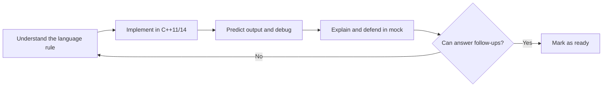

# Adobe Senior Computer Scientist (C++) — 14-Day Intensive Interview Bootcamp

**Role:** Senior Computer Scientist – C++ | **Location:** Noida | **Requisition:** R171863  
**Application date:** October 8, 2026  
**Preparation window:** October 14–27, 2026  
**Goal:** Be ready for an interview as early as October 20, with a second week for reinforcement.

> **Strategy:** Prioritize the previously identified weakness—C++ core concepts—while maintaining DSA, low-level design, system design, and senior-level project storytelling. No plan can guarantee selection. Aim for 10–12 hours of focused work within a maximum 14-hour daily study window, including breaks and adequate sleep.

## 1. Preparation priorities

| Subject | Allocation |
|---|---:|
| Core C++, modern C++, STL | 45% |
| Concurrency and multithreading | 20% |
| Performance, OS, debugging | 15% |
| DSA and coding | 10% |
| Low-level and system design | 7% |
| Projects and behavioral preparation | 3% |

These are **recommended study weights**, not Adobe's published interview weights.

## 2. First 7 days — interview-ready baseline

| Date | Focus | Mandatory practice |
|---|---|---|
| **Day 1 — Oct 14** | Pointers, references, memory layout, `const`, constructors, destructors, copy semantics | 30 output-prediction questions; implement a deep-copy class |
| **Day 2 — Oct 15** | OOP, inheritance, polymorphism, vtable/vptr implementation concepts, virtual destructor, slicing, Rule of Five | 25 output questions; polymorphic class hierarchy |
| **Day 3 — Oct 16** | Move semantics, smart pointers, RAII, `noexcept`, perfect forwarding, exception safety | Implement simplified `unique_ptr`; ownership debugging |
| **Day 4 — Oct 17** | STL internals: `vector`, `list`, `deque`, `map`, `unordered_map`, iterators, templates, lambdas | 30 STL questions; LRU cache |
| **Day 5 — Oct 18** | Threads, mutexes, condition variables, atomics, races, deadlocks, memory model | Bounded producer-consumer queue |
| **Day 6 — Oct 19** | Profiling, cache locality, false sharing, OS memory, gdb, sanitizers | Profile and optimize C++ code; basic thread pool |
| **Day 7 — Oct 20** | Full interview simulation and corrections | 60-minute C++ mock, 60-minute coding mock, 60-minute concurrency/LLD mock |

**Day 7 exit gate:** Explain core concepts without notes, predict output and undefined behavior, implement ownership-safe code, and defend synchronization choices. Use mock results to identify weak topics rather than treating mere completion as mastery.

## 3. Next 7 days — deepen and eliminate weaknesses

| Date | Focus | Mandatory practice |
|---|---|---|
| **Day 8 — Oct 21** | Templates, SFINAE basics, type deduction, casts, alignment, allocators | 25 advanced C++ questions |
| **Day 9 — Oct 22** | Acquire/release ordering, compare-exchange, lock-free tradeoffs, futures, thread pools | Thread pool with futures; concurrency debugging |
| **Day 10 — Oct 23** | SOLID, Factory, Strategy, Observer, thread-safe cache, logging library | Full C++ low-level design exercise |
| **Day 11 — Oct 24** | Scalable services, reliability, multi-tenancy, backward compatibility, observability | Two 45-minute system-design mocks |
| **Day 12 — Oct 25** | DSA revision: trees, graphs, DP, binary search, heaps, hashing | Five timed medium/hard problems |
| **Day 13 — Oct 26** | Advanced C++ and production debugging | Three mocks; revisit every mistake |
| **Day 14 — Oct 27** | Final revision, project deep dives, complete interview loop | Comprehensive interview simulation |

If an interview is scheduled before Day 7, compress the remaining high-priority C++ material into the available days, and preserve at least one timed mock.

## 4. Daily timetable — 12 focused hours

| Time (IST) | Duration | Activity | Deliverable |
|---|---:|---|---|
| 7:00–9:00 AM | 2 h | C++ concepts and internals | Notes and memory diagrams |
| 9:30–11:30 AM | 2 h | Hands-on C++ implementation | Compiling, tested code |
| 12:00–1:30 PM | 1.5 h | Output prediction and debugging | Written answers, corrected misconceptions |
| 2:30–4:30 PM | 2 h | Second technical subject | STL/concurrency/performance/OS practice |
| 5:00–6:30 PM | 1.5 h | DSA maintenance | Timed C++11/14 solution |
| 7:30–9:00 PM | 1.5 h | Mock interview and oral explanation | Scorecard and follow-up questions |
| 9:00–10:30 PM | 1.5 h | Review and weak-area correction | Updated error log and next-day plan |
| **Total** | **12 h** | | |

Breaks, meals, and sleep are separate from focused study. Reduce study hours if accuracy, attention, or recall deteriorates.

## 5. Four-step method for every C++ topic

A topic is **not complete** merely because its explanation was read. You should be able to:

- Explain what the language guarantees versus what a compiler commonly implements.
- Write a working example from memory in C++11/14.
- Predict output, compilation errors, and undefined behavior accurately.
- Find a bug and describe a safe correction.
- Handle at least three follow-up questions without notes.

### Example: `shared_ptr` mastery

Explain the control block, strong/weak ownership counts, custom deleters, cyclic references, `weak_ptr`, `make_shared`, and the distinction between thread-safe ownership bookkeeping and synchronization of the managed object. Then implement a simplified reference-counted pointer and discuss its limitations.

## 6. Highest-priority C++ question bank

### Memory, lifetime, and OOP

- What is the difference between stack, heap, static, and thread-local storage duration?
- Pointer vs reference; dangling pointer vs dangling reference?
- `const int*`, `int* const`, and `const int* const`?
- Constructor and destructor order with inheritance and member objects?
- Copy constructor vs copy assignment; deep copy vs shallow copy?
- Rule of Three, Five, and Zero?
- Why must a polymorphic base class generally have a virtual destructor?
- What is object slicing?
- What is a vtable? Is its exact layout standardized?
- What happens if a constructor throws?
- Explain undefined behavior with concrete examples.

### Modern C++ and STL

- What does `std::move` actually do?
- Lvalues, rvalues, forwarding references, and `std::forward`?
- Why does `noexcept` matter to `std::vector` reallocation?
- `unique_ptr` vs `shared_ptr` vs `weak_ptr`?
- `push_back` vs `emplace_back`?
- What invalidates `vector` iterators and references?
- Why is `unordered_map` average O(1), worst-case O(n)?
- `map` vs `unordered_map` vs `vector` performance tradeoffs?
- `list` vs `vector` and cache locality?
- Lambda capture by value vs reference; capture lifetime pitfalls?
- Function templates, specialization, and SFINAE basics?

### Concurrency

- Why is `volatile` not a substitute for atomic operations?
- `mutex` vs `atomic`; `lock_guard` vs `unique_lock`?
- Why use a predicate with `condition_variable::wait`?
- Spurious wakeups, lost wakeups, data races, deadlocks?
- Implement a bounded blocking queue with shutdown semantics.
- What is false sharing?
- What are acquire/release ordering and compare-exchange?
- When is a lock-free data structure justified?

### Performance and production debugging

- A process consumes 100% CPU: what is the investigation sequence?
- How do you profile heap allocations and memory leaks?
- Why might p99 latency worsen while throughput remains steady?
- How do you benchmark without misleading results?
- What are TLB misses, page faults, cache misses, and fragmentation?
- When would `mmap` or `epoll` be useful?
- How do AddressSanitizer and ThreadSanitizer help?

## 7. Initial C++ diagnostic (answer before checking)

**Q1.** What happens if a derived object is deleted through a base pointer whose destructor is not virtual?

A. Both destructors always run  
B. Undefined behavior (for ordinary delete when dynamic and static types differ)  
C. Only a memory leak; otherwise defined  
D. Compile-time error

**Q2.** What does `std::move(x)` itself do?

A. Moves bytes  
B. Destroys `x`  
C. Casts to an rvalue expression  
D. Allocates memory

**Q3.** Which operation invalidates all references to elements in a `std::vector`?

A. `size()`  
B. `reserve()` when it increases capacity  
C. Modifying an element  
D. `empty()`

**Q4.** Which statement about `std::shared_ptr` is correct?

A. Managed-object access is automatically thread-safe  
B. Separate `shared_ptr` instances sharing ownership can safely update ownership counts concurrently  
C. Cyclic references are automatically collected  
D. The count must be stored inside the managed object

**Q5.** Why should `condition_variable::wait` be used with a predicate?

A. To recheck the condition after spurious or competing wakeups  
B. To eliminate the mutex  
C. To guarantee FIFO scheduling  
D. To eliminate all deadlocks

Answer key — open only after attempting

1. **B** — Deleting through a nonvirtual base destructor is generally undefined behavior when the dynamic type differs; specialized destroying-delete cases are an exception.
2. **C** — `std::move` is a cast; a move constructor/assignment may subsequently be selected.
3. **B** — Capacity-increasing reallocation invalidates all element pointers, references, and iterators.
4. **B** — Ownership bookkeeping is synchronized across separate instances; access to the managed object is not automatically synchronized.
5. **A** — The predicate must be rechecked because wakeups can be spurious or another thread may consume the resource first.

## 8. Mandatory hands-on implementations

- [ ] Deep-copy resource-owning class (Rule of Five)
- [ ] Polymorphic class hierarchy with virtual destructor
- [ ] Simplified `unique_ptr`
- [ ] Simplified reference-counted smart pointer
- [ ] LRU cache using `list` + `unordered_map`
- [ ] Bounded blocking producer-consumer queue
- [ ] Basic thread pool with shutdown handling
- [ ] Thread pool with `future` results
- [ ] Benchmark `vector` vs `list` traversal
- [ ] Debug memory error with AddressSanitizer
- [ ] Debug a data race with ThreadSanitizer
- [ ] Complete C++ LLD: thread-safe cache or logging service

For each exercise: compile with `-std=c++14 -Wall -Wextra -Wpedantic`, test edge cases, and use sanitizers where applicable.

## 9. Mock interview scorecard

| Area | Suggested readiness target |
|---|---:|
| C++ core and modern C++ | 90% |
| STL and memory management | 90% |
| Concurrency | 85% |
| Performance debugging | 80% |
| DSA | 85% |
| LLD and system design | 80% |

These targets are **self-imposed preparation benchmarks**, not Adobe pass marks. Prefer three consecutive strong C++ mocks with no repeated critical misunderstandings.

**Daily error log:**

| Date | Question/topic | Mistake or missing rule | Correct explanation | Retest date | Passed? |
|---|---|---|---|---|---|
| | | | | | |

## 10. Final mock interview loop

| Mock | Duration | Focus |
|---|---:|---|
| C++ Core | 60 min | Lifetime, polymorphism, output prediction, memory |
| Advanced C++ | 60 min | STL, ownership, move semantics, templates |
| Concurrency | 60 min | Synchronization, atomics, working implementation |
| DSA | 60 min | Two optimized C++11/14 coding questions |
| LLD | 60 min | Complete classes, interfaces, tradeoffs, code |
| System design | 60 min | Scale, reliability, security, performance |
| Senior-level discussion | 60 min | Ownership, ambiguity, technical decisions, mentoring |

## 11. Project stories to rehearse

1. **Samsung Stability Monitor:** C/C++ systems, CPU/memory/flash monitoring, performance, resource limits, debugging, and reliability.
2. **IBM Cloud bare-metal controllers:** Go/Kubernetes orchestration, provisioning lifecycle, scalable control planes, operational issues, and team leadership.
3. **Microsoft SDX OAuth migration:** Security, X.509, reusable infrastructure, rollout strategy, telemetry, backward compatibility, cross-team coordination, and production ownership.
4. **AI-assisted engineering:** Copilot-assisted development and reviews, MCP-based workflows, verification of AI-generated code, and reliability-focused patent work.

For each story, practice: requirements → constraints → architecture → key technical decision → tradeoffs → failure/debugging → measurable outcome → what you would change.

## 12. Last-minute priorities if Adobe calls early

**If the interview is in 48 hours:** Review lifetime, Rule of Five, polymorphism, move semantics, smart pointers, STL invalidation, mutex/condition variable/atomics, and do one 60-minute C++ mock. Preserve sleep.

**If the interview is in 4–5 days:** Complete Days 1–5 at accelerated pace, plus one mock and one debugging exercise.

**If the interview is in 7 days:** Complete the full first-week baseline and Day 7 simulations.

**If the interview is in 14 days:** Follow the entire plan and repeat failed mock questions.

## 13. Topics to de-prioritize

Avoid overinvesting in obscure template metaprogramming, compiler-specific trivia, C++17/20-only features, or hundreds of new DSA problems. Understand major post-C++14 features conceptually, but write practice solutions in **C++11/14** unless the interviewer specifies otherwise.

---

**Next step:** Begin Day 1 with memory, pointers, references, object lifetime, copy semantics, diagrams, code, output-prediction questions, and an oral mock. The aim is to make C++ the strongest part of the interview rather than the weakest.
