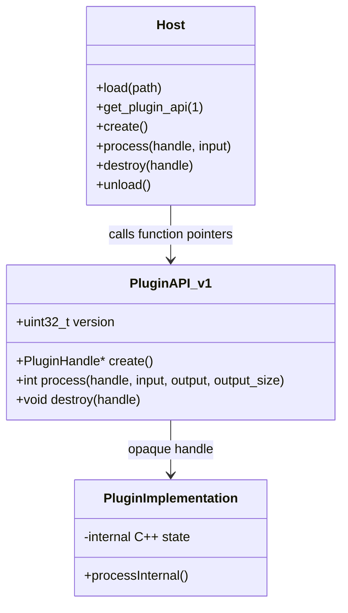

# Design an ABI-Compatible Plugin Interface (Simple C++11)

## 1. 60-second spoken answer

> I would expose a small **C ABI** from the plugin rather than exporting C++ classes. The host loads a shared library with `dlopen` and finds a known function, `get_plugin_api`, using `dlsym`. That function accepts an API version and returns a table of function pointers. The plugin keeps its internal C++ objects hidden behind an opaque handle. The host creates an instance, calls the functions, destroys the instance, and only then unloads the library. For future versions, I would keep version 1 unchanged and add a separate version 2 API. I would avoid passing STL types, exceptions, or ownership of C++ objects across the ABI boundary.

## 2. Requirements

- Load a plugin at runtime on Linux.
- Call `create`, `process`, and `destroy`.
- Allow the plugin to change its internal C++ implementation without breaking the host.
- Reject unsupported API versions safely.
- Avoid C++ STL objects and exceptions across the plugin boundary.

## 3. Simple UML (Mermaid)



### Three things to remember

1. **Host** loads the `.so` and calls the API.
2. **PluginAPI** is the stable contract: plain C-compatible types and function pointers.
3. **PluginHandle** hides the implementation: the host never dereferences it.

## 4. LLD: Ownership, lifetime and compatibility

| Item | Owner | Lifetime |
|---|---|---|
| Shared library (`.so`) | Host | From `dlopen` to `dlclose` |
| API function table | Plugin (static storage) | While library is loaded |
| Plugin instance (`PluginHandle*`) | Plugin allocates and destroys | From `create` to `destroy` |
| Input/output buffers | Host | Must remain valid during `process` |

**Correct call sequence:** `dlopen → dlsym → get_plugin_api(1) → create → process → destroy → dlclose`.

**ABI rules:**

- Export a known symbol with `extern "C"`.
- Keep **version 1 function signatures and layout unchanged**.
- Do not expose `std::string`, `std::vector`, virtual C++ classes, or C++ exceptions in the API.
- Allocate and free plugin objects on the **plugin side** (`create`/`destroy`).
- For an incompatible change, introduce `PluginAPI_v2` and return it only for version 2. Never reinterpret a v2 table as v1.
- A stable ABI still requires compatible target architecture, calling convention, and data-type representation.

## 5. Complete C++11 code

We use three small files.

### File 1: `plugin_api.h` (shared by host and plugin)

```cpp
#ifndef PLUGIN_API_H
#define PLUGIN_API_H

#include <stdint.h>
#include <stddef.h>

#ifdef __cplusplus
extern "C" {
#endif

// Opaque type: the host never sees its fields.
typedef struct PluginHandle PluginHandle;

typedef struct PluginAPI_v1 {
    uint32_t version;
    PluginHandle* (*create)();
    // Returns 0 on success, nonzero on failure.
    int (*process)(PluginHandle*, const char*, char*, size_t);
    void (*destroy)(PluginHandle*);
} PluginAPI_v1;

// Function signature resolved using dlsym.
typedef const PluginAPI_v1* (*GetPluginAPI)(uint32_t);

#ifdef __cplusplus
}
#endif

#endif
```

### File 2: `plugin.cpp` (shared library)

```cpp
#include "plugin_api.h"
#include <cstring>
#include <new>

// Only the plugin knows the real structure.
struct PluginHandle {
    int calls;
    PluginHandle() : calls(0) {}
};

namespace {
PluginHandle* create_impl() {
    return new (std::nothrow) PluginHandle();
}

int process_impl(PluginHandle* p, const char* input,
                 char* output, size_t output_size) {
    if (!p || !input || !output) return -1;

    const size_t len = std::strlen(input);
    if (len >= output_size) return -2;

    std::memcpy(output, input, len + 1);
    ++p->calls;
    return 0;
}

void destroy_impl(PluginHandle* p) {
    delete p;
}

const PluginAPI_v1 api = {
    1, create_impl, process_impl, destroy_impl
};
}

extern "C" const PluginAPI_v1* get_plugin_api(uint32_t version) {
    return version == 1 ? &api : nullptr;
}
```

### File 3: `host.cpp` (application)

```cpp
#include "plugin_api.h"
#include <dlfcn.h>
#include <iostream>

int main() {
    void* lib = dlopen("./libplugin.so", RTLD_NOW);
    if (!lib) {
        std::cerr << dlerror() << '\n';
        return 1;
    }

    GetPluginAPI get_api = reinterpret_cast<GetPluginAPI>(
        dlsym(lib, "get_plugin_api"));

    if (!get_api) {
        std::cerr << "Missing plugin entry point\n";
        dlclose(lib);
        return 1;
    }

    const PluginAPI_v1* api = get_api(1);
    if (!api || api->version != 1 ||
        !api->create || !api->process || !api->destroy) {
        std::cerr << "Unsupported or invalid API\n";
        dlclose(lib);
        return 1;
    }

    PluginHandle* plugin = api->create();
    if (!plugin) {
        std::cerr << "Could not create plugin\n";
        dlclose(lib);
        return 1;
    }

    char output[128] = {};
    int result = api->process(plugin, "Hello plugin", output,
                              sizeof(output));
    if (result == 0)
        std::cout << output << '\n';
    else
        std::cerr << "Plugin error: " << result << '\n';

    api->destroy(plugin);  // Destroy BEFORE unloading.
    dlclose(lib);
    return result == 0 ? 0 : 1;
}
```

### Build and run on Linux

```bash
g++ -std=c++11 -fPIC -shared plugin.cpp -o libplugin.so
g++ -std=c++11 host.cpp -ldl -o host
./host
```

Expected output:

```text
Hello plugin
```

## 6. How to evolve to version 2

Suppose we need a new `get_name()` function.

**Do not add a field to `PluginAPI_v1` and silently assume old hosts know it.** Instead:

```cpp
// New header addition; original PluginAPI_v1 stays unchanged.
typedef struct PluginAPI_v2 {
    uint32_t version;
    PluginHandle* (*create)();
    int (*process)(PluginHandle*, const char*, char*, size_t);
    void (*destroy)(PluginHandle*);
    const char* (*get_name)();
} PluginAPI_v2;
```

For version negotiation, use a **new typed entry point**, for example `get_plugin_api_v2()`, returning `const PluginAPI_v2*`. Keep `get_plugin_api(1)` for existing hosts. This avoids pretending a pointer to one struct type is a pointer to another. An alternative production design is a single entry point returning `void*` with strictly specified version-specific casts and validation.

## 7. Principal Engineer interview questions

**Q: Why not expose a C++ abstract base class?**  
A C++ class ABI depends on compiler/platform details such as vtable layout and name mangling. A C function table is easier to keep stable.

**Q: Why an opaque handle?**  
It hides the C++ implementation and keeps host code independent of object layout.

**Q: Who frees the plugin object?**  
The plugin's `destroy()` function. The host must not use `delete` on an opaque plugin object.

**Q: Can I unload the library while objects are alive?**  
No. Destroy plugin instances and stop in-flight calls before `dlclose()`.

**Q: What about thread safety?**  
Define it in the API contract. This small example does not promise concurrent calls to the same instance are safe.

**Q: Can exceptions cross the API?**  
They should not. A production plugin should catch exceptions inside exported callbacks and return error codes.

**Q: Does versioning solve every compatibility issue?**  
No. Architecture, compiler ABI assumptions, packing, calling conventions, and dependency compatibility still matter.

## 8. Whiteboard recall sheet

```text
HOST                PLUGIN
----                ------
dlopen(".so")
dlsym() ----------> extern "C" get_plugin_api(version)
                     |
                     v
                   PluginAPI_v1
                   { create, process, destroy }
                     |
create() ----------> opaque PluginHandle*
process() ---------> operate on hidden state
destroy() ---------> delete hidden state
dlclose()
```

**Memory formula:** **C ABI + versioned function table + opaque handle + plugin-side destroy**.

**Scope:** This is a deliberately small Linux/C++11 example. Production plugins also need documented calling conventions, error/exception boundaries, version negotiation, threading contracts, and lifecycle coordination.
