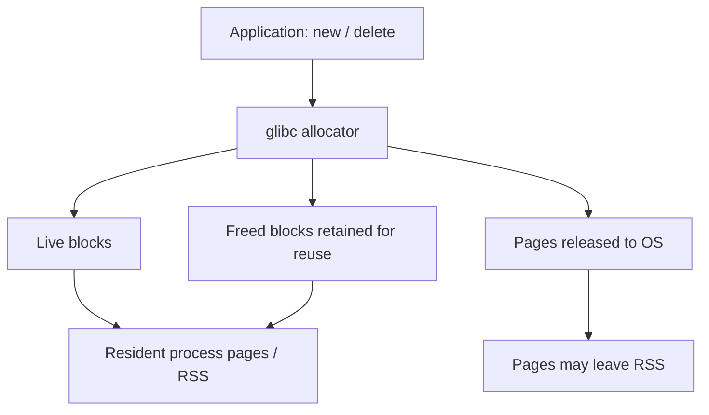
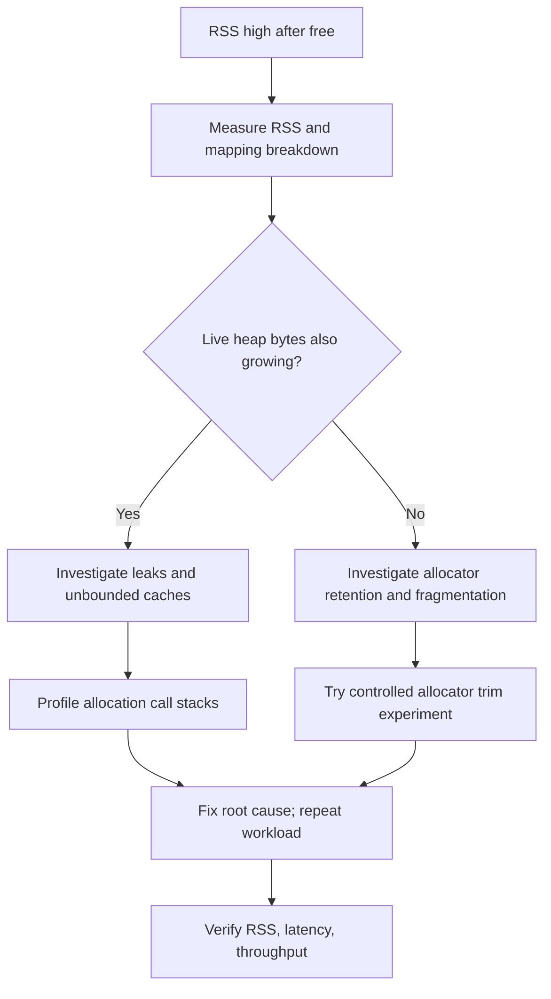

# Why a C++ Service's RSS Remains High After Freeing Objects

**Principal Engineer interview preparation | Linux | C++11/C++14**

## 1. 60-Second Spoken Answer

> Calling `delete` or `free()` returns memory to the allocator, but does not necessarily return resident pages to Linux. glibc malloc can retain freed blocks in arenas, bins, and per-thread caches for reuse. Fragmentation can leave free blocks interleaved with live allocations, preventing whole pages from being reclaimed. The service might also hold intentional caches or have a real leak. I would compare RSS with live heap allocation measurements across repeatable workload cycles, inspect `/proc/<pid>/status` and `smaps_rollup`, and use heap profiling or sanitizers in staging. `malloc_trim(0)` is a glibc-specific diagnostic experiment, not a guaranteed fix. I would only change allocator settings or code after confirming the cause and measuring latency impact.

## 2. Simple Memory Model (LLD)



**Key distinction:** `delete` ends the object's lifetime and deallocates storage to the allocator; RSS measures resident pages, not the number of live C++ objects.

### Common causes

| Cause | What happens | What to check |
|---|---|---|
| Allocator retention | Freed blocks stay in free lists/arenas | Live heap bytes vs RSS |
| Thread-local caches | Allocator keeps per-thread reusable blocks | Thread count, allocator statistics |
| Fragmentation | Live blocks pin pages containing free blocks | Allocation-size patterns, heap profiles |
| Application caches | Objects remain intentionally reachable | Cache sizes, eviction policies |
| Genuine leak | Unneeded allocations remain live or unreachable | LeakSanitizer, heap profiling |
| Other mappings | File mappings, shared pages, stacks also count toward RSS | `smaps_rollup`, `pmap` |

## 3. Investigation Flow



## 4. Linux Commands

```bash
ps -o pid,rss,vsz,nlwp,comm -p <PID>
grep -E 'VmRSS|RssAnon|RssFile|RssShmem|VmSize' /proc/<PID>/status
cat /proc/<PID>/smaps_rollup
pmap -x <PID>
```

- `VmRSS` is resident memory; `VmSize` is virtual address space, not resident usage.
- `RssAnon`, `RssFile`, and `RssShmem` break down RSS by broad category.
- `smaps_rollup` shows aggregated mapping statistics including private/shared memory.
- Measurements are snapshots and may not be perfectly synchronized.

### Understanding `VmRSS`, `RssAnon`, `RssFile`, and `RssShmem`

These are Linux `/proc/<PID>/status` fields, reported in **kB** (typically 1024-byte units). They describe **resident physical pages**, not the total virtual address space or the number of live C++ objects.

| Field | Full form | Meaning | Why useful when debugging |
|---|---|---|---|
| **`VmRSS`** | **Virtual Memory Resident Set Size** | Total resident memory mapped into this process (including shared pages). | Shows the process's overall resident-memory footprint; high RSS alone does not prove a leak. |
| **`RssAnon`** | **Resident Set Size — Anonymous** | Resident anonymous memory, commonly heap allocations, stacks, and private anonymous mappings. | Often the first field to watch when investigating C++ heap growth, but also rises with allocator retention, stacks, and other anonymous mappings. |
| **`RssFile`** | **Resident Set Size — File-backed** | Resident file-backed mappings, such as executable code, shared libraries, and `mmap`-mapped files. | Helps distinguish growth caused by file mappings from growth in anonymous heap memory. |
| **`RssShmem`** | **Resident Set Size — Shared Memory** | Resident shared-memory pages, such as POSIX/System V shared memory and some `tmpfs` mappings. | Useful when investigating interprocess communication or shared-memory-heavy services. |

**Relationship (for the same snapshot):**

```text
VmRSS = RssAnon + RssFile + RssShmem
```

**Example:**

```text
VmRSS:       614400 kB   # 600 MiB total
RssAnon:     512000 kB   # 500 MiB anonymous
RssFile:      81920 kB   #  80 MiB file-backed
RssShmem:     20480 kB   #  20 MiB shared memory
```

**Practical interpretation:** If `VmRSS` stays high after `delete[]` and most of it is `RssAnon`, investigate allocator arenas, caches, fragmentation, and live heap bytes. If `RssFile` grows, inspect mapped files and libraries; if `RssShmem` grows, inspect shared-memory users. **None of these fields alone establishes a leak.** Shared pages may also be counted in multiple processes' RSS, so do not sum process RSS values as though they were unique physical memory usage; consult **PSS** in `/proc/<PID>/smaps_rollup` for proportional accounting.

Check live values:

```bash
grep -E '^(VmRSS|RssAnon|RssFile|RssShmem):' /proc/<PID>/status
```

---

## 5. Minimal C++11 Demonstration

```cpp
#include <iostream>
#include <vector>
#include <malloc.h>   // glibc-specific malloc_trim
#include <unistd.h>   // Linux getpid, sleep

int main() {
    std::vector<char*> blocks;
    const size_t blockSize = 1024 * 1024;

    for (int i = 0; i < 500; ++i) {
        char* p = new char[blockSize];
        for (size_t j = 0; j < blockSize; j += 4096)
            p[j] = 1; // Touch pages so they become resident.
        blocks.push_back(p);
    }

    std::cout << "Allocated. PID=" << getpid() << std::endl;
    sleep(10);

    for (size_t i = 0; i < blocks.size(); ++i)
        delete[] blocks[i];
    blocks.clear();

    std::cout << "Freed allocations" << std::endl;
    sleep(10);

    malloc_trim(0); // Diagnostic only; no guaranteed RSS reduction.
    std::cout << "After malloc_trim" << std::endl;
    sleep(10);
}
```

Compile: `g++ -std=c++11 -O0 -g rss.cpp -o rss`

Monitor in another terminal: `watch -n 1 'ps -o pid,rss,vsz,comm -p <PID>'`

**Caution:** These 1 MiB allocations may use `mmap` internally and may be unmapped directly by `delete[]`. Consequently, RSS may drop before `malloc_trim`. To study retention and fragmentation, use many smaller, mixed-size allocations with interleaved long-lived objects; do not claim a particular RSS result without measuring it.

## 6. Production Investigation Checklist

1. Collect RSS, anonymous/file-backed breakdown, request volume, active objects, and thread count over time.
2. Compare the same metrics before and after an equivalent workload cycle.
3. Measure **live allocated bytes** using an allocator profiler or application metrics, not RSS alone.
4. Profile allocations in staging or a canary (e.g., heap profiler); run LeakSanitizer on a reproducible test build.
5. Check cache growth, per-thread allocation behavior, and fragmentation.
6. Consider a controlled `malloc_trim(0)` experiment on glibc to test whether releasable free pages are retained.
7. Fix the confirmed cause and validate RSS alongside CPU cost, latency, throughput, and page faults.

**Do not assume that a flat, high RSS proves a leak, or that a rising RSS proves one.**

## 7. Principal Engineer Interview Questions

**Q: Does `delete` return memory to Linux?**  
A: Not necessarily. It releases storage to the allocator; the allocator may reuse it without releasing pages.

**Q: Why do threads affect RSS?**  
A: Allocator arenas and per-thread caches may retain memory independently, depending on the allocator.

**Q: Can RSS stay high with zero live objects?**  
A: Yes. The allocator may retain pages, and the process may have other resident mappings.

**Q: What does `malloc_trim(0)` do?**  
A: On glibc, it attempts to release free heap pages; it is neither portable nor guaranteed to work.

**Q: How do you tell fragmentation from a leak?**  
A: Compare live heap bytes with allocator-reserved and resident bytes; inspect allocation profiles over repeated workloads.

**Q: Should we periodically trim in production?**  
A: Only after measuring the RSS benefit and the potential increase in faults, allocation overhead, and latency.

## 8. Whiteboard Recall Sheet

**FREE != RSS DROP**

**Reasons:** allocator retention → thread caches → fragmentation → application caches → leaks → other mappings.

**Workflow:** Observe → Measure live heap → Classify → Profile → Fix → Verify.

**One-liner:** Object lifetime, allocator ownership, and OS page residency are three different concepts.
