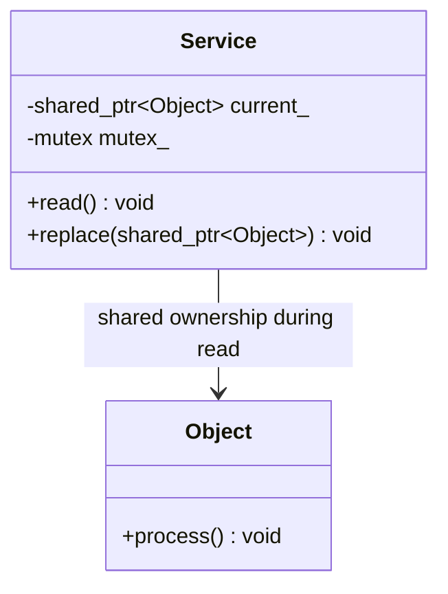
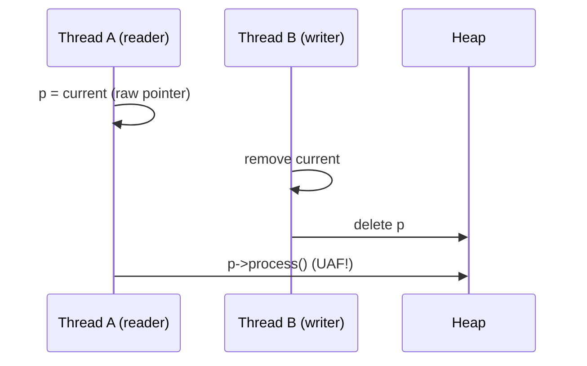
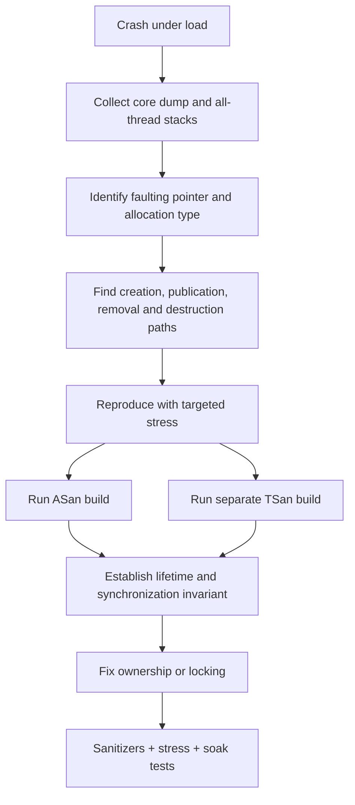

# Debug a Use-After-Free Under Heavy Concurrency — C++11 / Linux

> **Interview focus:** Senior / Principal C++ Engineer  
> **Format:** Spoken answer → Simple LLD → Investigation → C++11 code → Questions → Recall sheet

## 1. 60-second spoken answer

> First, I would preserve the crash evidence: core dump, all-thread backtraces, build IDs, and the workload that triggers the issue. A use-after-free under concurrency usually means one thread accesses an object after another thread releases its final ownership. I would reconstruct the timeline of acquisition, use, removal, and destruction, rather than focusing only on the crashing instruction. In a reproducible test environment, I would use AddressSanitizer to catch the invalid access and ThreadSanitizer in a **separate build** to detect data races. I would stress the suspected paths and log object addresses, IDs, and lifecycle events. To fix it, I would establish an explicit lifetime protocol: either hold the same lock throughout use and deletion, or give readers an owning `std::shared_ptr` acquired safely under synchronization. Finally, I would rerun the stress tests, sanitizer tests, and production-like soak tests to verify the fix.

## 2. Simple LLD: who owns the object?



**Design invariant:** A reader must hold a valid ownership token or a lock that prevents destruction for the **entire duration** of the access.

### Typical race timeline



A pointer being non-null does **not** mean it points to a live object.

## 3. Debugging flowchart



## 4. Linux commands: quick investigation

```bash
# Capture process memory and thread state (replace PID).
ps -L -p PID -o pid,tid,stat,comm
cat /proc/PID/status | grep -E 'VmRSS|Threads'

# Enable core dumps in a test shell, before starting the service.
ulimit -c unlimited

# Inspect a saved core (provide the matching executable and symbols).
gdb -q ./service ./core
# Inside GDB:
# (gdb) info threads
# (gdb) thread apply all bt full
# (gdb) frame 0
# (gdb) p ptr
# (gdb) info proc mappings

# On systemd systems, where available:
coredumpctl list
coredumpctl debug <PID-or-executable>
```

Use matching debug symbols (`-g`), exact binaries, and build IDs. A core dump shows the crash state; it may not show the earlier thread that freed the memory.

### Build with sanitizers — separate runs

```bash
# ASan: heap-use-after-free, invalid access, double free, etc.
g++ -std=c++11 -g -O1 -fno-omit-frame-pointer \
    -fsanitize=address -pthread main.cpp -o test_asan
./test_asan

# TSan: unsynchronized accesses and data races.
g++ -std=c++11 -g -O1 -fno-omit-frame-pointer \
    -fsanitize=thread -pthread main.cpp -o test_tsan
./test_tsan
```

**Do not combine ASan and TSan in one executable.** ASan detects invalid accesses when the schedule exposes them; TSan detects races, but neither tool proves the absence of all concurrency bugs. TSan also has platform/runtime constraints.

## 5. Minimal buggy example (C++11) — do not copy this pattern

```cpp
#include <thread>

struct Object {
    int value;
    void process() const { (void)value; }
};

Object* current = new Object{42};

void reader() {
    Object* p = current; // Data race: unsynchronized read.
    if (p) p->process(); // Could access freed memory.
}

void writer() {
    Object* old = current; // Data race.
    current = nullptr;
    delete old;           // Reader may still use old.
}

int main() {
    std::thread a(reader), b(writer);
    a.join(); b.join();
}
```

This example has a **data race and undefined behavior** even if it appears to work. A race does not always produce a visible crash. Do not rely on `sleep()` to reproduce or fix it.

## 6. Corrected example: safely acquire shared ownership

This is the simplest design when readers can process a **logically immutable** object without holding a global mutex during expensive work.

```cpp
#include <iostream>
#include <memory>
#include <mutex>
#include <thread>
#include <vector>

struct Object {
    explicit Object(int v) : value(v) {}
    int value;
    void process() const {
        // Example: read-only work.
        volatile int observed = value;
        (void)observed;
    }
};

class Service {
private:
    std::shared_ptr<const Object> current_;
    std::mutex mutex_;

public:
    Service() : current_(std::make_shared<Object>(42)) {}

    void read() {
        std::shared_ptr<const Object> local;
        {
            std::lock_guard<std::mutex> lock(mutex_);
            local = current_; // Acquire ownership while locked.
        }
        if (local) local->process(); // Safe after unlock.
    }

    void replace(int value) {
        std::shared_ptr<const Object> next =
            std::make_shared<Object>(value);
        {
            std::lock_guard<std::mutex> lock(mutex_);
            current_.swap(next);
        }
        // Old object is released outside the lock;
        // active readers still own their local copies.
    }
};

int main() {
    Service service;
    std::vector<std::thread> threads;

    for (int i = 0; i < 4; ++i) {
        threads.emplace_back([&service]() {
            for (int n = 0; n < 10000; ++n)
                service.read();
        });
    }

    threads.emplace_back([&service]() {
        for (int n = 0; n < 10000; ++n)
            service.replace(n);
    });

    for (size_t i = 0; i < threads.size(); ++i)
        threads[i].join();

    std::cout << "Completed safely\n";
}
```

**Why this works:** The mutex synchronizes access to the **same `shared_ptr` variable**. The reader copies it while locked, incrementing the reference count before the writer can replace it. After unlocking, its local copy keeps the object alive. `const Object` prevents mutation through this handle; the design assumes there are no other unsynchronized mutable aliases to the object.

**Alternative:** Hold a mutex while the reader uses a raw pointer and while the writer deletes it. This is even simpler but can create long critical sections.

**C++11 detail:** `std::atomic_load` / `std::atomic_store` overloads for `std::shared_ptr` exist in C++11, but using a normal mutex is easier to explain and audit in this interview design. An atomic *raw pointer* alone does not solve reclamation.

## 7. Ownership and lifetime checklist

| Question | What to verify |
|---|---|
| Who creates the object? | `new`, factory, container, pool |
| Who owns it? | Raw owner, `unique_ptr`, `shared_ptr`, container |
| How is it published? | Protected by mutex or atomic protocol |
| How does a reader acquire it? | Ownership/lock must be acquired before dereference |
| Who destroys it? | Writer, last shared owner, eviction, shutdown |
| When can it be reclaimed? | Only after all readers are finished |
| Are there aliases? | Callbacks, queues, cached raw pointers, iterators |
| Is the object mutable? | Lifetime safety does not imply race-free mutation |

### Common real-world causes

- A cache evicts an object while another thread holds a raw pointer to its value.
- A callback executes after its owning object is destroyed.
- A background worker outlives the service during shutdown.
- A container erase invalidates an iterator used by another thread.
- A reference count is updated incorrectly or a raw pointer is converted into an independent owner.
- An object pool reuses an address, masking the original lifetime bug (**ABA**).

## 8. What to log under stress

Record a stable object ID (not only its address), pointer address, thread ID, operation (`create`, `publish`, `acquire`, `release`, `destroy`), and monotonic timestamp. Avoid heavy synchronous logging in the hottest path because it can change thread scheduling. Prefer sampled or buffered tracing. Never dereference a suspected freed pointer merely to log its fields.

### Production-safe strategy

Start with existing crash artifacts and metrics; reproduce in staging with the same binary and representative load. Use ASan/TSan primarily in test builds because of their overhead and runtime requirements. Roll out the fix gradually, monitor crash rates, and run extended soak tests. Preserve exact symbols and reproduction steps.

## 9. Principal Engineer interview questions

1. **Why does `if (p != nullptr)` not prevent UAF?** Because non-null does not establish lifetime.
2. **Why isn't `std::atomic<Object*>` sufficient?** Atomic access to the pointer does not prevent deletion after the load.
3. **What does ASan report?** Invalid access, often with allocation and free stacks.
4. **What does TSan report?** Data races that may create invalid lifetime transitions.
5. **Can `shared_ptr` still have a data race?** Yes, on the same `shared_ptr` object without synchronization, or on the mutable pointee.
6. **Why copy `shared_ptr` under a lock?** To acquire ownership before replacement can release the old owner.
7. **Does a mutex on `delete` alone solve it?** No; readers must participate in the same lifetime protocol.
8. **What is ABA?** An address is freed and reused, making pointer equality misleading.
9. **What if callbacks retain `this`?** Coordinate cancellation/joining, or use an appropriate weak/strong ownership protocol.
10. **How do you prove the fix?** Targeted stress, sanitizer runs, shutdown tests, and soak monitoring—not one passing test.

## 10. Whiteboard recall sheet

**Observe → Reproduce → Trace lifetime → Fix ownership → Verify**

- **Root cause:** reader still using object ↔ writer destroys object.
- **ASan:** invalid memory access; **TSan:** data races; run separately.
- **Invariant:** hold lock or ownership token throughout access.
- **Simple fix:** copy `shared_ptr` under mutex, then use local copy.
- **Critical nuance:** lifetime safety ≠ mutable-object thread safety.
- **Production:** symbols + core + low-impact tracing + staging soak tests.
