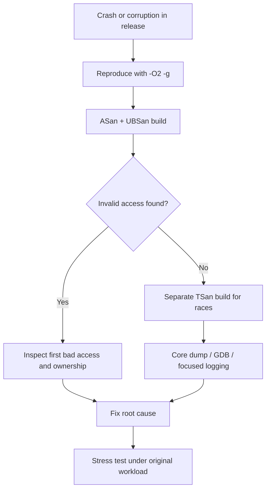

# Diagnose Heap Corruption That Disappears in Debug Builds — C++11 / Linux

## 60-second interview answer

When heap corruption occurs only in release builds, I suspect undefined behavior: out-of-bounds writes, use-after-free, double-free, uninitialized reads, or data races. Debug builds change layout, optimization, and timing, so they can mask the bug. I reproduce with release-like optimization and symbols (`-O2 -g`), then use AddressSanitizer and UndefinedBehaviorSanitizer to locate the first invalid access. For suspected concurrency, I use a separate ThreadSanitizer build. I inspect ownership and allocation history, fix the original violation, and rerun the production-like stress workload.

## Why debug builds may appear fine

| Cause | Effect |
|---|---|
| Different memory layout | Overwrites hit different locations |
| Optimizations | Undefined behavior manifests differently |
| Different thread scheduling | Race windows shift |
| Uninitialized memory | Values depend on layout and previous usage |
| Debug allocators | Guard regions and fill patterns can change symptoms |

A successful debug run does not prove memory safety.

## Simple diagnostic flow



## C++11 example: heap buffer overflow

```cpp
#include <iostream>

int main() {
    int* data = new int[10];

    for (int i = 0; i <= 10; ++i) {
        data[i] = i; // BUG: data[10] is out of bounds
    }

    std::cout << data[0] << "\n";
    delete[] data;
}
```

Valid indices are 0 through 9. Writing element 10 is undefined behavior and may silently corrupt nearby memory.

## Build and run with sanitizers

```bash
# Release-like optimization plus debug symbols
 g++ -std=c++11 -O2 -g -fsanitize=address,undefined \
    -fno-omit-frame-pointer main.cpp -o app
./app

# Separate build for concurrency races
 g++ -std=c++11 -O1 -g -pthread -fsanitize=thread \
    -fno-omit-frame-pointer main.cpp -o app_tsan
./app_tsan
```

Do not combine ASan and TSan in the same executable.

## If instrumentation masks the problem

- Preserve production-like input, optimization level, and concurrency.
- Capture core dumps: `ulimit -c unlimited` and `gdb ./app core`.
- In GDB: `bt full`, `thread apply all bt`, `info registers`.
- Set hardware watchpoints when the corrupted address can be reproduced.
- Run Valgrind Memcheck on a smaller reproducer; it can be much slower.
- Add narrow logging around allocations, frees, and object ownership changes.
- Do not assume a crash in `malloc()` or `free()` means the allocator caused the corruption.

## Exception safety and ownership considerations

Prefer `std::vector`, `std::unique_ptr`, and scoped locks over manual buffer sizes and raw ownership. However, RAII alone cannot prevent an out-of-bounds write or an unsynchronized data race. Confirm object lifetime, bounds, and thread synchronization separately.

## Principal Engineer interview questions

1. **Why does it crash in `free()`?** An earlier write may have corrupted allocator metadata; detection happens later.
2. **Does `-O2` introduce the bug?** It often changes how existing undefined behavior manifests.
3. **Can a race corrupt the heap?** Yes, particularly with concurrent container mutations or unsafe lifetime management.
4. **Does ASan detect everything?** No; it catches many memory violations but has blind spots and changes execution timing.
5. **Why use `-g` with `-O2`?** Preserve release-like behavior while retaining symbols for stack traces.
6. **Why separate ASan and TSan?** They are incompatible instrumentation modes.
7. **What should be fixed first?** The first invalid access, not the later crash site.

## Whiteboard recall sheet

**Reproduce → `-O2 -g` → ASan/UBSan → TSan separately → Find first bad access → Fix → Stress-test**

**Key distinction:** Heap corruption is often detected much later than the write that caused it.
