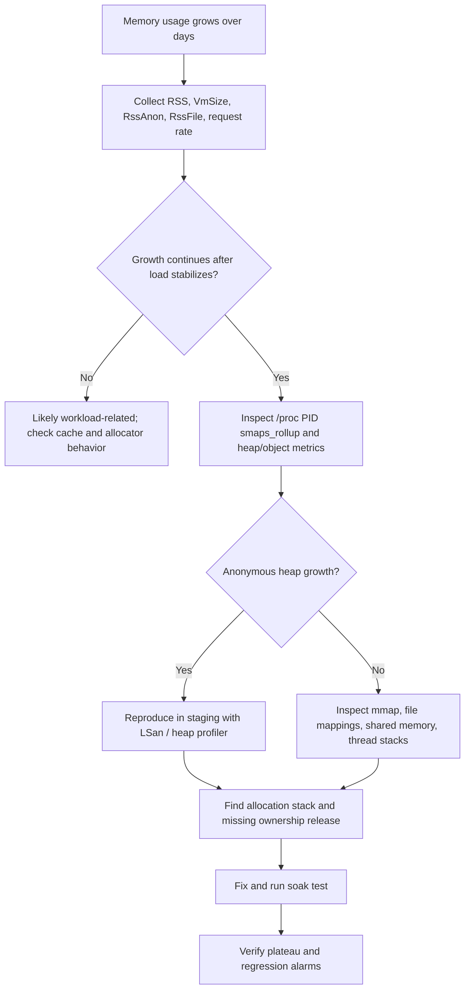
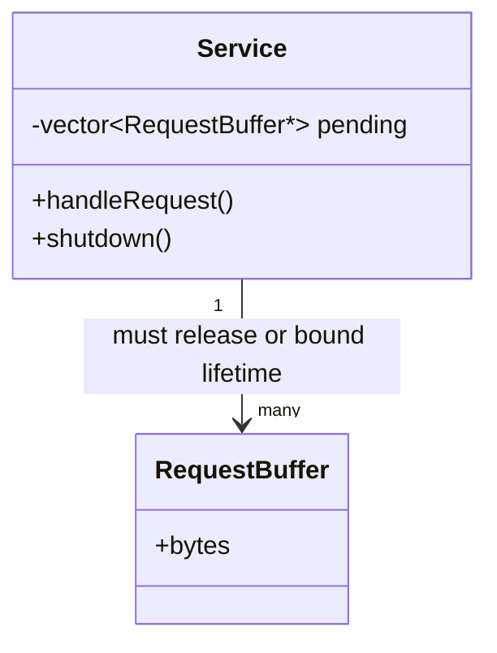

# Diagnose a Memory Leak in a Service Running for Weeks

**Interview level:** Senior / Principal C++ Engineer  
**Environment:** Linux, C++11/C++14  
**Goal:** Diagnose safely, identify the owner of growing memory, fix it, and verify the fix.

## 1. 60-second spoken answer

> First, I would establish whether memory is genuinely leaking or whether RSS is increasing because of caching, allocator fragmentation, memory-mapped files, or a growing workload. I would graph RSS, virtual memory, anonymous memory, allocation rate, request rate, and object counts over several days. I would correlate memory growth with traffic and deployments. Next, I would inspect `/proc/<pid>/status` and `smaps_rollup` to distinguish anonymous heap growth from file-backed mappings. On a reproducible staging workload, I would use AddressSanitizer/LeakSanitizer, Valgrind, or heap profiling to find allocation call stacks that remain live. I would check ownership bugs such as missing deletes, retained containers, shared_ptr cycles, unbounded queues, and thread-local caches. I would fix the root cause with RAII or bounded retention, then run a long soak test and verify memory stabilizes under a steady workload. In production, I would avoid invasive tools until their overhead and operational risk are understood.

## 2. Requirements

- Service must remain available during initial diagnosis.
- Distinguish **true leaks** from **legitimate retained memory**.
- Correlate memory with time, workload, and deployment changes.
- Obtain actionable allocation/ownership evidence.
- Fix and validate under representative sustained load.

## 3. Simple diagnostic design



### Minimal ownership diagram



**Design principle:** Every allocation needs a clear owner and an explicit release condition. A cache or queue can retain memory forever without being a traditional unreachable-memory leak.

## 4. What to measure first

| Metric | What it tells you | Caution |
|---|---|---|
| RSS / VmRSS | Resident process pages | Growth alone does not prove a leak |
| RssAnon | Anonymous resident memory | Often heap/stack, but not only heap |
| RssFile | File-backed resident pages | Can increase due to mappings |
| VmSize | Virtual address space | Not equal to committed RAM |
| Allocation rate / live bytes | Allocation churn and retention | Requires instrumentation |
| Queue/cache sizes | Unbounded retention | Often the root cause |
| Requests/sec, concurrency | Workload correlation | Compare under similar loads |

### Linux commands (replace PID)

```bash
PID=12345
ps -p "$PID" -o pid,etime,rss,vsz,%mem,cmd
cat /proc/$PID/status | grep -E 'VmRSS|VmSize|RssAnon|RssFile|RssShmem|Threads'
cat /proc/$PID/smaps_rollup
pmap -x "$PID" | tail -n 5
```

**Quick time-series sampling:**

```bash
PID=12345
while kill -0 "$PID" 2>/dev/null; do
    date -Is
    grep -E 'VmRSS|RssAnon|RssFile|VmSize' /proc/$PID/status
    sleep 60
done
```

Also graph application counters: active requests, queued jobs, cache entries, live connections, and per-request buffer sizes. Record deploy times and traffic changes.

## 5. A simple C++11 leak example

### Buggy service code

```cpp
#include <iostream>
#include <vector>

struct RequestBuffer {
    char data[4096];
};

class Service {
    std::vector<RequestBuffer*> buffers_;
public:
    void handleRequest() {
        RequestBuffer* buffer = new RequestBuffer();
        buffers_.push_back(buffer); // Retained indefinitely
    }
};

int main() {
    Service service;
    for (int i = 0; i < 100000; ++i)
        service.handleRequest();
    std::cout << "Processed requests\n";
}
```

**Diagnosis:** `buffers_` grows on every request. Even though the vector itself is destroyed at shutdown, the pointed-to `RequestBuffer` objects are never deleted. During execution this is unbounded retention; at shutdown it becomes leaked allocation.

### Simple fixed version: scoped ownership

```cpp
#include <iostream>
#include <memory>

struct RequestBuffer {
    char data[4096];
};

class Service {
public:
    void handleRequest() {
        std::unique_ptr<RequestBuffer> buffer(new RequestBuffer());
        // Process request here; buffer automatically freed on return.
        buffer->data[0] = 'X';
    }
};

int main() {
    Service service;
    for (int i = 0; i < 100000; ++i)
        service.handleRequest();
    std::cout << "Processed requests\n";
}
```

**Why this fixes it:** RAII binds the buffer lifetime to the request handler. If the request must be asynchronous, transfer ownership explicitly into the queued task and bound the queue.

## 6. Tools: what to run and where

### AddressSanitizer / LeakSanitizer (staging or reproducible test)

```bash
g++ -std=c++11 -g -O1 -fno-omit-frame-pointer \
    -fsanitize=address leak.cpp -o leak_asan
ASAN_OPTIONS=detect_leaks=1 ./leak_asan
```

**Use for:** Detecting many memory safety bugs and leaked allocations at process exit. **Limitations:** It needs an instrumented build, has runtime/memory overhead, and leak detection is usually reported at termination, so it is not the first choice for a production service that must remain live.

### Valgrind Memcheck (small staging reproduction)

```bash
g++ -std=c++11 -g -O0 leak.cpp -o leak
valgrind --leak-check=full --show-leak-kinds=all ./leak
```

**Use for:** Allocation stacks and leak classifications. **Limitations:** Very high overhead; typically inappropriate for full-load production.

### Heap profiling

Use a suitable allocation profiler (for example, heaptrack or allocator-specific profiling) on a staging reproduction. Compare **live allocations at two points in time**, not only cumulative allocated bytes. Confirm tool compatibility and production overhead before attachment.

### If memory growth is not heap-related

Inspect `mmap()` allocations, file-backed pages, shared memory, thread count/stacks, allocator arenas, and native libraries. Also investigate GPU/device memory if relevant to the service.

## 7. Typical causes and how to recognize them

| Cause | Symptom | Fix |
|---|---|---|
| Missing `delete` | Live heap allocations never freed | RAII / `unique_ptr` |
| Unbounded cache | Live objects grow with unique keys | Capacity / TTL / eviction |
| Queue backlog | Memory tracks pending work | Backpressure and queue limits |
| `shared_ptr` cycle | Reference counts never reach zero | `weak_ptr` for back-references |
| Thread-local retention | Memory grows with threads | Bound caches and thread lifetimes |
| Fragmentation / allocator arenas | RSS remains high despite frees | Profile allocator; assess reuse/trim |
| File mappings | RssFile or mapped regions grow | Audit mmap/unmap and mapping lifetime |

## 8. Safe production investigation

1. Confirm memory pressure, OOM risk, and whether the issue is isolated to a release or instance.
2. Collect low-overhead `/proc` and application metrics; avoid dumping sensitive heap contents without authorization.
3. Compare a growing instance with a healthy instance under comparable traffic.
4. Capture reproducible workload characteristics and run an instrumented staging build.
5. Deploy the smallest ownership/retention fix behind a controlled rollout.
6. Run a multi-day soak test; compare memory after warm-up at similar request rates.
7. Alert on **sustained growth slope** and OOM headroom, not just a single RSS threshold.

**Validation:** A successful fix means live-object counts stabilize and memory behavior is bounded under a steady workload. RSS may not fall immediately after objects are freed because allocators can retain pages for reuse.

## 9. Principal Engineer follow-up questions

**Q1. Does increasing RSS prove a leak?**  
No. Caches, fragmentation, allocator arenas, mapped files, and legitimate active work can increase RSS.

**Q2. What is the difference between a leak and unbounded retention?**  
A leak is memory no longer releasable through intended ownership paths. Unbounded retention may remain reachable, but the application keeps more memory than intended.

**Q3. Why not attach Valgrind to the live service?**  
Memcheck generally requires launching the process under Valgrind and incurs substantial slowdown. Reproduce in staging first.

**Q4. Why might LeakSanitizer report nothing while RSS grows?**  
Objects may remain reachable through containers, caches, global pointers, or other owners. RSS growth may also be non-heap memory or allocator behavior.

**Q5. How would you debug a leak that appears only after two weeks?**  
Collect long-duration metrics and allocation/live-object counters, correlate with periodic jobs or rare paths, replay the triggering workload, and profile live allocations over time.

**Q6. What if the leak comes from a third-party library?**  
Isolate allocation stacks and library versions, check API ownership contracts, build a minimal reproducer, and consider a library update or containment while tracking the fix.

**Q7. How do you handle a `shared_ptr` cycle?**  
Use `std::weak_ptr` for a non-owning back-reference and document which object owns which.

**Q8. What if you cannot restart production?**  
Start with noninvasive metrics and supported low-overhead profiling, then use a canary or staging replica for intrusive instrumentation.

## 10. Whiteboard recall sheet

**Observe → Classify → Reproduce → Attribute → Fix → Verify**

- **Observe:** RSS, RssAnon, RssFile, workload, object counts.
- **Classify:** True leak, unbounded retention, fragmentation, mmap, or workload growth.
- **Reproduce:** Staging, realistic traffic, long-running soak test.
- **Attribute:** Allocation stack + owner + release condition.
- **Fix:** RAII, correct destruction, bounded queues/caches, `weak_ptr` cycles.
- **Verify:** Live memory plateaus; no new regressions; rollout safely.

**Best one-liner:** “I don't diagnose a memory leak from RSS alone; I trace live allocations back to their owners and prove the fix with a sustained workload.”
