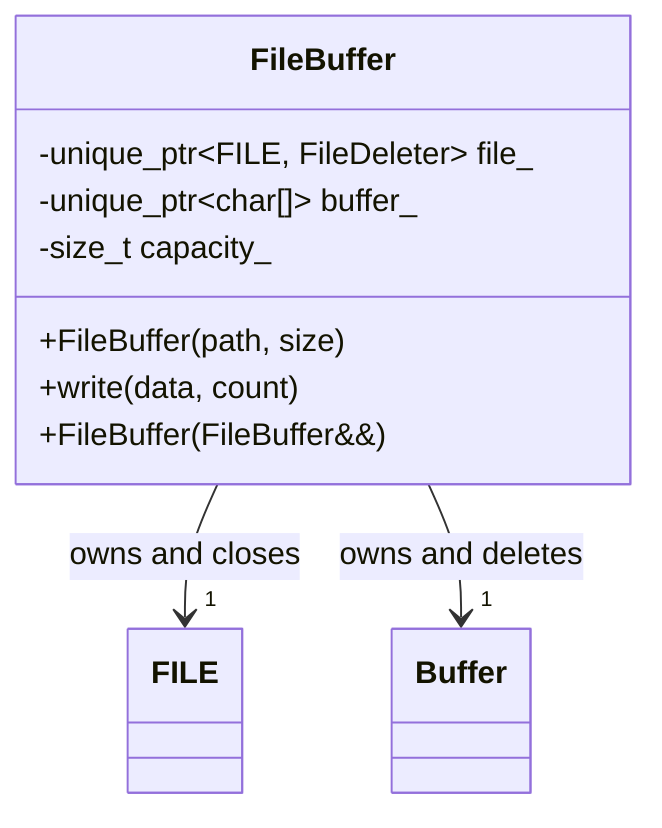
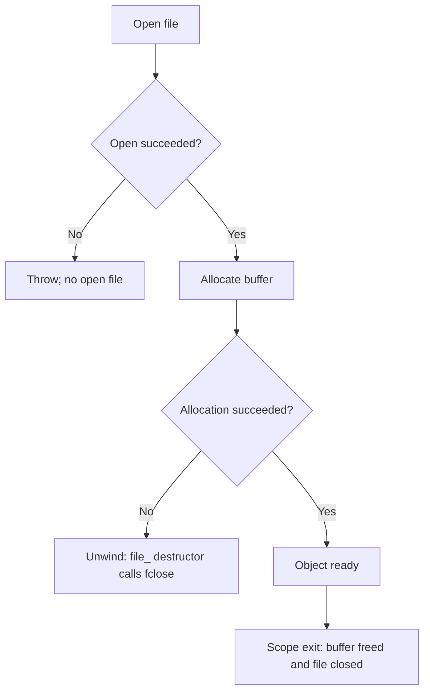

# Exception-Safe Class Managing Multiple Resources — C++11

## 60-second interview answer

> I use RAII for each owned resource. For example, a class may own a file and a heap buffer. I store the file in a `unique_ptr` with an `fclose` deleter and the buffer in `unique_ptr<char[]>`. If allocation of the buffer throws, the already-constructed file member closes automatically. I delete copying and support moving to transfer ownership. The key is that fully constructed members are destroyed during constructor unwinding even though the enclosing object's destructor is not called.

## Simple UML



## Complete C++11 example

```cpp
#include <cstdio>
#include <cstddef>
#include <memory>
#include <stdexcept>
#include <utility>

class FileBuffer {
    std::unique_ptr<FILE, decltype(&std::fclose)> file_;
    std::unique_ptr<char[]> buffer_;
    std::size_t capacity_;

public:
    FileBuffer(const char* filename, std::size_t size)
        : file_(std::fopen(filename, "wb"), &std::fclose),
          buffer_(nullptr), capacity_(size) {
        if (!file_)
            throw std::runtime_error("Cannot open file");
        buffer_.reset(new char[size]); // may throw: file_ closes automatically
    }

    FileBuffer(const FileBuffer&) = delete;
    FileBuffer& operator=(const FileBuffer&) = delete;
    FileBuffer(FileBuffer&&) = default;
    FileBuffer& operator=(FileBuffer&&) = default;

    void write(const char* data, std::size_t count) {
        if (!file_ || count > capacity_ || (count && !data))
            throw std::runtime_error("Invalid write");
        for (std::size_t i = 0; i < count; ++i)
            buffer_[i] = data[i];
        if (std::fwrite(buffer_.get(), 1, count, file_.get()) != count)
            throw std::runtime_error("Write failed");
    }
};

int main() {
    FileBuffer resource("output.txt", 1024);
    resource.write("Hello", 5);
}
```

Compile: `g++ -std=c++11 -Wall -Wextra -pedantic main.cpp -o app && ./app`

## Exception flow



## Guarantees and limitations

- **Constructor failure:** No file or heap-buffer leak; fully constructed RAII members clean up automatically.
- **Destructor:** Implicit destructor releases the buffer and closes the file.
- **Copying:** Disabled; prevents double ownership.
- **Moving:** Transfers ownership. Do not use a moved-from instance for I/O; `write()` checks for an empty file owner.
- **`write()` failure:** May partially modify the file. RAII gives cleanup, not transactional file writes.
- **Close errors:** `fclose()` errors are not reported by the deleter. Production code may provide an explicit checked `close()`/`flush()` operation when persistence matters.

## Interview questions

**Why not use raw `FILE*` and `char*`?** Manual cleanup is easy to miss when the second acquisition throws.

**Does the class destructor run if its constructor throws?** No. Already-constructed members and bases are destroyed.

**What is the basic exception guarantee?** No resource leaks and valid object invariants, though external file contents may have changed.

**Why disable copy?** These are uniquely owned resources; copying the raw handles would cause duplicate cleanup.

**What if the buffer allocation throws `std::bad_alloc`?** The `file_` member's destructor closes the file during stack unwinding.

## Whiteboard recall

**One RAII owner per resource → constructor acquires → member unwinding cleans up → copying disabled → moving transfers ownership.**
