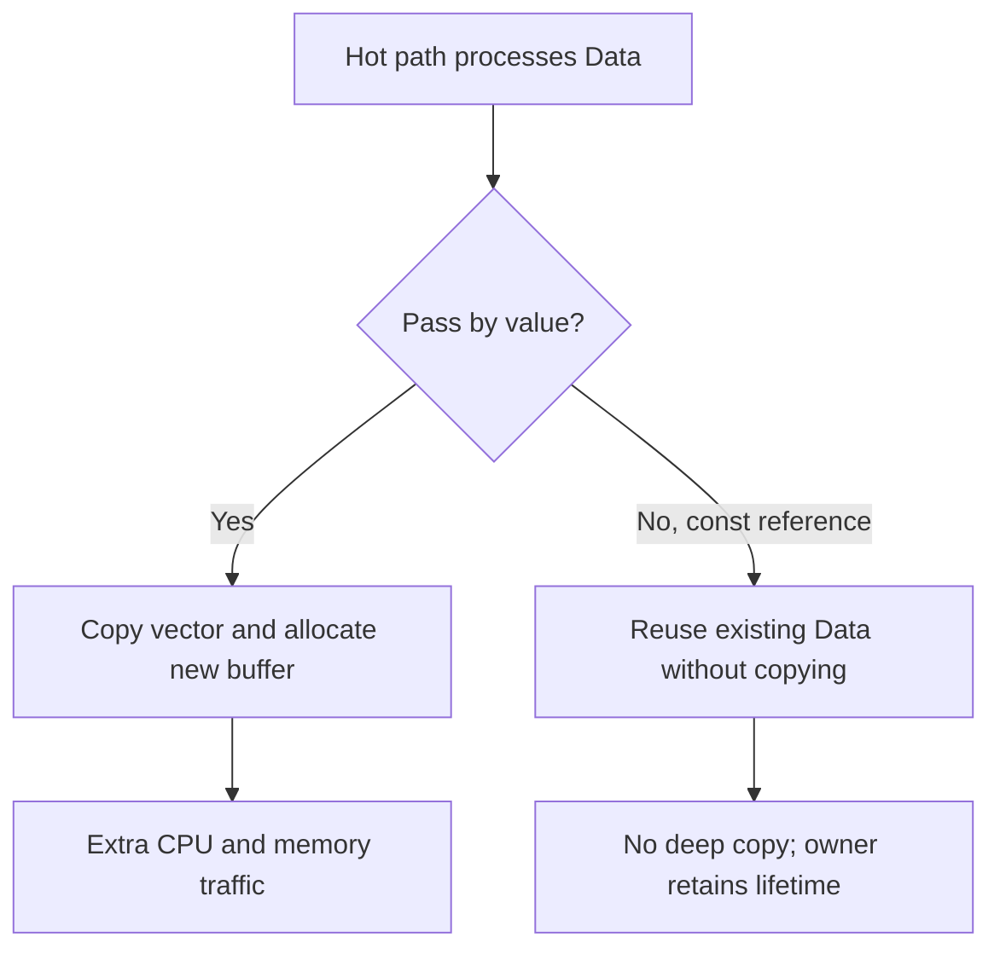

# Identify Accidental Deep Copies in a Hot Path — C++11

## 60-second interview answer

When a C++ service shows unexpected CPU usage or allocations in a hot path, I look for accidental deep copies of large vectors, strings, and owning objects. I first profile CPU and allocations, then inspect pass-by-value parameters, range-for loops, local `auto` declarations, and container insertions. I instrument copy and move constructors to count operations, replace unnecessary copies with `const T&`, and use moves only when ownership transfer is intended. Finally, I benchmark under a representative workload. Returning by value is often efficient because of copy elision and moves, so I don't automatically replace returns with references.

## LLD and ownership diagram



`Data b = a` copies a `std::vector`'s elements into a separate buffer. `const Data& b = a` refers to the original object and requires it to remain alive.

## Common accidental copies

| Site | Copies | Avoids copy |
|---|---|---|
| Function argument | `void process(Data d)` | `void process(const Data& d)` |
| Range loop | `for (auto x : items)` | `for (const auto& x : items)` |
| Local alias | `auto x = data;` | `const auto& x = data;` |
| Transfer to vector | `v.push_back(obj)` | `v.push_back(std::move(obj))` if `obj` is no longer needed |

Pass small trivial types by value. Returning a large object by value is often efficient thanks to copy elision or moving; avoid blindly writing `return std::move(local);`.

## Complete simple C++11 example

```cpp
#include <iostream>
#include <vector>
#include <utility>
#include <cstddef>

struct Data {
    std::vector<int> values;

    explicit Data(std::size_t n) : values(n, 42) {}

    Data(const Data& other) : values(other.values) {
        std::cout << "Deep copy!\n";
    }

    Data(Data&& other) noexcept : values(std::move(other.values)) {
        std::cout << "Move!\n";
    }
};

void slow(Data data) {
    std::cout << data.values.size() << '\n';
}

void fast(const Data& data) {
    std::cout << data.values.size() << '\n';
}

int main() {
    Data data(1000000);
    slow(data);  // Copies one million integers
    fast(data);  // No copy
}
```

Compile: `g++ -std=c++11 -O2 -Wall -Wextra example.cpp -o example`

Expected output:

```text
Deep copy!
1000000
1000000
```

## Diagnosing in Linux

```bash
# Sample CPU call stacks; look for memcpy, copy constructors and allocation
perf record -g -- ./app
perf report

# Build with debug symbols and optimization
 g++ -std=c++11 -O2 -g -Wall -Wextra -Wpessimizing-move app.cpp -o app
```

Optimized functions can be inlined; use allocation profiling and temporary copy-constructor counters to supplement CPU profiles. If counting copies across threads, use `std::atomic`.

## Exception safety and tradeoffs

- `const T&` avoids copies but does not own the object: the caller must keep it alive.
- `std::move()` only enables move overload resolution; it does not guarantee a move or make concurrent access safe.
- Moving a `std::vector` is normally cheap, but moving arbitrary user-defined objects can be expensive.
- `noexcept` move constructors can help containers prefer moving over copying during growth.
- Measure throughput, tail latency, allocations and copy counts before and after changes.

## Interview questions

**Is `const T&` always better?** No. Small scalars are better passed by value, and pass-by-value can be useful when the callee needs ownership.

**Does `std::move()` always avoid copies?** No. If no suitable move constructor exists, a copy may occur.

**Why `noexcept` on a move constructor?** Containers may choose copying over a potentially throwing move to preserve exception guarantees.

**Should a function return `const T&` instead of `T`?** Not without a lifetime guarantee; return-by-value often benefits from elision and moves.

**How do you prove improvement?** Compare representative benchmarks, copy counts, allocation profiles and CPU samples.

## Whiteboard recall sheet

**Profile → Find copy sites → Count copies → Change to references/moves where safe → Benchmark.**
