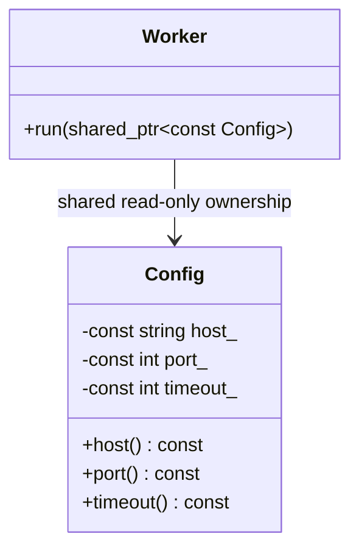
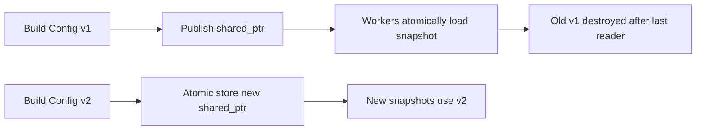

# Immutable Configuration Shared Across Threads — C++11

## 60-second interview answer

Create a `Config` object fully in its constructor and never mutate it. Share it with workers through `std::shared_ptr<const Config>` so the object remains alive while workers read it. After safe publication, concurrent read-only access to immutable fields needs no mutex. To reload, construct a fresh Config and atomically publish a new shared pointer using C++11 `std::atomic_store` / `std::atomic_load`. Each worker retains a consistent snapshot; old configurations are destroyed after their last reader finishes.

## Simple LLD



## Complete C++11 example (including reload)

```cpp
#include <iostream>
#include <string>
#include <memory>
#include <thread>
#include <vector>
#include <mutex>

class Config {
    const std::string host_;
    const int port_;
    const int timeout_;
public:
    Config(const std::string& host, int port, int timeout)
        : host_(host), port_(port), timeout_(timeout) {}
    const std::string& host() const { return host_; }
    int port() const { return port_; }
    int timeout() const { return timeout_; }
};

// All concurrent reads/writes of this variable use atomic shared_ptr functions.
std::shared_ptr<const Config> currentConfig =
    std::make_shared<Config>("server1", 8080, 30);

std::mutex printMutex;

void worker(int id) {
    // One consistent, lifetime-safe snapshot for this operation.
    std::shared_ptr<const Config> config = std::atomic_load(&currentConfig);
    std::lock_guard<std::mutex> lock(printMutex);
    std::cout << "Worker " << id << ": " << config->host()
              << ':' << config->port()
              << " timeout=" << config->timeout() << '\n';
}

int main() {
    std::vector<std::thread> threads;
    for (int i = 0; i < 3; ++i)
        threads.emplace_back(worker, i);

    // Build a complete replacement before publishing it.
    std::shared_ptr<const Config> replacement =
        std::make_shared<Config>("server2", 9090, 60);
    std::atomic_store(&currentConfig, replacement);

    for (auto& thread : threads)
        thread.join();

    worker(99); // Guaranteed to observe the replacement in this example.
}
```

Compile: `g++ -std=c++11 -Wall -Wextra -pthread immutable_config.cpp -o immutable_config`

Workers 0–2 can observe either complete version depending on scheduling. Worker 99 sees the replacement. No worker sees a partially updated configuration.

## Ownership and reload flow



## Rules and tradeoffs

- `const` members and no mutating methods keep this example immutable. If the object holds pointers to mutable external data, `const` alone is not sufficient for deep immutability.
- `shared_ptr<const Config>` protects object lifetime and prevents mutation through that pointer. It does not synchronize mutable objects referenced by the config.
- Atomic `shared_ptr` load/store publishes the pointer safely in C++11; it is not necessarily lock-free.
- Do not access `currentConfig` with plain reads/writes concurrently with atomic operations.
- A worker should load once per logical operation to keep a consistent version.
- Keep costly validation and construction outside the publication step.

## Interview questions

**Why not a global mutable Config?** Readers can observe partial updates or data races.

**Why `shared_ptr`?** Workers can retain the old version until finished.

**Why `const`?** Prevents accidental changes through the shared interface.

**Do reads require a lock?** Not on immutable fields, after safe publication. Pointer replacement still requires atomic operations or a lock.

**Can a worker see an old version?** Yes; that is intentional snapshot behavior.

**Is it lock-free?** Not necessarily; the C++11 atomic shared-pointer functions may use internal locks.

## Whiteboard recall

**Construct once → Publish safely → Atomic snapshot → Read without mutation → Replace whole object → Old version dies after last reader.**
