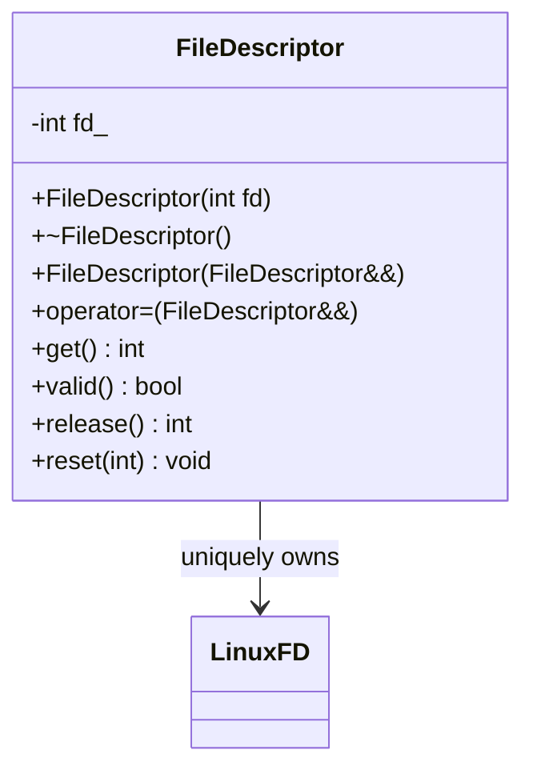
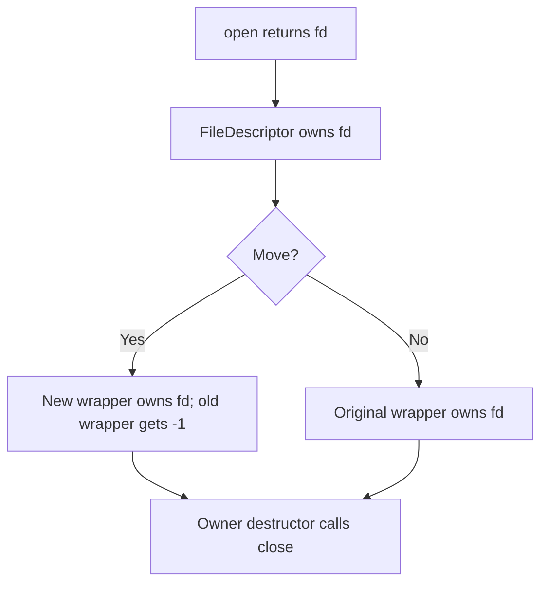

# Linux File Descriptor RAII Wrapper — Simple C++11

## 60-second interview answer

I would use RAII: wrap an integer Linux file descriptor in a small class. The destructor calls `close()` automatically, so early returns and exceptions do not leak descriptors. Copying is disabled to prevent double-close; move construction and move assignment transfer unique ownership. The interface exposes `get()`, `valid()`, `release()`, and `reset()`. `-1` means invalid; descriptor 0 is valid.

## Simple LLD



## Complete C++11 code

```cpp
#include <unistd.h>
#include <fcntl.h>
#include <utility>
#include <iostream>

class FileDescriptor {
    int fd_;
public:
    explicit FileDescriptor(int fd = -1) noexcept : fd_(fd) {}

    ~FileDescriptor() {
        if (fd_ != -1) ::close(fd_);
    }

    FileDescriptor(const FileDescriptor&) = delete;
    FileDescriptor& operator=(const FileDescriptor&) = delete;

    FileDescriptor(FileDescriptor&& other) noexcept : fd_(other.release()) {}

    FileDescriptor& operator=(FileDescriptor&& other) noexcept {
        if (this != &other) reset(other.release());
        return *this;
    }

    int get() const noexcept { return fd_; }
    bool valid() const noexcept { return fd_ != -1; }

    int release() noexcept {
        int old = fd_;
        fd_ = -1;
        return old;
    }

    void reset(int newFd = -1) noexcept {
        if (fd_ == newFd) return;
        int old = fd_;
        fd_ = newFd;
        if (old != -1) ::close(old);
    }
};

int main() {
    FileDescriptor file(::open("example.txt", O_WRONLY | O_CREAT | O_TRUNC, 0644));
    if (!file.valid()) {
        std::cerr << "open() failed\n";
        return 1;
    }

    const char text[] = "Hello from RAII\n";
    if (::write(file.get(), text, sizeof(text) - 1) == -1) {
        std::cerr << "write() failed\n";
        return 1;
    }

    FileDescriptor moved(std::move(file));
    std::cout << "Original valid: " << file.valid() << "\n";
    std::cout << "Moved valid: " << moved.valid() << "\n";
}
```

Compile: `g++ -std=c++11 -Wall -Wextra -pedantic main.cpp -o app`

Expected output:

```text
Original valid: 0
Moved valid: 1
```

## Ownership flow



## Important details and tradeoffs

- `-1` represents invalid; `0` is a valid file descriptor.
- Never copy a unique owning wrapper: double-close can close a *reused* descriptor belonging to someone else.
- `release()` gives ownership to the caller without closing; `reset()` closes the old descriptor and adopts a new one.
- `get()` is a borrowed descriptor: callers must not close it while the wrapper owns it.
- `write()` can perform partial writes; production code should loop until all bytes are written and handle `EINTR` and `EAGAIN` as appropriate.
- On Linux, do not blindly retry `close()` after `EINTR`: the descriptor number may already have been released and reused.
- `close()` failures cannot be reported from a nonthrowing destructor; explicitly close and check when errors matter.
- This class provides ownership, not synchronization between threads sharing the descriptor.
- `reset(get())` is a no-op; passing the same descriptor number from another owner is still an ownership bug.

## Interview questions

**Why RAII?** Deterministic cleanup, including exceptions and early returns.

**Why delete copy operations?** To avoid two wrappers closing one descriptor.

**Why support moves?** Ownership transfer without `dup()`.

**What does `release()` do?** Detaches the descriptor without closing it.

**Does `std::move` duplicate the kernel descriptor?** No, it transfers the integer ownership in this wrapper.

**Why is descriptor zero valid?** Standard input commonly uses descriptor 0.

## Whiteboard recall sheet

`int fd_ = -1` → destructor closes → delete copy → move uses `release()` → `get / valid / release / reset`.
