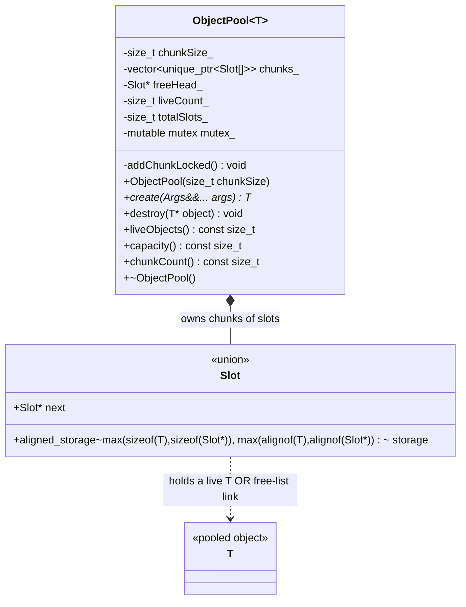
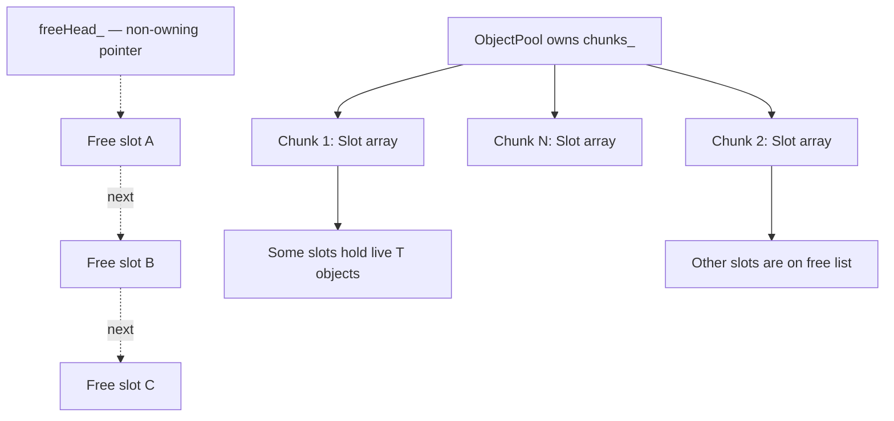
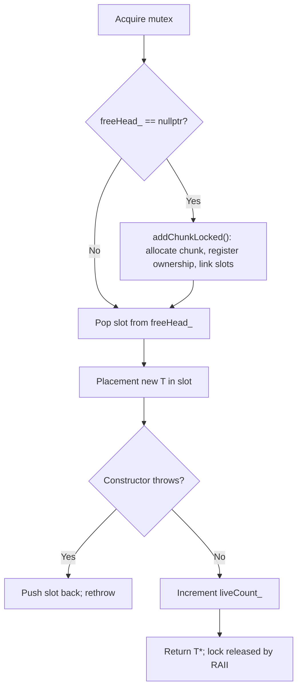
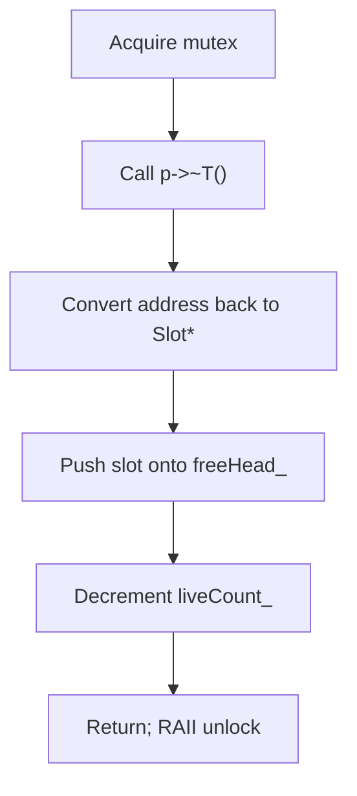
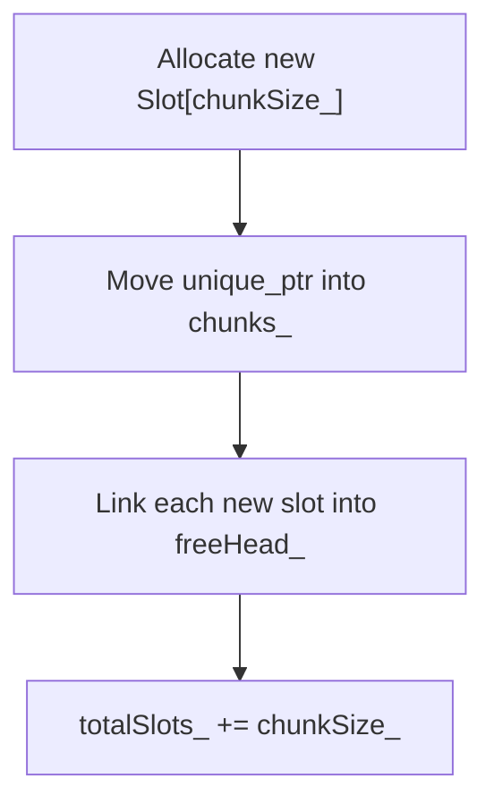

# Design a Memory Pool for Millions of Small Objects

**Level:** Senior / Principal Software Engineer  
**Language:** C++11 (also compiles with C++14)  
**Design:** Thread-safe, fixed-size, typed object pool backed by chunks and an intrusive free list.

## 60-second spoken answer — Start Here

> I would build a typed, fixed-size object pool using chunks of aligned slots and an intrusive singly linked free list. The pool owns each chunk through a unique pointer. On allocation, I pop a free slot and construct the object using placement new; on release, I explicitly invoke the destructor and push the slot back onto the free list. This avoids per-object heap allocation and provides amortized constant-time slot management. A mutex protects the shared free list and metadata, while callers are responsible for not accessing an object after destruction. Returned addresses remain stable as the pool grows because moving the vector of unique pointers does not move the chunks. For multicore scalability, I would benchmark contention and consider thread-local magazines or sharded pools, while documenting lifetime, double-free, and shutdown contracts.


> **Interview recall:** **Pool = Chunks + Slots + Free List + Mutex + Live Count**.  
> **CREATE = Lock → Reuse/Grow → Placement new → Return**.  
> **DESTROY = Lock → Destructor → Push to Free List**.

---

# PART I — LOW-LEVEL DESIGN

## 1. Problem statement and requirements

Allocate and recycle **millions of small objects** efficiently without calling general-purpose `new`/`delete` for every object. Object construction and destruction must still follow normal C++ semantics.

### Functional requirements
- `create(args...) -> T*`: acquire a free slot and construct a `T` in it.
- `destroy(T*)`: call `T`'s destructor and recycle its slot.
- Grow by allocating another chunk when no free slot exists.
- Expose `liveObjects()`, `capacity()`, and `chunkCount()` for diagnostics.

### Non-functional requirements
- Amortized O(1) slot allocation and O(1) recycling (not counting `T`'s constructor/destructor or lock contention).
- Proper `alignof(T)` alignment; no per-object heap allocation by the pool.
- Concurrent `create` and `destroy` calls are serialized by a mutex.
- Minimal metadata overhead: free-list pointer occupies the *same slot storage* as a `T`, but only while the slot is free.
- Explicit lifetime and ownership contract; no unsafe references after destruction.

### Assumptions and scope
- All pooled objects have the same type `T` and therefore the same size/alignment.
- `T` has a **non-throwing destructor** (required by this implementation).
- Objects are returned to the **same pool** that created them, exactly once.
- The pool outlives all objects and all threads using it; it must have **zero live objects at destruction**.
- No automatic trimming of chunks. Memory is retained for reuse until the pool is destroyed.
- A single global mutex is the baseline; later sections discuss scaling alternatives.

## 2. UML class diagram



**C++ type aliases / members to remember**:

| Member | Type | Purpose |
|---|---|---|
| `Slot` | `union` | Storage for either free-list pointer or live `T` |
| `chunks_` | `vector<unique_ptr<Slot[]>>` | Owns every allocated chunk |
| `freeHead_` | `Slot*` | Head of singly linked free list; **non-owning** |
| `chunkSize_` | `size_t` | Number of slots added on growth |
| `liveCount_` | `size_t` | Constructed objects not yet destroyed |
| `totalSlots_` | `size_t` | Total allocated slot capacity |
| `mutex_` | `mutable std::mutex` | Protects metadata and slot transitions |

### Ownership diagram



The pool owns **raw slot memory**. The caller gets a **borrowed `T*`** to a constructed object, not ownership of the allocation. The caller must return it via `pool.destroy(p)`, **never `delete p`**.

## 3. Memory layout and why a union matters

A naïve node with `T value; Node* next;` pays for both fields on *every* slot. Instead, a union overlays storage:

```cpp
union Slot {
    Slot* next;              // meaningful only while slot is FREE
    Storage storage;         // storage occupied by T while slot is LIVE
    Slot() {}
    ~Slot() {}
};
```

```text
Chunk allocated once:
+-----------+-----------+-----------+-----------+---------+
|  Slot 0   |  Slot 1   |  Slot 2   |  Slot 3   |  ...    |
+-----------+-----------+-----------+-----------+---------+
    LIVE        FREE        LIVE        FREE
    T object    next -----> T object    next -----> ...

FREE: bytes can hold a pointer to the next free slot.
LIVE: bytes hold a constructed T (placement new).
```

Each slot occupies approximately `max(sizeof(T), sizeof(Slot*))`, rounded for alignment. For a 16-byte object with 8-byte pointers and suitable alignment, slot storage can be 16 bytes. The vector of chunk pointers is comparatively tiny when chunks are large.

**Alignment:** `std::aligned_storage<...>::type` (C++11) ensures storage alignment sufficient for `T` and `Slot*`. A custom allocator may be needed for special platform-specific over-aligned allocation requirements; this example relies on standard C++11 allocation support.

## 4. Object lifecycle / state machine

```mermaid
stateDiagram-v2
    [*] --> Free : chunk created
    Free --> Reserved : pop freeHead_
    Reserved --> Live : placement new T(args...)
    Reserved --> Free : constructor throws; rollback
    Live --> Free : call ~T(); push to freeHead_
    Free --> [*] : pool destroyed (no live objects)
```



- **Allocation is not construction.** `new Slot[n]` reserves slot objects; `new (address) T(args...)` begins the lifetime of `T` in a slot.
- **Destruction is not deallocation.** `p->~T()` ends `T`'s lifetime, but the slot remains allocated and is reused.
- **Pool destruction** releases all chunks after every live object has already been destroyed.

## 5. Method flowcharts

### `create(args...)`



**Recall:** Lock → Grow if needed → Pop → Construct → Count → Return.

### `destroy(p)`



**Recall:** Lock → Destruct → Push → Decrement.

### `addChunkLocked()`



If allocation or vector growth throws, existing chunks and free-list links remain unchanged.

## 6. Ownership, lifetime, thread safety and validity

| Question | Design answer |
|---|---|
| Who owns memory? | `chunks_` owns the arrays via `unique_ptr<Slot[]>`. |
| Who owns a constructed object? | The pool controls storage; caller borrows the `T*` and must explicitly return it. |
| When does `T` begin to exist? | Successful placement `new (slot) T(...)`. |
| When does `T` cease to exist? | Explicit `p->~T()` in `destroy`. |
| Does `destroy` release memory to OS? | No; it returns the slot to the pool's free list. |
| Are live `T*` pointers stable when the pool grows? | Yes. Chunk arrays do not move when `vector<unique_ptr<Slot[]>>` reallocates. |
| What invalidates a `T*`? | Destroying that object; the same address may later be reused for another object. |
| Can `destroy` race with a thread using `*p`? | **No.** Caller must coordinate access to the object. Pool mutex protects pool metadata, not arbitrary object fields. |
| Can the pool be destroyed while threads use it? | **No.** Stop/join workers, return all objects, then destroy the pool. |
| Can `delete p` be used? | **No.** Use `pool.destroy(p)`. |

**ABA / stale pointer warning:** A freed slot can be immediately reused at the same address. An old `T*` can therefore appear to point to a valid address but refer to a *different lifetime*. This pool does not provide generation-checked handles; callers must enforce lifetime rules.

## 7. Thread safety and contention

The baseline uses a **single `std::mutex`** around allocation, construction, destruction and free-list updates. This keeps the design easy to prove correct and supports concurrent calls from multiple threads, though it serializes operations.

For millions of allocations across many CPU cores, measure contention. Potential improvements:

1. **Per-thread free lists / magazines:** most allocations avoid a global lock; periodically refill/drain from a central pool.
2. **Sharded pools:** assign objects to shards; address cross-thread frees carefully.
3. **Batch allocate/recycle:** amortize synchronization across many objects.
4. **Lock-free free list:** requires a robust ABA solution, memory reclamation strategy, and careful atomics; not the default interview implementation.
5. **NUMA-aware chunks:** allocate near threads and minimize remote memory traffic.

A global mutex is a correctness-first starting point, **not a claim of ideal multicore scalability**.

## 8. Complexity and memory costs

| Operation | Complexity | Notes |
|---|---|---|
| `create()` with free slot | O(1) | Plus constructor and lock waiting |
| `create()` on growth | O(chunkSize) | Linking new slots; amortized O(1) over a chunk |
| `destroy()` | O(1) | Plus destructor and lock waiting |
| `liveObjects()`, `capacity()` | O(1) | Lock-protected |
| `chunkCount()` | O(1) | Lock-protected |
| Memory | O(totalSlots × sizeof(Slot)) | Plus O(number of chunks) metadata |

Example: 1,000,000 slots × 16 bytes ≈ **15.26 MiB** of slot memory, excluding chunk bookkeeping and allocator overhead. A pool sized to peak demand retains its peak memory footprint until destruction.

---

# PART II — COMPLETE C++11 IMPLEMENTATION

## 9. Full runnable program

The following code uses **only C++11**. It includes a multithreaded smoke test, constructor/destructor tracking and basic reuse demonstration.

```cpp
#include <cassert>
#include <cstddef>
#include <iostream>
#include <memory>
#include <mutex>
#include <new>
#include <stdexcept>
#include <thread>
#include <type_traits>
#include <utility>
#include <vector>
#include <atomic>

template <typename T>
class ObjectPool {
private:
    // While free: stores next pointer.
    // While live: contains an object of type T.
    typedef typename std::aligned_storage<
        (sizeof(T) > sizeof(void*) ? sizeof(T) : sizeof(void*)),
        (alignof(T) > alignof(void*) ? alignof(T) : alignof(void*))
    >::type Storage;

    union Slot {
        Slot* next;
        Storage storage;

        Slot() : next(nullptr) {}
        ~Slot() {}
    };

    const size_t chunkSize_;
    std::vector<std::unique_ptr<Slot[]> > chunks_;
    Slot* freeHead_;
    size_t liveCount_;
    size_t totalSlots_;
    mutable std::mutex mutex_;

    // Caller MUST hold mutex_.
    void addChunkLocked() {
        std::unique_ptr<Slot[]> chunk(new Slot[chunkSize_]);
        Slot* raw = chunk.get();

        // Commit ownership before changing the free list.
        chunks_.push_back(std::move(chunk));

        for (size_t i = 0; i < chunkSize_; ++i) {
            raw[i].next = freeHead_;
            freeHead_ = &raw[i];
        }
        totalSlots_ += chunkSize_;
    }

public:
    explicit ObjectPool(size_t chunkSize = 4096)
        : chunkSize_(chunkSize),
          freeHead_(nullptr),
          liveCount_(0),
          totalSlots_(0) {
        if (chunkSize == 0)
            throw std::invalid_argument("chunkSize must be > 0");
    }

    ObjectPool(const ObjectPool&) = delete;
    ObjectPool& operator=(const ObjectPool&) = delete;
    ObjectPool(ObjectPool&&) = delete;
    ObjectPool& operator=(ObjectPool&&) = delete;

    template <typename... Args>
    T* create(Args&&... args) {
        std::lock_guard<std::mutex> lock(mutex_);

        if (freeHead_ == nullptr)
            addChunkLocked();

        Slot* slot = freeHead_;
        freeHead_ = slot->next;

        try {
            // Construct T in the preallocated, aligned slot.
            T* object = new (static_cast<void*>(slot))
                T(std::forward<Args>(args)...);
            ++liveCount_;
            return object;
        } catch (...) {
            // Constructor failed: restore slot to free list.
            slot->next = freeHead_;
            freeHead_ = slot;
            throw;
        }
    }

    void destroy(T* object) {
        if (object == nullptr)
            return;

        std::lock_guard<std::mutex> lock(mutex_);

        // Preconditions: object came from THIS pool, is live,
        // is not being used concurrently, and is destroyed once.
        object->~T(); // T's destructor must not throw.

        Slot* slot = reinterpret_cast<Slot*>(object);
        slot->next = freeHead_;
        freeHead_ = slot;
        --liveCount_;
    }

    size_t liveObjects() const {
        std::lock_guard<std::mutex> lock(mutex_);
        return liveCount_;
    }

    size_t capacity() const {
        std::lock_guard<std::mutex> lock(mutex_);
        return totalSlots_;
    }

    size_t chunkCount() const {
        std::lock_guard<std::mutex> lock(mutex_);
        return chunks_.size();
    }

    ~ObjectPool() {
        // PRECONDITION: no threads are using the pool.
        // All constructed T objects must already be destroyed.
        assert(liveCount_ == 0 && "Live objects remain in pool");
        // unique_ptr<Slot[]> automatically frees all chunks.
    }
};

struct SmallObject {
    int id;
    double value;

    SmallObject(int i, double v) : id(i), value(v) {}
    ~SmallObject() noexcept {}
};

int main() {
    ObjectPool<SmallObject> pool(1024);

    SmallObject* first = pool.create(1, 1.5);
    SmallObject* second = pool.create(2, 2.5);
    std::cout << "First: " << first->id << ", " << first->value << "\n";
    std::cout << "Live: " << pool.liveObjects() << "\n";

    pool.destroy(first);
    SmallObject* reused = pool.create(3, 3.5);
    std::cout << "Reused address: "
              << (static_cast<void*>(first) == static_cast<void*>(reused))
              << "\n";
    // Never dereference 'first' after destroy(first).

    pool.destroy(second);
    pool.destroy(reused);

    const int threadCount = 4;
    const int objectsPerThread = 10000;
    std::vector<std::thread> workers;
    for (int t = 0; t < threadCount; ++t) {
        workers.emplace_back([&pool, t, objectsPerThread]() {
            std::vector<SmallObject*> mine;
            mine.reserve(objectsPerThread);
            for (int i = 0; i < objectsPerThread; ++i)
                mine.push_back(pool.create(t * objectsPerThread + i, 1.0));
            for (size_t i = 0; i < mine.size(); ++i)
                pool.destroy(mine[i]);
        });
    }
    for (size_t i = 0; i < workers.size(); ++i)
        workers[i].join();

    std::cout << "Live after joins: " << pool.liveObjects() << "\n";
    std::cout << "Allocated slots: " << pool.capacity() << "\n";
    std::cout << "Chunks: " << pool.chunkCount() << "\n";
    return 0;
}
```

### Compile and run

```bash
g++ -std=c++11 -O2 -Wall -Wextra -pthread memory_pool.cpp -o memory_pool
./memory_pool
```

**Important technical notes:**
- `std::aligned_storage` and variadic templates are available in C++11.
- A pointer returned by `create` remains stable until `destroy`, even when the vector of chunk owners grows.
- The example holds the pool lock while running user constructors/destructors. **Do not call pool operations recursively from `T` constructors/destructors**, or a deadlock may occur. A more sophisticated design can reserve a slot under the lock, construct outside the lock, and publish accounting afterward, with explicit shutdown coordination.
- The implementation trusts the caller on pointer validity. It does **not** detect double-free, foreign pointers, stale pointers, or data races on object fields. Production builds can add debug allocation bitmaps/generation counters and sanitizer tests.
- In the reuse demonstration, `first` is used **only as an address value for comparison** after destruction, never dereferenced. Avoid relying on stale pointers in real applications; record the address as `void*` before destruction if you need diagnostics.

## 10. Exception-safety walkthrough

1. `new Slot[chunkSize_]` fails → `chunks_` and free list remain unchanged.
2. `chunks_.push_back` fails → local `unique_ptr` frees the new chunk; no free-list changes.
3. `T` constructor fails → slot is pushed back; `liveCount_` does not increase.
4. `T` destructor throws → **not supported**; require `noexcept` destruction.
5. `T` constructor calls `pool.create` on the same pool → **deadlock** with the simple mutex design; do not permit re-entrancy.

## 11. Common interview follow-up questions

**Q1. Why is a pool faster than calling `new` for each object?**  
The pool amortizes backing allocation over many objects and uses constant-time free-list pop/push; actual performance depends on allocation patterns, locality, and contention.

**Q2. How do you avoid fragmentation?**  
All slots have the same size; external fragmentation *within a chunk* is avoided. Partially occupied chunks can still waste reserved memory (internal/retention overhead).

**Q3. Why use placement `new`?**  
It starts a `T` object's lifetime at a preallocated address without requesting another allocation.

**Q4. Why call `object->~T()` explicitly?**  
Returning storage to a pool is different from destroying a C++ object; the destructor must release `T`'s resources before reuse.

**Q5. Why use `unique_ptr<Slot[]>`?**  
The pool owns each chunk; `unique_ptr` provides deterministic cleanup, including during exceptions.

**Q6. What happens if `std::vector` reallocates?**  
It moves `unique_ptr` owners, **not** the underlying `Slot[]` arrays; previously returned object addresses remain stable.

**Q7. What if objects have different sizes?**  
Use size-class pools (e.g., 16/32/64/128-byte classes) or a segregated allocator. A single typed pool is not suitable for arbitrary sizes.

**Q8. What if many threads allocate simultaneously?**  
The global mutex serializes operations. Improve with thread-local magazines, shards, batching, and possibly NUMA-aware allocation.

**Q9. What if an object is destroyed on a different thread?**  
The central locked free list supports cross-thread `destroy`, provided the object is not concurrently accessed and the pool is still alive.

**Q10. How do you prevent double-free or use-after-free?**  
The minimal implementation assumes correct callers. Add debug slot-state tracking, generation-checked handles, ASan tests, or higher-level RAII handles.

**Q11. Why not return `unique_ptr<T>` with the default deleter?**  
Default deletion would incorrectly call `delete` on pooled storage. A `unique_ptr<T, CustomDeleter>` can call `pool.destroy`, but the pool must outlive the handle.

**Q12. How would you release unused chunks?**  
Track free counts per chunk and reclaim fully free chunks, carefully unlinking their slots from the global free list. Thread-local caches complicate reclamation.

**Q13. Is a lock-free free list automatically faster?**  
No. It introduces ABA/reclamation complexity and can lose to sharded or thread-local designs under realistic workloads.

**Q14. What metrics would you expose?**  
Live count, capacity, high-water mark, chunk allocations, allocation latency, contention, reuse rate and memory retained.

**Q15. How would you benchmark it?**  
Compare against `new/delete` with representative object sizes, thread counts, lifetime distributions, producer/consumer patterns, and peak live-object counts. Report throughput, p95/p99 latency and memory footprint.

## 12. Whiteboard recall sheet (60–90 seconds)

```text
CLASS ObjectPool<T>
  TYPES:   Storage = aligned_storage<max(sizeof(T), sizeof(ptr)), max(alignof(T), alignof(ptr))>
           Slot = union { next; storage; }
  FIELDS:  chunkSize, chunks, freeHead, liveCount, totalSlots, mutex
  PRIVATE: addChunkLocked()
  PUBLIC:  create(args...), destroy(ptr), liveObjects(), capacity(), chunkCount()

CREATE:   lock → if empty addChunk → pop freeHead → placement new → ++live → return
DESTROY:  lock → ~T → push freeHead → --live
GROW:     allocate Slot[] → save unique_ptr → link slots → update capacity

OWNERSHIP: chunks own raw memory; returned T* is borrowed
LIFETIME: placement new starts; explicit destructor ends
VALIDITY: pointers stable across chunk growth; invalid after destroy
SAFETY: mutex protects pool, not object field accesses
SCALE: thread-local magazines / shards / batching / NUMA
```


---

**Final reminder:** The most important distinction is **storage allocation vs. C++ object construction**, and **object destruction vs. storage release**. This is the heart of a correct memory pool design.
