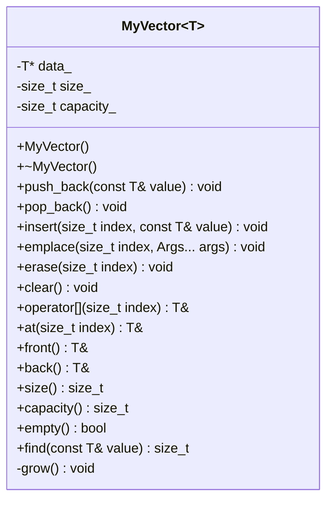

# Implement Your Own Vector — Simple C++11

## 1. 60-second interview answer

> I would implement a dynamic array using three fields: a pointer to the allocated array, the current logical size, and its capacity. When an insertion exceeds capacity, I allocate a larger array (typically twice as large), copy the existing elements, and release the old array only after copying succeeds. `push_back` appends an element, `pop_back` removes the last logical element, `insert` and `erase` shift elements, and indexed access is constant time. This simple teaching version uses `new T[]` and therefore requires a default-constructible, copyable, assignable type. A real `std::vector` uses raw storage and constructs only active elements.

## 2. Simple UML / LLD



- `data_` owns an array allocated using `new T[]`.
- `size_` is the number of logically active elements.
- `capacity_` is the number of array slots allocated.
- `grow()` doubles capacity and keeps the original array intact if copying into the new array throws.
- `find()` is an added convenience, **not** a member of `std::vector`.

## 3. Complete, simple C++11 code

```cpp
#include <iostream>
#include <stdexcept>
#include <utility>
#include <string>
#include <cstddef>

template<typename T>
class MyVector {
private:
    T* data_;
    size_t size_;
    size_t capacity_;

    void grow() {
        size_t newCapacity = capacity_ == 0 ? 1 : capacity_ * 2;
        T* newData = new T[newCapacity];
        try {
            for (size_t i = 0; i < size_; ++i)
                newData[i] = data_[i];
        } catch (...) {
            delete[] newData;
            throw;
        }
        delete[] data_;
        data_ = newData;
        capacity_ = newCapacity;
    }

public:
    MyVector() : data_(nullptr), size_(0), capacity_(0) {}

    ~MyVector() { delete[] data_; }

    MyVector(const MyVector&) = delete;
    MyVector& operator=(const MyVector&) = delete;

    void push_back(const T& value) {
        // Copy first so push_back(v[0]) also works when growing.
        T temp = value;
        if (size_ == capacity_) grow();
        data_[size_] = temp;
        ++size_;
    }

    void pop_back() {
        if (empty()) throw std::out_of_range("pop_back on empty vector");
        --size_;
        // With new T[], this does not immediately destroy the element.
    }

    void insert(size_t index, const T& value) {
        if (index > size_) throw std::out_of_range("insert index");
        T temp = value;
        if (size_ == capacity_) grow();
        for (size_t i = size_; i > index; --i)
            data_[i] = data_[i - 1];
        data_[index] = temp;
        ++size_;
    }

    template<typename... Args>
    void emplace(size_t index, Args&&... args) {
        T value(std::forward<Args>(args)...);
        insert(index, value);
    }

    void erase(size_t index) {
        if (index >= size_) throw std::out_of_range("erase index");
        for (size_t i = index; i + 1 < size_; ++i)
            data_[i] = data_[i + 1];
        --size_;
    }

    void clear() { size_ = 0; }

    T& operator[](size_t index) { return data_[index]; }
    const T& operator[](size_t index) const { return data_[index]; }

    T& at(size_t index) {
        if (index >= size_) throw std::out_of_range("at index");
        return data_[index];
    }
    const T& at(size_t index) const {
        if (index >= size_) throw std::out_of_range("at index");
        return data_[index];
    }

    T& front() {
        if (empty()) throw std::out_of_range("front on empty vector");
        return data_[0];
    }
    T& back() {
        if (empty()) throw std::out_of_range("back on empty vector");
        return data_[size_ - 1];
    }

    size_t size() const { return size_; }
    size_t capacity() const { return capacity_; }
    bool empty() const { return size_ == 0; }

    size_t find(const T& value) const {
        for (size_t i = 0; i < size_; ++i)
            if (data_[i] == value) return i;
        return size_; // not found
    }
};

int main() {
    MyVector<int> v;
    v.push_back(10);
    v.push_back(20);
    v.push_back(30);
    v.insert(1, 15);        // 10 15 20 30
    v.emplace(2, 17);       // 10 15 17 20 30
    v.erase(3);             // 10 15 17 30
    v.pop_back();           // 10 15 17

    for (size_t i = 0; i < v.size(); ++i)
        std::cout << v[i] << ' ';
    std::cout << "\nfront=" << v.front()
              << " back=" << v.back()
              << " at(1)=" << v.at(1)
              << " find(17)=" << v.find(17)
              << " size=" << v.size()
              << " capacity=" << v.capacity()
              << " empty=" << v.empty() << '\n';

    v.clear();
    std::cout << "size after clear=" << v.size() << '\n';
}
```

Compile:

```bash
g++ -std=c++11 -Wall -Wextra -pedantic myvector.cpp -o myvector && ./myvector
```

## 4. Complexity

| Operation | Complexity |
|---|---|
| `push_back` | Amortized O(1), O(n) when growing |
| `pop_back`, `clear`, `size`, `capacity`, `empty` | O(1) |
| `insert`, `emplace`, `erase` | O(n) |
| `operator[]`, `at`, `front`, `back` | O(1) |
| `find` | O(n) |

## 5. Important limitations (say these in the interview)

1. **This is a learning implementation, not a fully conforming `std::vector`.** `new T[]` constructs every capacity slot, even when `size_` is smaller. Thus `T` must be default-constructible and assignable.
2. `pop_back()`, `erase()`, and `clear()` reduce logical size but **do not immediately invoke destructors** for removed elements. Destructors run when the backing array is deleted. A real vector destroys removed elements immediately.
3. `emplace()` constructs a temporary and then inserts it; it is not true in-place construction.
4. `grow()` leaves the original array intact if copying into the new array throws, but `insert()` and `erase()` can leave partially shifted elements if assignment throws. They do not offer the strong exception guarantee.
5. Copying `MyVector` is disabled to prevent double deletion. Move operations, custom allocators, and iterators are intentionally omitted.
6. References/pointers into the array become invalid after growth; shifting elements changes which logical element occupies a given index.

**Whiteboard recall:** `data_ + size_ + capacity_` → grow by 2 → append or shift → update size.
