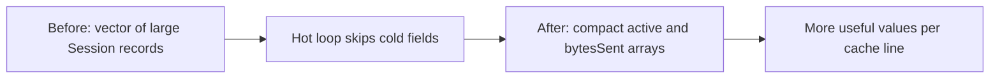

# Optimize a Large Structure for Cache Locality — C++11

## 60-second interview answer

I first profile the hot path and cache misses. CPUs typically transfer memory in cache lines (often 64 bytes). If a loop accesses only a few fields of a large structure, an array of structures (AoS) wastes cache capacity and bandwidth fetching cold fields. I would separate hot and cold data, consider structure of arrays (SoA), minimize pointer chasing, and benchmark the change with representative workloads and Linux perf. I would also check false sharing in multithreaded code. Optimization depends on access pattern; SoA is not universally better.

## Problem

```cpp
#include <cstdint>
struct Session {
    uint64_t id;
    uint64_t bytesSent;
    uint64_t bytesReceived;
    bool active;
    char username[64];
    char description[128];
    char metadata[256];
};
```

A hot loop scans `active` and `bytesSent` for one million sessions. Each large record contains mostly fields the loop does not need.

## Simple LLD / memory layout



**AoS:** `[Session0: hot + cold][Session1: hot + cold]...`

**SoA:** `active[0..N]`, `bytesSent[0..N]`; cold metadata stored separately when needed.

## Complete C++11 example

```cpp
#include <iostream>
#include <vector>
#include <cstdint>
#include <cstddef>

struct SessionData {
    std::vector<uint64_t> bytesSent;
    std::vector<uint8_t> active;
};

int main() {
    const std::size_t N = 1000000;
    SessionData data;
    data.bytesSent.resize(N, 100);
    data.active.resize(N, 1);

    uint64_t total = 0;
    for (std::size_t i = 0; i < N; ++i) {
        if (data.active[i])
            total += data.bytesSent[i];
    }
    std::cout << "Total: " << total << '\n';
}
```

Compile: `g++ -std=c++11 -O3 -Wall -Wextra cache.cpp -o cache`

## Other practical improvements

| Technique | Why it helps | Caution |
|---|---|---|
| Hot/cold splitting | Avoids touching cold fields in hot loops | Extra indirection when cold data is needed |
| SoA | Compact sequential scans over selected fields | May hurt operations requiring every field of one record |
| Reorder fields | Can reduce alignment padding | Measure `sizeof` and offsets |
| Contiguous storage | Better spatial locality and prefetching | Large reallocations can be costly |
| Avoid pointer chasing | Fewer unpredictable cache misses | May require data-model changes |
| Avoid false sharing | Less cache-line bouncing between writers | Padding increases memory footprint |

## Measure rather than assume

```bash
perf stat -e cycles,instructions,cache-references,cache-misses ./cache
perf record -g ./cache
perf report
```

Compare end-to-end time and CPU counters under the same representative workload. Generic cache counters are CPU-dependent. The example is for illustration, not proof of a speedup.

## Principal Engineer interview questions

**Why does SoA help?** The CPU can load more useful field values into each cache line during sequential scans.

**Is SoA always faster?** No. AoS can be better when code accesses most fields of each object together.

**What is false sharing?** Independent data modified by different threads resides on the same cache line, causing coherence traffic.

**Does field reordering always reduce size?** No; alignment and ABI constraints may limit changes. Avoid changing layouts used as stable binary interfaces.

**How do you validate?** Profile the hot path, benchmark both layouts with realistic data, inspect cache behavior, and verify correctness.

## Whiteboard recall sheet

**Profile → Identify hot fields → Separate cold data → Make hot access sequential → Check false sharing → Benchmark.**
