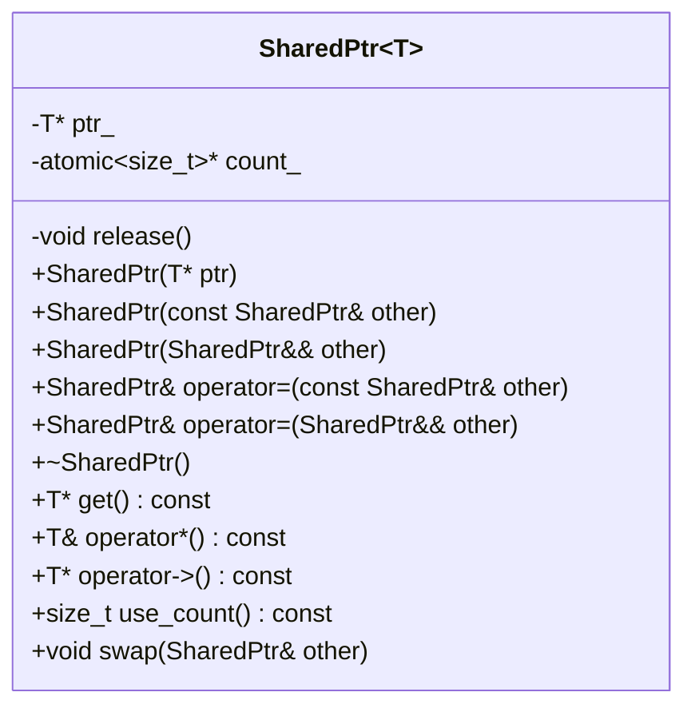
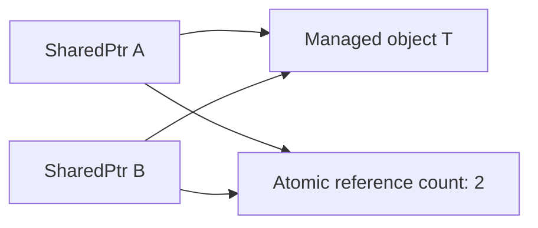

# Reference-Counted Smart Pointer — Simple LLD (C++11/C++14)

> **Interview goal:** Reconstruct a working shared-ownership smart pointer in 15–20 minutes. This is a teaching implementation, not a replacement for `std::shared_ptr`.

## 1. 60-second spoken answer

> I will implement a template `SharedPtr<T>` with two pointers: one to the managed object and another to a heap-allocated atomic reference count. When constructed from a raw pointer, the count starts at one. Copying shares the object and increments the count. Moving transfers the two pointers without incrementing the count. On destruction or replacement, a pointer decrements the count; the last owner deletes both the object and the counter. I will use `std::atomic<size_t>` so independent smart-pointer instances can safely share and release ownership across threads. However, this does not make concurrent access to the managed object safe, and it does not make simultaneous unsynchronized modifications of the same smart-pointer instance safe. The design cannot break ownership cycles and omits advanced `std::shared_ptr` features.

## 2. Minimal UML class diagram



**Remember only two data members:** `T* ptr_` (managed object) and `std::atomic<size_t>* count_` (shared counter). `release()` is the only private helper.

## 3. Ownership and memory layout



- The smart-pointer instances **jointly own** the managed object and the counter.
- Each smart-pointer instance holds non-owning raw pointers *internally*, but its participation in the count represents ownership.
- Copying `A` into `B` makes the count 2; destroying `A` makes it 1; destroying `B` makes it 0 and deletes both allocations.
- The counter and object are separate heap allocations in this simplified design.

## 4. Method flows — what to memorize

| Operation | Steps | Count effect |
|---|---|---|
| Construct from `new T` | Save pointer; allocate counter initialized to 1 | 1 |
| Copy constructor | Copy both pointers; increment counter | +1 |
| Move constructor | Steal both pointers; null out source | 0 |
| Copy assignment | Copy temporary; swap; old state released by temporary | +1 for new owner; -1 for old |
| Move assignment | Release old state; steal source; null source | -1 for old; 0 for transferred |
| Destructor | Decrement counter; if last, delete object and counter | -1 |

### Copy example

```cpp
SharedPtr<int> a(new int(42)); // count = 1
SharedPtr<int> b = a;          // count = 2
```

### Move example

```cpp
SharedPtr<int> c = std::move(b); // count remains 2; b becomes empty
```

### Destruction example

When `a` is destroyed, count becomes 1. When `c` is destroyed, count becomes 0 and the object is deleted.

## 5. Complete minimal C++11 implementation

```cpp
#include <atomic>
#include <cstddef>
#include <iostream>
#include <utility>

// Educational implementation: manages a single object allocated with new.
template <typename T>
class SharedPtr {
private:
    T* ptr_;
    std::atomic<std::size_t>* count_;

    void release() noexcept {
        if (count_ && count_->fetch_sub(1, std::memory_order_acq_rel) == 1) {
            delete ptr_;
            delete count_;
        }
        ptr_ = nullptr;
        count_ = nullptr;
    }

public:
    explicit SharedPtr(T* ptr = nullptr)
        : ptr_(ptr), count_(nullptr) {
        if (ptr_) {
            try {
                count_ = new std::atomic<std::size_t>(1);
            } catch (...) {
                delete ptr_; // Avoid leaking the adopted object.
                ptr_ = nullptr;
                throw;
            }
        }
    }

    SharedPtr(const SharedPtr& other) noexcept
        : ptr_(other.ptr_), count_(other.count_) {
        if (count_) count_->fetch_add(1, std::memory_order_relaxed);
    }

    SharedPtr(SharedPtr&& other) noexcept
        : ptr_(other.ptr_), count_(other.count_) {
        other.ptr_ = nullptr;
        other.count_ = nullptr;
    }

    SharedPtr& operator=(const SharedPtr& other) noexcept {
        SharedPtr temp(other);
        swap(temp);
        return *this;
    }

    SharedPtr& operator=(SharedPtr&& other) noexcept {
        if (this != &other) {
            release();
            ptr_ = other.ptr_;
            count_ = other.count_;
            other.ptr_ = nullptr;
            other.count_ = nullptr;
        }
        return *this;
    }

    ~SharedPtr() { release(); }

    void swap(SharedPtr& other) noexcept {
        std::swap(ptr_, other.ptr_);
        std::swap(count_, other.count_);
    }

    T* get() const noexcept { return ptr_; }
    T& operator*() const { return *ptr_; }
    T* operator->() const noexcept { return ptr_; }

    std::size_t use_count() const noexcept {
        return count_ ? count_->load(std::memory_order_acquire) : 0;
    }
};

int main() {
    SharedPtr<int> a(new int(42));
    std::cout << "a count: " << a.use_count() << "\n";

    {
        SharedPtr<int> b = a; // Copy: 1 -> 2
        SharedPtr<int> c = std::move(b); // Move: stays 2
        std::cout << "c value: " << *c << "\n";
        std::cout << "c count: " << c.use_count() << "\n";
        std::cout << "b count: " << b.use_count() << "\n";
    } // c destroyed: 2 -> 1

    std::cout << "a count: " << a.use_count() << "\n";
} // a destroyed: 1 -> 0, deletes object and count
```

Compile and run:

```bash
g++ -std=c++11 -Wall -Wextra -pedantic -pthread main.cpp -o smartptr
./smartptr
```

Expected output:

```text
a count: 1
c value: 42
c count: 2
b count: 0
a count: 1
```

## 6. Thread safety — precise interview explanation

**Safe:** Separate `SharedPtr` instances that already share ownership can be copied, moved, or destroyed in different threads without losing reference-count updates, provided each individual instance is not concurrently accessed unsafely.

**Not automatically safe:**

- Concurrent assignment to the **same** `SharedPtr` instance requires external synchronization.
- Concurrent reads/writes to `*ptr_` require synchronization appropriate for `T`.
- Calling `use_count()` does **not** reserve ownership or guarantee the count will stay unchanged.
- Constructing two independent `SharedPtr` instances from the **same raw pointer** creates two counters and causes double deletion. Always share by copying an existing `SharedPtr`.

**Atomic ordering:** `fetch_add(..., relaxed)` is enough to increment a count when an owner already exists; `fetch_sub(..., acq_rel)` ensures the last owner can safely perform destruction. The counter is about ownership lifetime, not object data synchronization.

## 7. Important limitations and edge cases

1. **Cycles leak:** If object A owns B and B owns A through reference-counted pointers, neither count reaches zero. A production design uses weak references (`std::weak_ptr`).
2. **Not `make_shared`:** The object and counter use separate allocations; standard `make_shared` can combine them.
3. **No custom deleters or arrays:** This design assumes a single object allocated using `new T`, not `new T[]` or `malloc`.
4. **No polymorphic conversion, aliasing, or weak ownership:** Those require a richer control-block design.
5. **Not a universal drop-in replacement:** Prefer `std::shared_ptr` in production.
6. **`operator*()` on an empty pointer is invalid:** Same basic precondition as ordinary pointer dereference.
7. **The destructor of `T` should not throw:** Throwing during destruction can terminate the program.

## 8. Complexity

| Operation | Time | Notes |
|---|---|---|
| Construct from raw pointer | O(1) | One counter allocation |
| Copy / move | O(1) | Atomic increment / pointer transfer |
| Assign | O(1) | May destroy old object on final release |
| Destroy | O(1) | Excludes arbitrary cost of `T` destructor |
| `use_count()` | O(1) | Atomic load |
| Extra space per ownership group | O(1) | Counter allocation plus pointers per owner |

## 9. Principal Engineer follow-up questions

**Q1. Why atomic count instead of `size_t`?** Because different owners may release or acquire shared ownership concurrently.

**Q2. Why does move not increment the count?** Ownership is transferred, not duplicated.

**Q3. Why use copy-and-swap for copy assignment?** It handles self-assignment and ensures the old ownership is released after the new ownership is secured.

**Q4. Can reference counting prevent use-after-free of `T`?** It protects lifetime while a valid owner exists; it does not protect unsafe raw-pointer access or data races on `T`.

**Q5. How would you add `WeakPtr`?** Use a control block with separate strong and weak counts; the object dies at strong count zero, and the control block dies when both strong and weak ownership are gone.

**Q6. Why prefer `std::make_shared` in production?** It usually reduces allocations and improves locality, although weak references may prolong control-block/allocation storage after the object is destroyed.

## 10. Whiteboard recall sheet

```text
TWO POINTERS: ptr_ + count_

RAW NEW:       count = 1
COPY:          count++
MOVE:          steal; source = null
DESTRUCTOR:    count--; if zero => delete object + counter
ASSIGNMENT:    copy-and-swap (copy), release-and-steal (move)

THREAD SAFETY: atomic count != thread-safe T
LIMITATIONS:   cycles, double-adoption, no weak_ptr, no custom deleter
```

**Final interview line:** "The counter answers *how many owners remain*; the final release determines *when the object is destroyed*."
