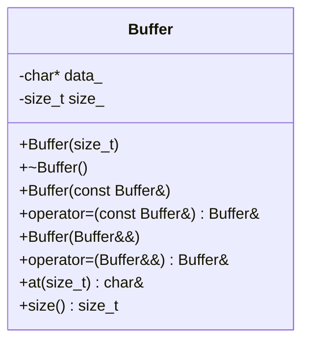
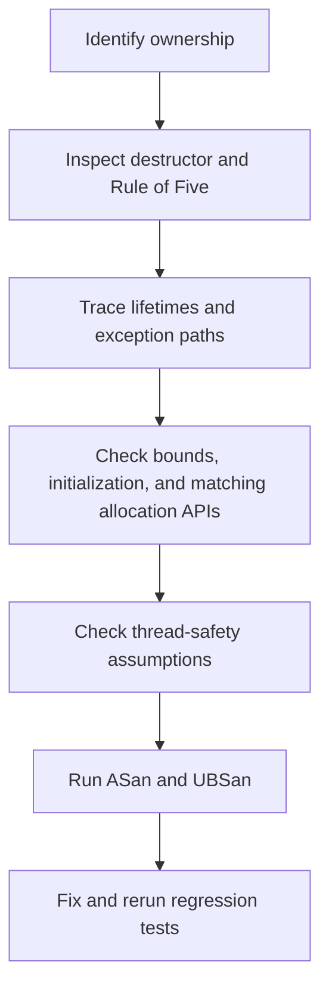

# Review a Legacy C++ Class: Rule of Five, Lifetime, and Undefined Behavior

**Level:** Senior / Principal Engineer  
**Standard:** C++11 / C++14

## 1. 60-second spoken interview answer

> I start by identifying what the class owns versus what it merely borrows: heap buffers, file descriptors, sockets, callbacks, and references. I inspect the destructor and all copy/move operations for leaks, double-free, shallow copies, and invalid moved-from states. Next I trace pointer and reference lifetimes, initialization order, bounds, and allocation/deallocation matching. I test exception paths and concurrency assumptions. I prefer RAII and the Rule of Zero when possible, and verify fixes with compiler warnings, ASan, UBSan, and focused tests.

## 2. Buggy legacy class

```cpp
class Buffer {
    char* data_;
    int size_;
public:
    Buffer(int size) {
        size_ = size;
        data_ = new char[size];
    }
    ~Buffer() { delete data_; } // BUG: should be delete[]
    char& operator[](int index) { return data_[index]; } // no bounds check
};
```

### Defects

1. `new[]` is mismatched with scalar `delete` (undefined behavior).
2. Implicit copy constructor shallow-copies `data_`: both objects think they own one allocation.
3. Implicit copy assignment overwrites a pointer, leaking its former allocation, and then creates shared ownership and possible double-free.
4. No safe move operations are defined; declaring a destructor inhibits implicit move generation in C++11.
5. Negative size converts to a huge unsigned allocation size or fails; validate input or use `size_t`.
6. Indexing with negative or out-of-range values is undefined behavior.
7. `data_` and `size_` are not initialized until constructor body runs; prefer member initializer lists.
8. Thread-safety is unspecified; simultaneous writes or unsynchronized read/write can race.

## 3. UML and ownership diagram



**Buggy shallow copy:** `Buffer a` → same allocation ← `Buffer b`; both destructors free it.  
**Correct deep copy:** `Buffer a` → allocation A; `Buffer b` → independent allocation B.  
**Correct move:** ownership of allocation A transfers to B; A becomes empty.

## 4. Rule of Five review table

| Member | Review question |
|---|---|
| Destructor | Does it release exactly the owned resource, using the correct API? |
| Copy constructor | Does it perform a deep copy or deliberately disable copying? |
| Copy assignment | Is self-assignment safe? Does failure leave the original valid? |
| Move constructor | Does it steal ownership and empty the source? Is it `noexcept`? |
| Move assignment | Does it release its old resource, steal the new one, and handle self-move? |

**Rule of Zero:** If the class stores `std::vector<char>` instead of owning `char*`, the standard library already handles copying, moving, destruction, and exceptions. Prefer this in real code unless manual ownership is the point of the interview.

## 5. Complete corrected C++11 implementation

```cpp
#include <algorithm>
#include <cstddef>
#include <iostream>
#include <stdexcept>
#include <utility>

class Buffer {
    char* data_;
    std::size_t size_;

public:
    explicit Buffer(std::size_t size)
        : data_(size ? new char[size]() : nullptr), size_(size) {}

    ~Buffer() { delete[] data_; }

    Buffer(const Buffer& other)
        : data_(other.size_ ? new char[other.size_] : nullptr),
          size_(other.size_) {
        if (size_)
            std::copy(other.data_, other.data_ + size_, data_);
    }

    Buffer& operator=(const Buffer& other) {
        if (this != &other) {
            Buffer temp(other); // may throw; *this unchanged
            swap(temp);         // no-throw commit
        }
        return *this;
    }

    Buffer(Buffer&& other) noexcept
        : data_(other.data_), size_(other.size_) {
        other.data_ = nullptr;
        other.size_ = 0;
    }

    Buffer& operator=(Buffer&& other) noexcept {
        if (this != &other) {
            delete[] data_;
            data_ = other.data_;
            size_ = other.size_;
            other.data_ = nullptr;
            other.size_ = 0;
        }
        return *this;
    }

    void swap(Buffer& other) noexcept {
        std::swap(data_, other.data_);
        std::swap(size_, other.size_);
    }

    char& at(std::size_t index) {
        if (index >= size_)
            throw std::out_of_range("Buffer index out of range");
        return data_[index];
    }

    const char& at(std::size_t index) const {
        if (index >= size_)
            throw std::out_of_range("Buffer index out of range");
        return data_[index];
    }

    std::size_t size() const noexcept { return size_; }
};

int main() {
    Buffer a(3);
    a.at(0) = 'A';
    a.at(1) = 'B';
    a.at(2) = 'C';

    Buffer b = a;            // independent deep copy
    b.at(0) = 'X';
    Buffer c = std::move(b); // b becomes empty
    Buffer d(1);
    d = a;                  // strong exception-safe copy assignment
    d = std::move(c);       // transfers ownership

    std::cout << a.at(0) << ' ' << d.at(0)
              << " moved-from-size=" << b.size() << '\n';
}
```

Expected output: `A X moved-from-size=0`.

Compile:

```bash
g++ -std=c++11 -O1 -g -Wall -Wextra -Wpedantic \
    -fsanitize=address,undefined -fno-omit-frame-pointer \
    main.cpp -o app
./app
```

## 6. Exception safety and lifetime

- If `new[]` throws in a constructor, construction fails without leaking previously owned memory (none exists yet).
- The copy constructor allocates first and copies bytes, so no partial ownership escapes on failure.
- Copy assignment uses **copy-and-swap**: failure while constructing the temporary leaves the destination unchanged (**strong guarantee**).
- Move constructor and move assignment are `noexcept`; moved-from objects are valid and empty.
- Never return a reference or pointer into a temporary or destroyed `Buffer`.
- Borrowed raw pointers must not outlive the owning object.
- `at()` validates indices; unchecked `operator[]` would need a documented precondition.

## 7. Other UB defects to look for

| Pattern | Defect |
|---|---|
| `new T[n]` + `delete p` | Mismatched delete |
| `malloc()` + `delete` | Mismatched allocation family |
| `return local.c_str()` | Dangling pointer after local destruction |
| `return reference_to_local` | Dangling reference |
| `memcpy()` of a non-trivially-copyable object | Bypasses object semantics; may cause UB |
| Base-pointer deletion without virtual destructor | UB when deleting derived object through base pointer (unless suitable destroying delete applies; not C++11) |
| Dereference after `std::move` of `unique_ptr` | Moved-from pointer is empty |
| Concurrent unsynchronized access | Data race and UB |
| Out-of-range access | Undefined behavior |
| Using uninitialized scalar members | Undefined/erroneous behavior depending on language version and context |

## 8. Review workflow



For suspected data races, use a separate ThreadSanitizer build:

```bash
g++ -std=c++11 -O1 -g -pthread -fsanitize=thread \
    -fno-omit-frame-pointer main.cpp -o app_tsan
```

Do not combine ASan and TSan in the same executable.

## 9. Principal Engineer interview questions

**Q1. Why does defining a destructor affect implicit moves?** In C++11, a user-declared destructor prevents implicit move constructor/assignment generation. Copy operations may still be implicitly declared and accidentally shallow-copy raw pointers.

**Q2. Is the Rule of Five mandatory?** No. It is a prompt to review resource semantics. Rule of Zero is usually better; copying may be explicitly deleted for unique resources.

**Q3. What is the copy-and-swap idiom?** Make an independent temporary copy, then swap its state into the destination. The old state is cleaned up by the temporary destructor.

**Q4. Why `noexcept` on move?** It documents that ownership transfer cannot throw and allows standard containers to move elements during reallocation without compromising exception guarantees.

**Q5. What happens when a constructor throws?** The enclosing object's destructor does not run; already constructed base classes and members are destroyed automatically.

**Q6. How do you find latent UB?** Combine code review, targeted tests, sanitizer builds, and real workload reproduction. Sanitizers cannot detect every UB defect.

## 10. Whiteboard recall sheet

**OWNERSHIP → RULE OF FIVE → LIFETIME → BOUNDS → EXCEPTIONS → THREADS → SANITIZERS**

Key phrases: **double-free, shallow copy, deep copy, move-to-empty, copy-and-swap, strong exception guarantee, Rule of Zero**.
