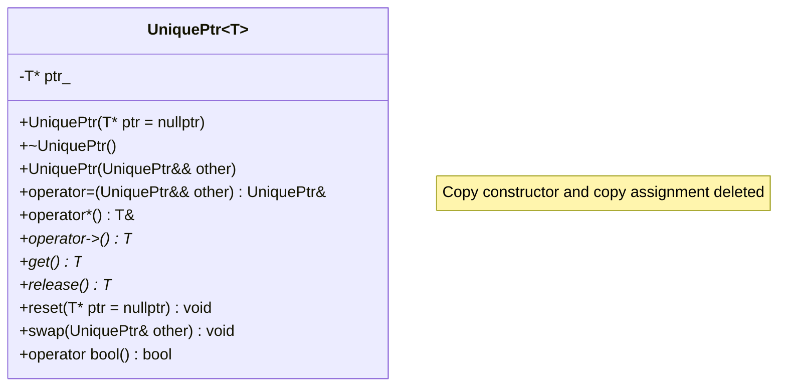
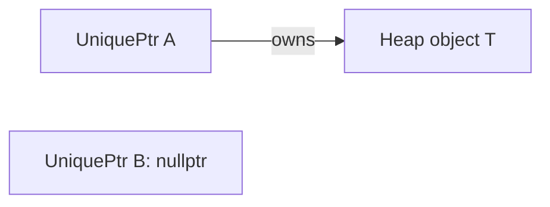
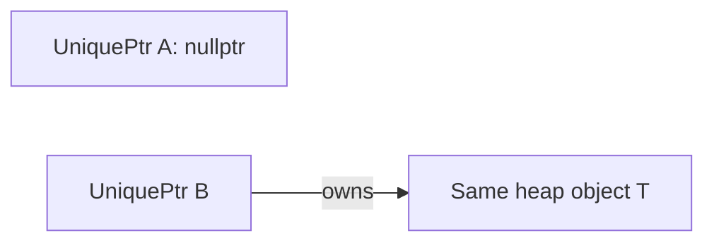
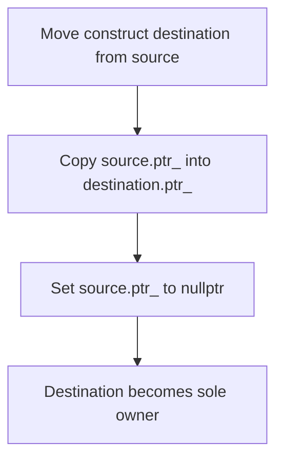
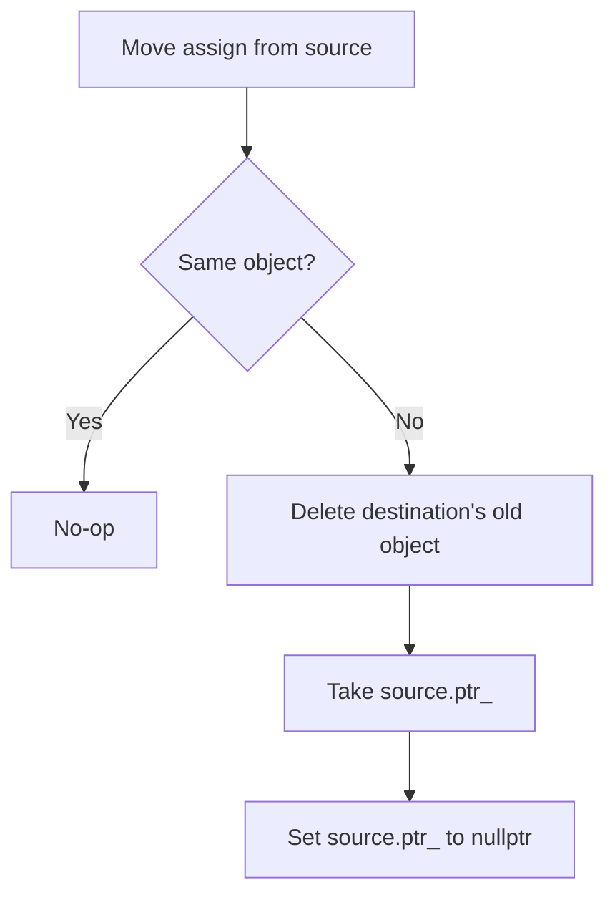
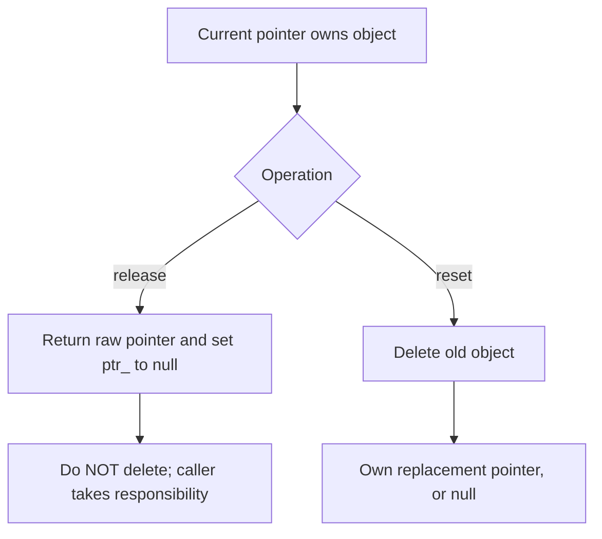

# Implement a Simplified `unique_ptr` — LLD and C++11

> **Interview goal:** Explain unique ownership, RAII, move semantics, and object lifetime; then implement the class from memory in 10–15 minutes.
>
> **Scope:** Single objects allocated with `new T`, default `delete` deleter. This is an educational subset of `std::unique_ptr`, not a replacement for the standard library type.

## 1. 60-second spoken answer

> I would implement a `UniquePtr<T>` class that owns one dynamically allocated `T` through a raw pointer. Its destructor deletes the owned object, following RAII. Copy construction and copy assignment are deleted because two unique owners would cause double deletion. Move construction transfers the pointer from the source to the destination and sets the source to `nullptr`; move assignment also disposes of the destination's old object before taking ownership. `get()` observes the raw pointer without transferring ownership, `release()` returns the raw pointer and relinquishes ownership without deleting it, and `reset()` deletes the current object and optionally takes ownership of a replacement. No reference counter or mutex is required because ownership is exclusive, although the object itself is not automatically thread-safe.

## 2. UML class diagram



**Only one data member:** `T* ptr_`.

| Function | What to remember |
|---|---|
| Constructor | Store the pointer |
| Destructor | `delete ptr_` |
| Copy constructor / assignment | `= delete` |
| Move constructor | Steal pointer; null source |
| Move assignment | Release old ownership; steal; null source |
| `get()` | Borrow pointer; owner unchanged |
| `release()` | Return pointer; set member to null; caller must manage it |
| `reset(p)` | Delete current object; own `p` |
| `operator*`, `operator->` | Access owned object |

## 3. Ownership and lifetime



After `UniquePtr<T> b(std::move(a));`:



- **Exactly one owner:** never copy a `UniquePtr`.
- **Lifetime:** the managed object is destroyed when its owning pointer is destroyed or reset, unless ownership was released or moved.
- **Move:** transfers ownership; the object itself is *not* moved or copied.
- **Borrowing:** a pointer returned by `get()` does not keep the object alive; it can dangle after `reset()` or destruction.
- **Thread safety:** separate unique pointers to separate objects can be used independently; simultaneous unsynchronized access to the *same* `UniquePtr` or mutable pointee can cause data races.

## 4. Method flow diagrams

### Move construction



### Move assignment



### `release()` vs `reset()`



## 5. Complete C++11 implementation

```cpp
#include <iostream>
#include <utility>
#include <cassert>

// Simplified unique_ptr for single objects only.
template<typename T>
class UniquePtr {
private:
    T* ptr_;

public:
    explicit UniquePtr(T* ptr = nullptr) noexcept : ptr_(ptr) {}

    ~UniquePtr() {
        delete ptr_;
    }

    // Unique ownership: copying is forbidden.
    UniquePtr(const UniquePtr&) = delete;
    UniquePtr& operator=(const UniquePtr&) = delete;

    // Transfer ownership; do not delete the transferred object.
    UniquePtr(UniquePtr&& other) noexcept : ptr_(other.ptr_) {
        other.ptr_ = nullptr;
    }

    UniquePtr& operator=(UniquePtr&& other) noexcept {
        if (this != &other) {
            delete ptr_;               // Release old destination object.
            ptr_ = other.ptr_;         // Take source object.
            other.ptr_ = nullptr;      // Source no longer owns it.
        }
        return *this;
    }

    T& operator*() const { return *ptr_; }
    T* operator->() const noexcept { return ptr_; }

    explicit operator bool() const noexcept { return ptr_ != nullptr; }

    T* get() const noexcept { return ptr_; }

    T* release() noexcept {
        T* old = ptr_;
        ptr_ = nullptr;
        return old;
    }

    void reset(T* replacement = nullptr) noexcept {
        // Passing get() to reset() is a caller error; avoid it.
        if (ptr_ == replacement) return;
        T* old = ptr_;
        ptr_ = replacement;
        delete old;
    }

    void swap(UniquePtr& other) noexcept {
        std::swap(ptr_, other.ptr_);
    }
};

struct Widget {
    int id;
    explicit Widget(int n) : id(n) {
        std::cout << "Construct " << id << '\n';
    }
    ~Widget() {
        std::cout << "Destroy " << id << '\n';
    }
    void hello() const {
        std::cout << "Widget " << id << '\n';
    }
};

int main() {
    UniquePtr<Widget> a(new Widget(1));
    a->hello();
    assert((*a).id == 1);

    UniquePtr<Widget> b(std::move(a));
    assert(!a && b);

    UniquePtr<Widget> c(new Widget(2));
    c = std::move(b);  // Destroys Widget 2; c owns Widget 1.
    assert(!b && c && c->id == 1);

    Widget* raw = c.release(); // Caller now owns Widget 1.
    assert(!c && raw->id == 1);
    delete raw;

    c.reset(new Widget(3));
    c.reset();              // Destroys Widget 3.
    assert(!c);

    UniquePtr<Widget> d(new Widget(4));
    UniquePtr<Widget> e(new Widget(5));
    d.swap(e);
    assert(d->id == 5 && e->id == 4);
    // Both remaining objects destroyed at scope exit.
}
```

Compile and run:

```bash
g++ -std=c++11 -Wall -Wextra -pedantic -O2 unique_ptr.cpp -o unique_ptr
./unique_ptr
```

### Why `std::move()`?

`std::move(x)` casts `x` to an rvalue reference, allowing the move constructor/assignment to be selected. It does **not** move anything by itself; our move methods transfer the pointer.

### Important simplifications

- Only `delete` for a **single object**; do not pass a pointer from `new T[n]` (that needs `delete[]` and an array specialization).
- No custom deleter, no `make_unique`, no converting constructors, and no fancy-pointer support.
- Dereferencing a null `UniquePtr` is invalid, just as with `std::unique_ptr`.
- Constructing two independent owners from the **same raw pointer** causes double deletion; the class cannot prevent that misuse.
- The `reset(get())` pattern is invalid for real `std::unique_ptr`; our simplified version returns early for equal pointers as a defensive convenience, but never rely on that behavior when using the standard type.

## 6. Complexity

| Operation | Time | Extra memory |
|---|---|---|
| Construct from pointer | O(1) | O(1) |
| Move construct/assign | O(1) excluding object destruction | O(1) |
| `get`, `release`, `operator->` | O(1) | O(1) |
| `reset`, destructor | O(1) plus destructor/deallocation cost | O(1) |
| Pointer storage | O(1) | One `T*` |

## 7. Principal Engineer interview questions

1. **Why delete copy operations?** Copying would produce two owners and risk double deletion.
2. **Why is move allowed?** It transfers ownership and nulls the source.
3. **Does `std::move` move the object?** No; it enables the move operation, which transfers the pointer.
4. **Difference between `get()` and `release()`?** `get()` borrows; `release()` relinquishes ownership.
5. **Difference between `reset()` and `release()`?** `reset()` destroys the old object; `release()` does not.
6. **What happens during move assignment?** The destination destroys its old object and takes ownership of the source's object.
7. **What if the source is null?** Destination becomes null after releasing its previous object.
8. **Why `noexcept` on moves?** It expresses non-throwing ownership transfer and helps generic containers choose moves.
9. **Can two `UniquePtr`s own the same object?** Not safely; unique ownership is a contract.
10. **Is it thread-safe?** Ownership alone does not synchronize shared access to the pointer or pointee.
11. **Why is `delete nullptr` safe?** It is a no-op.
12. **Can this own an array?** No, not without `delete[]` support or an array specialization.
13. **What is RAII?** Resource cleanup occurs automatically in the owning object's destructor.
14. **Can a `UniquePtr` be returned by value?** Yes, via move semantics or copy elision.
15. **How does this differ from `shared_ptr`?** Unique ownership has no reference-counting overhead; shared ownership requires a control block and count management.

## 8. Whiteboard recall sheet

**One member:** `T* ptr_`.

**Four ownership rules:**

1. Constructor: `ptr_ = p`.
2. Destructor: `delete ptr_`.
3. Copy: `= delete`.
4. Move: steal pointer; source becomes `nullptr`.

**Three helper verbs:** `get = observe`, `release = give away`, `reset = replace/delete`.

**Interview sequence:** 60-second answer → UML → ownership flow → Rule of Five → code → pitfalls.
