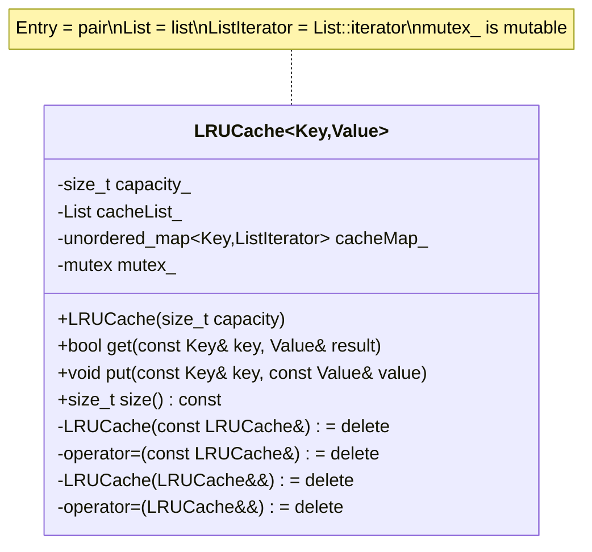
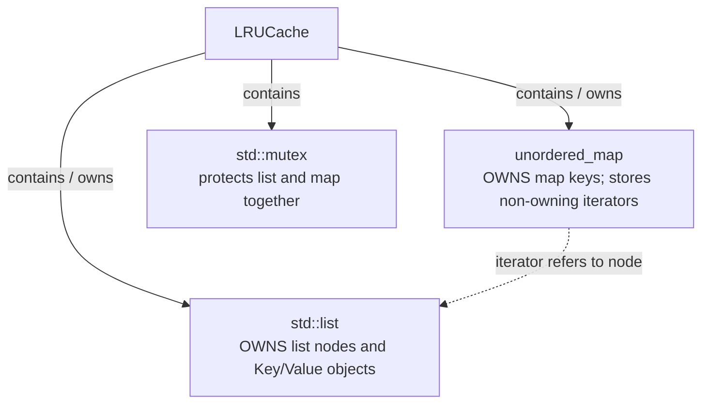
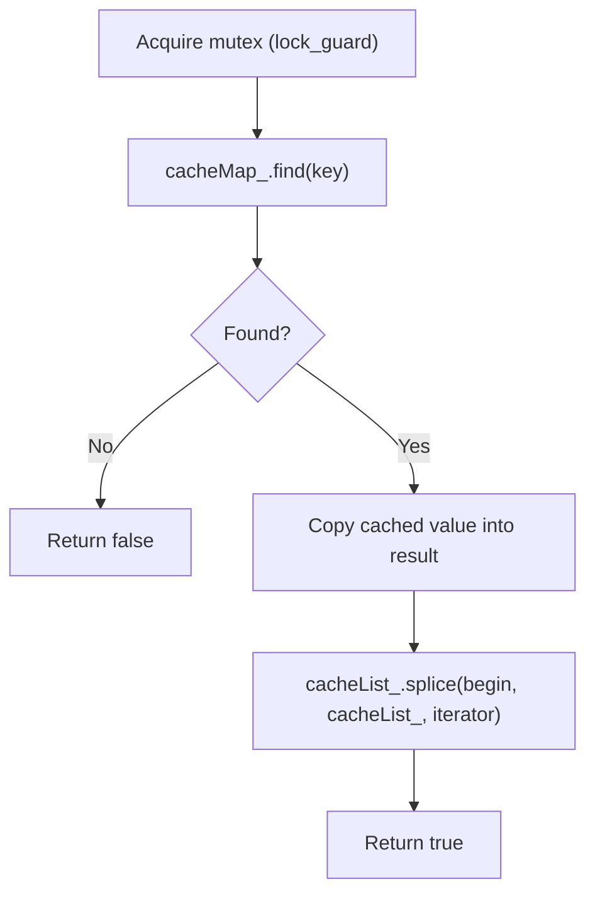
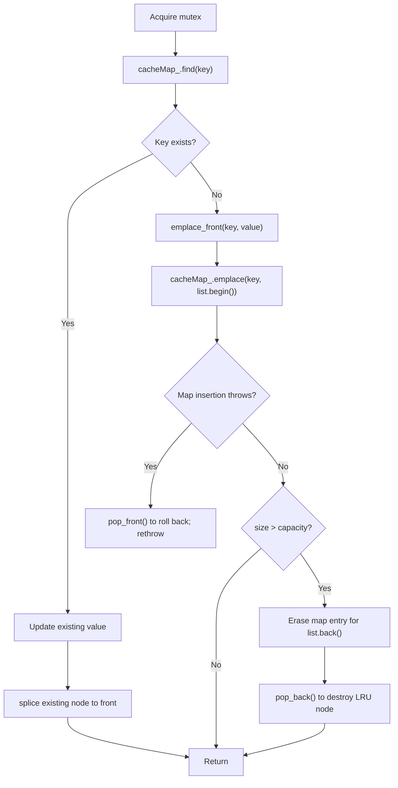

# Thread-Safe LRU Cache — Low-Level Design and C++11 Implementation

**Target:** Senior / Principal C++ Engineer interviews  
**Language:** C++11 (also compatible with C++14)  
**Goal:** Understand the design well enough to reconstruct the implementation without memorizing it.

---

# Part I — Low-Level Design (LLD)

## 1. Requirements

### Functional
- `put(key, value)`: insert or update a key and mark it most recently used.
- `get(key, result)`: retrieve a value, mark the key most recently used, and return success/failure.
- Evict the least recently used (LRU) key when an insertion exceeds capacity.
- Updating an existing key does not change cache size.
- `size()` returns the number of entries.

### Non-functional
- Thread-safe concurrent `get()` / `put()` / `size()` on a live cache.
- Average O(1) hash lookup, list rearrangement, and eviction (excluding key/value operations).
- No exposed references or iterators into evictable entries.
- RAII locking; clearly defined ownership and shutdown responsibilities.

## 2. UML Class Diagram



**UML legend:** `+` public; `-` private. `Key` and `Value` are template type parameters, not data members.

### Type aliases (C++11)

```cpp
typedef std::pair<Key, Value> Entry;
typedef std::list<Entry> List;
typedef typename List::iterator ListIterator;
```

### Four data members — memorize these

| Member | Type | Responsibility |
|---|---|---|
| `capacity_` | `size_t` | Maximum number of entries |
| `cacheList_` | `List` | Owns key/value entries, MRU at front, LRU at back |
| `cacheMap_` | `std::unordered_map<Key, ListIterator>` | Key-to-node index; iterators do not own nodes |
| `mutex_` | `mutable std::mutex` | Guards both containers and their invariants |

**Memory hook:** Capacity → List → Map → Mutex.

## 3. Ownership / Relationship Diagram



The list is the source of truth for cached entries. The map is a secondary index. Every map iterator must refer to a live node in `cacheList_`.

## 4. List Ordering Example

Capacity = 4:

```text
FRONT / MRU                           BACK / LRU
    [40] <--> [30] <--> [20] <--> [10]

get(20):
    [20] <--> [40] <--> [30] <--> [10]

put(50), cache full:
    [50] <--> [20] <--> [40] <--> [30]
                                      (10 evicted)
```

`get(20)` rearranges existing nodes; `put(50)` creates a new node and evicts the tail.

## 5. Method Design — `get(key, result)`



**Recall:** Lock → Find → Copy → Splice → Return.

- `cacheMap_.find(key)` gives a **map iterator**.
- `it->second` is a **list iterator** pointing to the cached entry.
- `it->second->second` is the cached **Value**.
- Copying before `splice` means if the copy throws, the recency order remains unchanged.
- `std::lock_guard` automatically unlocks even if copying throws.
- The caller must not concurrently access the same output `result` without its own synchronization.

## 6. Method Design — `put(key, value)`



**Recall:** Existing → Update + Splice. New → Emplace + Map + Evict.

## 7. Eviction — Exact Sequence

```cpp
ListIterator last = std::prev(cacheList_.end());
cacheMap_.erase(last->first);  // remove map's reference first
cacheList_.pop_back();         // destroy node second
```

1. Identify the LRU node at the tail.
2. Remove its map entry while the node/key is still alive.
3. Remove the list node, destroying the stored key/value.
4. Both actions happen under the same mutex, so other cache operations cannot observe an intermediate state.

**Production exception-safety note:** The example assumes key hashing/equality do not throw during eviction. For arbitrary throwing hash/equality functions, a stronger design is required to guarantee list/map consistency in every exceptional path.

## 8. `emplace_front` vs `splice`

| Function | What it does | Allocation / copying | Iterator validity | Typical use |
|---|---|---|---|---|
| `emplace_front(key, value)` | Constructs a **new** entry at the front | Allocates a new list node; may copy key/value arguments | Existing list iterators remain valid | New key |
| `splice(begin, list, iterator)` | Moves an **existing** node to the front | No node allocation or key/value copy for this move | Iterator to moved node remains valid | Cache hit or existing-key update |

```cpp
cacheList_.emplace_front(key, value);

cacheList_.splice(cacheList_.begin(), cacheList_, it->second);
```

`splice` has three arguments: destination position, source list, iterator to the node being moved. In this cache, source and destination are the same list. The node is relinked in O(1) time.

## 9. Iterator Validity

| Operation | Existing list iterators |
|---|---|
| `emplace_front` / `push_front` | Stay valid |
| `splice` within the same list | Stay valid, including iterator to moved node |
| `erase(it)` | Only iterator to erased node invalidated |
| `pop_back` | Iterator to removed tail node invalidated |
| `clear` | All element iterators invalidated |

**Important distinction:** `unordered_map` rehashing may invalidate iterators **into the map**, but not the `std::list` iterators stored as map values. Never retain a map iterator across a possible rehash.

## 10. Lifetime and Return Safety

- A list entry lives from insertion until eviction, removal, or cache destruction.
- A map-held list iterator does **not** extend that entry's lifetime.
- Never return `Value&` or a raw pointer to a cached value after unlocking: a later eviction could make it dangling.
- This design uses `bool get(const Key&, Value&)` and copies the value under lock. The caller owns the result object.
- For expensive values, an alternative is `std::shared_ptr<const Value>`; that preserves the value's lifetime after eviction, but eviction may not free its memory immediately.
- The cache object itself must outlive all concurrent operations. A mutex does not make concurrent destruction safe; the owner must coordinate shutdown and join/stop workers first.
- Copying and moving the cache are disabled because it contains a mutex and map-to-list iterator relationships.

## 11. Thread Safety and Locking

| Operation | Why it needs the mutex |
|---|---|
| `get()` | Moves node to MRU position |
| `put()` existing | Updates value and list order |
| `put()` new | Changes both map and list; may evict |
| `size()` | Reads a container concurrently modified by writers |

Use **one mutex** first: it protects the invariant that each map entry refers to the correct live list node. Two independent mutexes require careful lock ordering and still must preserve the map/list consistency boundary. A reader-writer lock does not allow normal `get()` calls to share a read lock, because `get()` mutates recency order.

## 12. Complexity

| Operation | Average time |
|---|---|
| `get()` | O(1) hash lookup + O(1) splice + value copy |
| `put()` existing | O(1) lookup/splice + value assignment |
| `put()` new | O(1) expected lookup/insert/eviction + key/value work |
| `size()` | O(1) |
| Space | O(capacity) entries plus hash index |

Worst-case hash operations can take O(n). Lock contention adds waiting time; expensive copies/assignments are not O(1).

## 13. Whiteboard Recall Sheet

```text
CLASS: LRUCache<Key, Value>
TYPES: Entry, List, ListIterator
STATE: capacity_, cacheList_, cacheMap_, mutex_

GET:  lock -> find -> copy -> splice -> return
PUT:  lock -> find -> (update + splice) OR (emplace + map + evict)
EVICT: prev(end) -> map.erase(key) -> list.pop_back()

OWNER: list owns entries; map stores non-owning iterators
LIFETIME: insert -> (get/update)* -> evict/destruct
ITERATORS: splice preserves; erase/pop_back invalidate removed node
THREADS: one mutex protects both structures; shutdown external
```

---

# Part II — Complete C++11 Implementation

```cpp
#include <iostream>
#include <list>
#include <unordered_map>
#include <mutex>
#include <string>
#include <stdexcept>
#include <utility>
#include <iterator>
#include <thread>
#include <vector>

template <typename Key, typename Value>
class LRUCache {
private:
    typedef std::pair<Key, Value> Entry;
    typedef std::list<Entry> List;
    typedef typename List::iterator ListIterator;

    size_t capacity_;
    List cacheList_;  // MRU at front; LRU at back; owns entries
    std::unordered_map<Key, ListIterator> cacheMap_;
    mutable std::mutex mutex_;

public:
    explicit LRUCache(size_t capacity)
        : capacity_(capacity) {
        if (capacity == 0) {
            throw std::invalid_argument("Cache capacity must be positive");
        }
    }

    LRUCache(const LRUCache&) = delete;
    LRUCache& operator=(const LRUCache&) = delete;
    LRUCache(LRUCache&&) = delete;
    LRUCache& operator=(LRUCache&&) = delete;

    bool get(const Key& key, Value& result) {
        std::lock_guard<std::mutex> lock(mutex_);

        typename std::unordered_map<Key, ListIterator>::iterator it =
            cacheMap_.find(key);
        if (it == cacheMap_.end()) {
            return false;
        }

        // Copy while the cached node is still protected.
        result = it->second->second;

        // Move existing node to MRU without invalidating its iterator.
        cacheList_.splice(cacheList_.begin(), cacheList_, it->second);
        return true;
    }

    void put(const Key& key, const Value& value) {
        std::lock_guard<std::mutex> lock(mutex_);

        typename std::unordered_map<Key, ListIterator>::iterator it =
            cacheMap_.find(key);
        if (it != cacheMap_.end()) {
            // Existing key: update value and refresh recency.
            it->second->second = value;
            cacheList_.splice(cacheList_.begin(), cacheList_, it->second);
            return;
        }

        // New key: create list node, then index it.
        cacheList_.emplace_front(key, value);
        try {
            cacheMap_.emplace(cacheList_.front().first, cacheList_.begin());
        } catch (...) {
            // Roll back new list node if map insertion fails.
            cacheList_.pop_front();
            throw;
        }

        if (cacheList_.size() > capacity_) {
            ListIterator last = std::prev(cacheList_.end());
            cacheMap_.erase(last->first); // invalidate index first
            cacheList_.pop_back();        // destroy cached entry second
        }
    }

    size_t size() const {
        std::lock_guard<std::mutex> lock(mutex_);
        return cacheList_.size();
    }
};

int main() {
    LRUCache<int, std::string> cache(3);
    cache.put(1, "One");
    cache.put(2, "Two");
    cache.put(3, "Three");

    std::string result;
    cache.get(1, result);      // recency: 1, 3, 2
    cache.put(4, "Four");     // evicts 2

    if (!cache.get(2, result)) {
        std::cout << "Key 2 evicted\n";
    }
    if (cache.get(1, result)) {
        std::cout << "Key 1: " << result << "\n";
    }

    // Two threads safely call methods on the same live cache.
    // Each worker uses its own output variable.
    std::thread writer([&cache]() {
        for (int i = 5; i < 100; ++i) {
            cache.put(i, "Value");
        }
    });
    std::thread reader([&cache]() {
        for (int i = 1; i < 100; ++i) {
            std::string localResult;
            cache.get(i, localResult);
        }
    });

    writer.join();
    reader.join();
    std::cout << "Final cache size: " << cache.size() << "\n";
}
```

### Build and run

```bash
g++ -std=c++11 -Wall -Wextra -pedantic -pthread lru_cache.cpp -o lru_cache
./lru_cache
```

### Expected output

```text
Key 2 evicted
Key 1: One
Final cache size: 3
```

### Exception-safety caveat for a Principal interview

This compact implementation is intended for ordinary keys (e.g., `int`, `std::string`) and values with well-behaved copy/assignment. The `try`/`catch` rolls back the new list node if map insertion throws. For arbitrary user-defined `Key`, `Value`, hash and equality types, fully strong exception guarantees require additional work: updating an existing value can throw, and `cacheMap_.erase(last->first)` can invoke throwing hash/equality logic. Do not claim unconditional strong exception safety for this version.

---

# Part III — Interview Follow-Up Questions

1. **Why `std::list`?** Stable iterators and O(1) node relinking through `splice`.
2. **Why not `std::vector`?** Front insertion is O(n), and reallocation invalidates iterators.
3. **Why one mutex?** A hit changes recency order; map and list must stay synchronized.
4. **Why not return `Value&`?** The reference can dangle after unlock and eviction.
5. **Who owns the value?** The list node; the map only stores an iterator to it.
6. **Does `splice` invalidate iterators?** No for moving a node within the same list.
7. **What does `emplace_front` do?** Constructs a new list element at the front.
8. **What happens on eviction?** Erase map entry first, then pop list tail.
9. **Can the cache be destroyed during `get`?** No; lifetime/shutdown must be coordinated externally.
10. **How to scale?** Profile contention, then consider sharded caches or approximate/segmented LRU; sharding sacrifices strict global LRU.

**One-minute explanation:** “I use a doubly linked list for MRU-to-LRU ordering, a hash map from keys to stable list iterators for average O(1) access, and a single mutex protecting both. The list owns entries; map iterators are non-owning. A hit uses `splice` to relink the node without copying or invalidating the iterator. Insertion uses `emplace_front`; eviction removes the map entry before destroying the tail node. I return a value copy rather than an internal reference to avoid use-after-eviction, and require callers to coordinate the cache's lifetime.”
