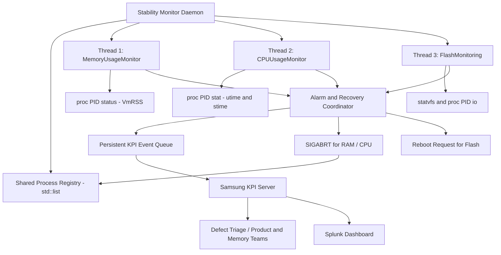
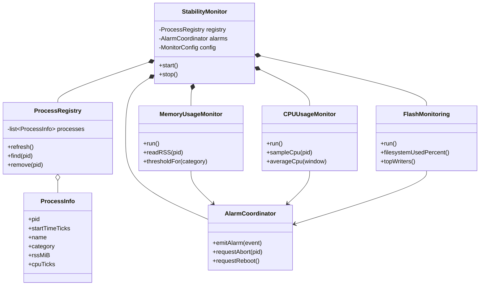
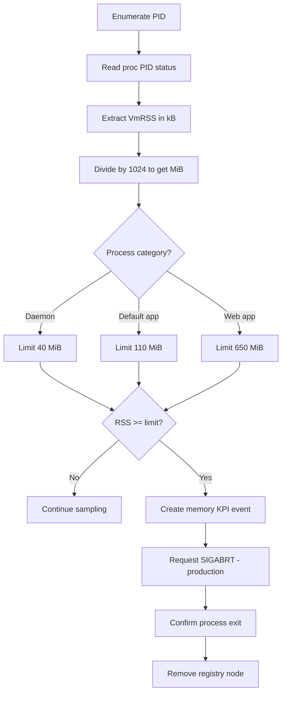
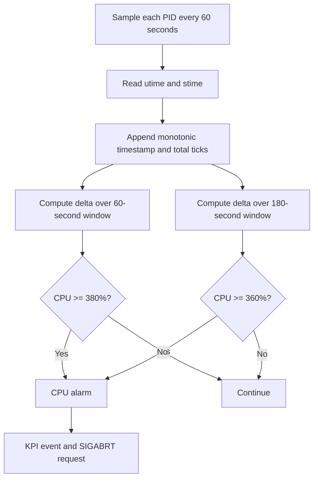
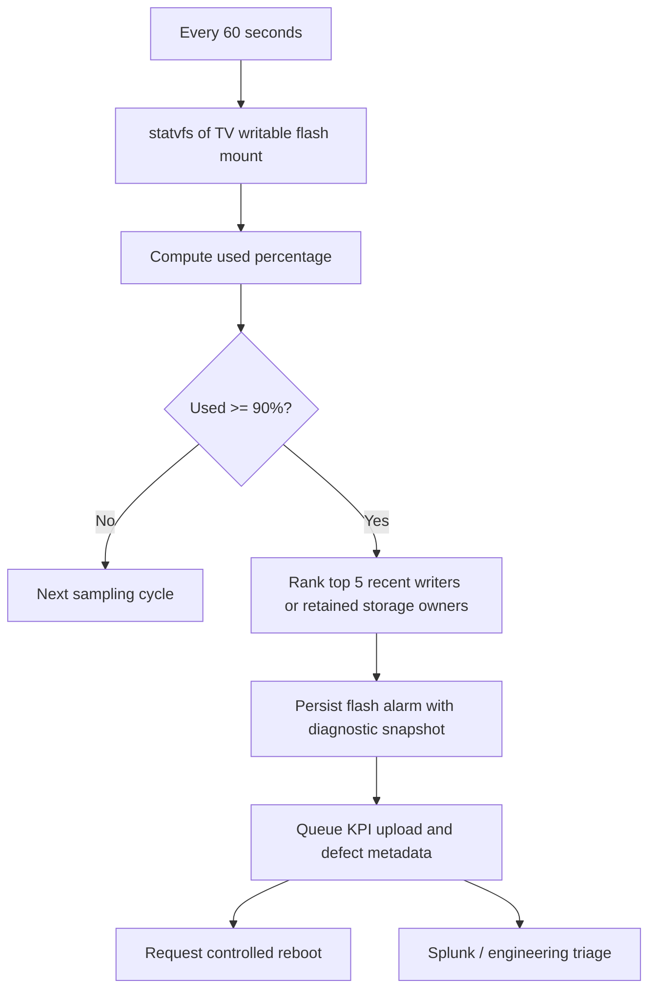
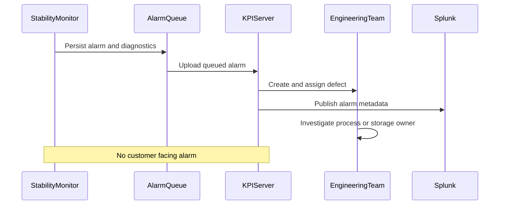

# Samsung Smart TV Stability Monitor — Requirements, UML, HLD, LLD and Testable C++14

> **Reconstructed engineering design, not recovered Samsung proprietary source.** The thresholds, three monitor threads, KPI workflow, Splunk dashboard, and SIGABRT/reboot behavior are based on the supplied project recollection. Linux collection details, class design, event schema and sample code are a portable reconstruction. Where exact historical behavior is unknown, assumptions are labeled.

## 1. Purpose and context

A Samsung Smart TV runs multiple native daemons, default applications, and browser/web applications on embedded Linux. A resident **Stability Monitor** uses three long-running threads to detect runaway memory, sustained CPU saturation and dangerously full flash storage. The production intent was to report silent diagnostics to a Samsung KPI backend, create defects for engineering ownership, and make alarms visible to leadership through Splunk. Memory/CPU violations resulted in a process-directed **signal 6 (SIGABRT)**; a flash violation initiated a **reboot request** after generating diagnostics. Neither alarm was intended to appear on the customer-facing screen.

**Recalled limits**:

| Area | Category / window | Threshold | Action in recalled TV system |
|---|---|---:|---|
| RAM | System daemon | 40 MB | KPI event; SIGABRT to offending process |
| RAM | Default/native app | 110 MB | KPI event; SIGABRT |
| RAM | Web app | 650 MB | KPI event; SIGABRT |
| CPU | Last 3 minutes | 90% of 4-core capacity = **360%** on per-core process scale | KPI event; SIGABRT |
| CPU | Last 1 minute | 95% of 4-core capacity = **380%** on per-core process scale | KPI event; SIGABRT |
| Flash | Every 60 seconds | **>=90%** full | Top five suspected writers, KPI/defect event; reboot request |

**Unit note:** The historic limits were described as “MB”; Linux `/proc` counters are usually in **kB**, and the implementation below converts to **MiB** (1024 KiB per MiB). Confirm whether the original specification used decimal MB or binary MiB.

**Critical CPU ambiguity:** The phrase “90% of the 4-core CPU” is interpreted here as 90% of total four-core capacity, i.e. **360%** on a scale where one busy core is 100%. Likewise 95% becomes **380%**. If the original policy instead meant *90% per process on a single-core scale*, update the policy. Also clarify whether CPU rules apply **per process** (as implemented) or to the **sum of all processes** (a distinct machine-wide saturation rule).

## 2. Functional requirements

| ID | Requirement | Acceptance criteria |
|---|---|---|
| FR-01 | Discover running Linux PIDs | Enumerate `/proc` numeric directories and identify PID/start time |
| FR-02 | Maintain process registry | Doubly linked list supports traversal and removal of exited/terminated processes |
| FR-03 | Monitor memory | Read VmRSS from `/proc/PID/status`, convert kB to MiB, compare to category threshold |
| FR-04 | Monitor CPU | Sample process `utime+stime`; compute rolling 60-second and 180-second utilization |
| FR-05 | Monitor flash | Sample configured filesystem capacity every 60 seconds using `statvfs` |
| FR-06 | Diagnose flash offenders | Identify top five likely contributors with available telemetry; disclose attribution limitations |
| FR-07 | Generate alarms | Include timestamp (production), process identity, metric, observed value, limit and firmware/device metadata (production) |
| FR-08 | Recovery | Memory/CPU: SIGABRT and remove after confirmed exit; flash: request reboot after telemetry is persisted |
| FR-09 | Report remotely | Asynchronously submit alarms to KPI backend; route/ingest into Splunk dashboard |
| FR-10 | Customer UX | Never show monitoring alarms in the TV UI |
| FR-11 | Configuration | Thresholds, categories, monitored filesystem, sampling intervals and recovery policy configurable |
| FR-12 | Testability | Linux host simulation defaults to no destructive recovery and no real network submission |

## 3. Non-functional requirements

- **Low overhead:** Avoid parsing every page mapping (`smaps`) at high frequency; use `/proc/PID/status` for RSS and `/proc/PID/stat` for CPU.
- **Concurrency:** Exactly three logical monitor workers; use locks around shared registry, history and event state.
- **Availability:** A monitor crash should not crash the TV; failure to read a short-lived PID is normal.
- **Correctness:** Account for PID reuse with process start time, counter rollover/restarts, disappearing PIDs, CPU tick frequency, 4-core normalization and filesystem mount boundaries.
- **Safety:** Deduplicate alerts, protect critical processes, rate-limit aborts, persist telemetry before reboot and never reboot repeatedly on startup.
- **Security:** Limit signal/reboot privileges; authenticate KPI transport and redact personal data.
- **Reliability:** Queue alarms locally if network is unavailable; retry with bounded backoff; ensure diagnostic events survive reboot.
- **Observability:** Track monitor health, sample lag, alert counts, recovery attempts, dropped telemetry and reboot causes.
- **Portability:** C++14 and POSIX/Linux APIs; embedded kernel features may vary.

## 4. HLD — three threads and downstream reporting



**Production note:** Three *monitor* threads can coexist with a separate telemetry agent or asynchronous queue; the diagram shows logical components, not a claim about the exact historical thread count for KPI transport.

## 5. UML class diagram (proposed LLD)



The supplied `stability_monitor.cpp` is a **single-file runnable teaching prototype**, rather than a literal implementation of these proposed production classes. It has the same three worker functions and core collection algorithms.

## 6. LLD — process registry and doubly linked list

`std::list<ProcessInfo>` is a doubly linked list. Once a node iterator is known, erase is **O(1)**; finding a PID by scanning is **O(N)**. For O(1) expected PID lookup, combine a list with `unordered_map<pid_t, list<ProcessInfo>::iterator>`; update both under one mutex. Never hold an iterator after its node is erased.


On a confirmed exit of PID 205:


**Important:** `kill(pid, SIGABRT)` only *requests* delivery; do not remove the entry solely because `kill()` returned zero. Verify exit (`waitpid` for a child, pidfd or `/proc` identity for an unrelated process), then remove. PID reuse makes PID-only deletion unsafe. In the prototype the registry is refreshed from live `/proc` snapshots, so dead PIDs disappear at the next scan rather than immediately after a signal.

## 7. Memory monitor — how TV RAM usage was computed

### 7.1 Linux sources

```bash
cat /proc/1234/status | grep -E 'VmSize|VmRSS|RssAnon|RssFile|RssShmem'
```

Example:

```text
VmSize:   950000 kB
VmRSS:    620000 kB
RssAnon:  480000 kB
RssFile:  130000 kB
RssShmem:  10000 kB
```

- `VmSize`: virtual address space; **not physical RAM consumption**.
- `VmRSS`: resident physical pages mapped by this process, including shared pages counted in each mapper.
- `RssAnon`: resident anonymous pages (heap, stacks, anonymous maps).
- `RssFile`: resident file-backed pages (libraries, binaries, file mappings).
- `RssShmem`: resident shared-memory pages.

Formula:

```text
RSS_kB = RssAnon_kB + RssFile_kB + RssShmem_kB
       = 480000 + 130000 + 10000
       = 620000 kB
RSS_MiB = 620000 / 1024 = 605.46875 MiB
Web-app threshold = 650 MiB
605.47 < 650 => no alarm
```

Linux documentation cautions that `/proc/PID/status` RSS figures can be approximate; use `smaps`/`smaps_rollup` for higher-accuracy diagnosis if supported, at a greater cost. Shared RSS must **not** be summed across processes as unique physical RAM.

### 7.2 Decision diagram



### 7.3 Example

| PID | Type | VmRSS kB | RSS MiB | Limit MiB | Decision |
|---:|---|---:|---:|---:|---|
| 101 | Daemon | 35,840 | 35 | 40 | OK |
| 205 | Default app | 122,880 | 120 | 110 | Alarm |
| 310 | Web app | 620,000 | 605.47 | 650 | OK |

### 7.4 Complexity

Per scan of N processes: O(N) `/proc` file reads, O(N) transient snapshot space. Registry refresh in the prototype is O(N); a production incremental registry can avoid replacing the whole list each cycle.

## 8. CPU monitor — 1-minute and 3-minute rolling usage

### 8.1 Read counters

`/proc/<PID>/stat` fields **14** and **15** contain `utime` and `stime` (clock ticks). `sysconf(_SC_CLK_TCK)` supplies ticks per second. Do not naïvely split the entire stat line on spaces: the process name in parentheses may contain spaces.

```text
process_cpu_ticks = utime + stime
elapsed_cpu_seconds = (ticks_new - ticks_old) / CLK_TCK
elapsed_wall_seconds = monotonic_time_new - monotonic_time_old
process_cpu_percent = 100 * elapsed_cpu_seconds / elapsed_wall_seconds
```

**Per-core scale:** 100% = one fully busy core; 400% = four fully busy cores. If desired, `normalized_total_cpu_percent = process_cpu_percent / 4` on the fixed four-core TV.

### 8.2 Numerical dry run

Assume `CLK_TCK = 100` and four cores. A process consumes 222 CPU-seconds during 60 wall-clock seconds:

```text
CPU% = 100 * 222 / 60 = 370%
Normalized total CPU = 370 / 4 = 92.5%
Last 1 minute: 370% < 380% => OK
```

Over the last 180 seconds, suppose it used 666 CPU-seconds:

```text
CPU% = 100 * 666 / 180 = 370%
Normalized total CPU = 370 / 4 = 92.5%
Last 3 minutes: 370% >= 360% => ALARM
```

The two policies can disagree: the 3-minute rule detects sustained high usage, while the 1-minute rule catches sharper saturation.

### 8.3 Sampling design



| Time | CPU ticks | Delta over 60s | CPU% over 60s |
|---|---:|---:|---:|
| t=0s | 10,000 | — | — |
| t=60s | 32,200 | 22,200 | 370% |
| t=120s | 54,400 | 22,200 | 370% |
| t=180s | 76,600 | 22,200 | 370% |

For the 180-second window, `(76600 - 10000) / (100 * 180) * 100 = 370%`.

**Important implementation notes:** Store timestamped samples in a rolling ring buffer or deque; expire old samples; don't average percentages without weighting by elapsed time. Samples should use a monotonic clock. A process that existed for only 30 seconds has insufficient history for a 180-second rule. If the target is **aggregate CPU for all processes**, sum CPU tick deltas for all tracked processes and compare the sum against 360%/380%; this is a separate implementation and requires handling processes that exit between samples.

## 9. Flash monitor — filesystem usage, top five and reboot

### 9.1 Measure filesystem occupancy

On Linux, `statvfs(mount_path, &st)` returns filesystem block counts:

```text
capacity_bytes = f_blocks * f_frsize
free_for_unprivileged_bytes = f_bavail * f_frsize
used_percent_for_unprivileged = 100 * (f_blocks - f_bavail) / f_blocks
```

For example, a 4 GiB filesystem with only 0.35 GiB available:

```text
used% = (4.00 - 0.35) / 4.00 * 100 = 91.25%
91.25% >= 90% => FLASH ALARM
```

**Filesystem nuance:** `f_bavail` excludes blocks reserved for privileged users, so this measures effective fullness for ordinary writers, not necessarily strictly allocated blocks. To compute actual allocated fraction, use `(f_blocks - f_bfree) / f_blocks`. Pick one and document it. Monitor the **specific writable TV data/flash mount**, not an arbitrary root mount.

### 9.2 How to identify the top five

**Fundamental Linux limitation:** `statvfs` tells you *filesystem* occupancy, not which process owns the bytes. `/proc/PID/io` provides `write_bytes`, which approximates process-attributed bytes submitted to storage, **not current occupied space**. Deleted files, overwritten files, writeback, short-lived processes and shared files break any equivalence. Therefore, the example ranks **top five writers over the last sample interval** as a useful diagnostic proxy, not true top five owners of occupied flash space.

To truly rank top five flash-space consumers, production instrumentation must associate files/directories with app or process identities (for example, application-specific writable directories, quotas, per-app storage accounting, or write/delete lifecycle telemetry). A directory-based `du` can measure retained bytes by application ownership but is costly and may not match individual processes.



### 9.3 Sample diagnostic event

```json
{
  "type": "FLASH_FULL",
  "filesystem": "/data",
  "used_percent": 91.25,
  "threshold_percent": 90,
  "top_writers_by_interval_bytes": [
    {"pid": 310, "name": "WebApp", "bytes": 52428800},
    {"pid": 205, "name": "DefaultApp", "bytes": 20971520},
    {"pid": 101, "name": "Logger", "bytes": 10485760},
    {"pid": 405, "name": "Updater", "bytes": 5242880},
    {"pid": 512, "name": "Cache", "bytes": 1048576}
  ],
  "recovery": "REBOOT_REQUESTED"
}
```

Example event is illustrative; not a recovered Samsung KPI schema.

## 10. KPI server, defect ownership and Splunk

The following uses simple Mermaid participant identifiers for GitHub compatibility.



In a hardened design, send asynchronously and durably queue before SIGABRT/reboot. On reboot, upload unsent events later. Use correlation IDs to deduplicate repeated alarms.

## 11. Recovery behavior and safety

- **SIGABRT is signal 6 on Linux** and normally terminates the process with a core dump if allowed; it is not the same as `SIGKILL` (9). A process can handle SIGABRT, so monitor actual exit.
- Avoid aborting PID 1, the monitor itself, critical recovery services or arbitrary host processes. Production recovery requires a vetted allowlist and policy.
- A flash alarm can trigger a controlled reboot via the platform's reboot coordinator; sending a signal to an ordinary PID is **not** inherently a reboot request.
- Prevent repeated reboots with persisted counters, hysteresis and a minimum time between recovery attempts.
- Core dumps and logs themselves consume flash; use size caps and reserve storage for telemetry.
- The **sample never reboots** and only aborts processes when explicitly started with a dangerous opt-in flag; do not enable that flag on your normal workstation.

## 12. Working Linux C++14 prototype

Files included alongside this guide:

- [`stability_monitor.cpp`](stability_monitor.cpp) — three real monitor threads, `/proc` sampling, `statvfs`, threshold alarms and mocked KPI reporting.
- [`Makefile`](Makefile) — builds with GCC and pthreads.

### Build

```bash
sudo apt-get install build-essential
make
```

Or directly:

```bash
g++ -std=c++14 -O2 -Wall -Wextra -pthread stability_monitor.cpp -o stability_monitor
```

### Run safely

```bash
# Default: 60-second samples, 60/180-second CPU windows, unlimited run
./stability_monitor --flash-path /tmp

# Quick smoke test: 1-second samples, 1/2-second CPU windows, 5 cycles
./stability_monitor --interval 1 --iterations 5 --cpu-short 1 --cpu-long 2 --flash-path /tmp

# Stop an ongoing run with Ctrl+C
```

**The smoke test deliberately changes the CPU windows** to speed up test execution; it does not validate the production 60/180-second policy. On a general Linux workstation, the demonstration's fallback classifier treats unknown processes as daemons, so 40 MiB alarms for ordinary desktop processes are expected **false positives**. Adapt `category()` to actual TV process names or a configuration map before using the thresholds seriously.

### What the prototype does and does not implement

| Feature | Prototype | Production hardening needed |
|---|---|---|
| Three threads | Yes | Supervision, lifecycle management |
| RSS from VmRSS | Yes | Accurate classification, missing-data handling |
| CPU 60/180-second windows | Yes | PID start-time identity in history; precise sampling and deduplication |
| 4-core 360%/380% thresholds | Yes | Detect actual online CPU count or pin to TV hardware |
| Flash percent every 60s | Yes | Exact TV mount and reserved-block policy |
| Top 5 flash consumers | **Proxy:** recent `/proc/PID/io` writers | True app-owned retained storage attribution |
| Doubly linked list | Yes (`std::list`) | Incremental updates and O(1) PID index |
| Memory SIGABRT | Optional unsafe opt-in | Approved process allowlist, post-signal exit confirmation |
| CPU SIGABRT | **Not executed** | Same controlled recovery coordinator as memory |
| Flash reboot | **Never executed** | TV platform reboot coordinator, durability safeguards |
| KPI/Splunk/defect integration | Mock stdout alarm | Authenticated network client, persistent queue and server integration |

The prototype is intended to demonstrate measurement and alarm detection on a development Linux machine, **not** to reproduce all destructive recovery actions or Samsung backend integrations.

## 13. Test plan

| Test | Procedure | Expected |
|---|---|---|
| T1 Build | `make` | Successful C++14 compilation |
| T2 Normal sampling | `--interval 1 --iterations 5 --cpu-short 1 --cpu-long 2` | Flash utilization printed, no reboot |
| T3 RSS verification | Compare `VmRSS` from `/proc/<pid>/status` with code's RSS | Close match (snapshots vary) |
| T4 CPU calculation | Run CPU-bound 1-core worker; compare with `top -H -p PID` | Approximately 100% on per-core scale |
| T5 CPU threshold | Run 4-core CPU workload with 60/180-second windows | Alarm if sustained process CPU reaches 360%/380% |
| T6 Flash occupancy | Use a **dedicated disposable test filesystem**; fill to >=90% | Flash alarm and mock reboot request |
| T7 Process exit | Start/stop a short-lived worker | Removed from refreshed process registry |
| T8 Safety | Run without opt-in | No process aborts and no reboot |
| T9 Top writers | Generate file writes between flash samples | Diagnostic ranking based on `/proc/PID/io` deltas; may require elevated permissions |
| T10 KPI mock | Trigger alarm | stdout `ALARM [...]` event; no network traffic |

### CPU workload example

Use a disposable four-thread workload (Python for convenience):

```bash
python3 - <<'PY'
import multiprocessing
import time

def busy():
    end = time.monotonic() + 200
    x = 0
    while time.monotonic() < end:
        x += 1

if __name__ == '__main__':
    ps = [multiprocessing.Process(target=busy) for _ in range(4)]
    for p in ps: p.start()
    for p in ps: p.join()
PY
```

**Caveat:** This starts four separate processes, each near 100%, so it tests aggregate host saturation but **will not** trigger a per-process 360% alarm. For the per-process rule, use one multithreaded process with four busy threads, e.g. a small C++ pthread workload. The code can be adapted to monitor aggregate CPU if that was the original TV rule.

### Flash test caution

Never fill your actual `/`, `/home`, or production TV data filesystem to 90% just to test an alarm. Use a small disposable loopback filesystem in a VM or container with an isolated filesystem mount and cleanup, or inject a fake `statvfs` provider in a unit test. The provided binary has **no fake-injection interface**; that would be a useful next hardening step.

## 14. Complexity and tradeoffs

| Subsystem | Time per sample | State |
|---|---|---|
| Process discovery | O(N) directory entries | O(N) snapshot |
| Memory | O(N) `/proc` reads | O(N) registry |
| CPU | O(N × W) for short bounded sample history W | O(N × W) |
| Flash | O(N) `/proc/PID/io` reads; O(N log N) sorting | O(N) writer snapshots |
| List erase with known iterator | O(1) | — |

CPU and flash attribution are sensitive to processes exiting between samples. `/proc/PID/io` may be unreadable without sufficient privileges. Kernel, device and filesystem writeback accounting differs by platform.

## 15. Interview explanation (2–3 minutes)

> At Samsung, I developed a C/C++ Stability Monitor for Linux-based Smart TVs with three independent monitoring threads. The memory thread collected each process's VmRSS from `/proc/<PID>/status` and compared resident memory against per-category limits — roughly 40 MB for daemons, 110 MB for default apps and 650 MB for web apps. The CPU thread sampled user and system CPU ticks from `/proc/<PID>/stat`, maintained time-window histories, and checked one-minute and three-minute saturation thresholds. On our four-core platform the total theoretical CPU scale was 400%. The flash thread checked writable filesystem occupancy once per minute and triggered an alarm at 90% fullness, capturing the top five likely storage contributors for investigation. We tracked process metadata in a doubly linked list and removed entries after processes exited. CPU and memory violations triggered SIGABRT-based recovery, while a critical flash alarm led to a controlled reboot request. These alarms were invisible to customers; diagnostics flowed to Samsung's KPI/defect pipeline and Splunk so engineering teams could identify and fix recurring reliability issues.

**Interview follow-ups to be ready for:** Why RSS rather than VSZ? Why 400% on a four-core CPU? How do you compute a 180-second CPU window? How do you prevent PID reuse errors? Why does `/proc/PID/io` not equal disk space owned by a process? How do you guarantee alarm delivery before reboot? Why choose a doubly linked list, and how is removal O(1)?

## 16. Open historical questions

1. Were CPU limits 360%/380% on a 400% scale, or 90%/95% per process on another scale?
2. Did the CPU alarm apply to each process, or aggregate system CPU?
3. Did flash “top five” mean top file/directory owners, top recent writers, or processes with highest cumulative write counters?
4. Was RSS taken from `VmRSS` directly or computed from the three `Rss*` fields?
5. Was SIGABRT followed by a core dump, and did a separate recovery manager restart the application?

These questions are explicitly left open rather than presenting unverified reconstruction as historical fact.
