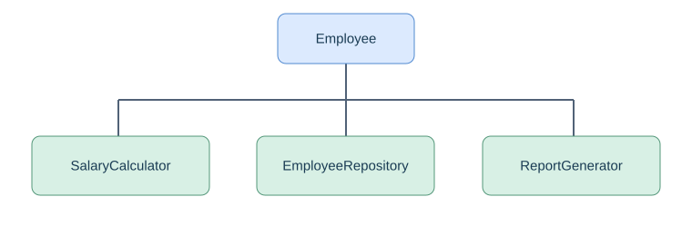
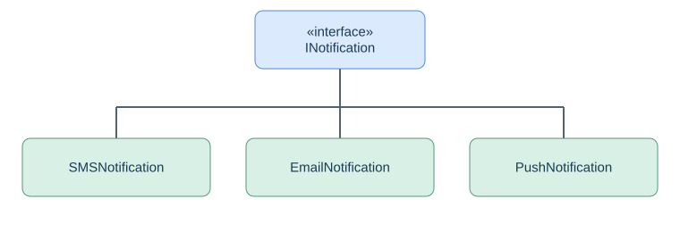
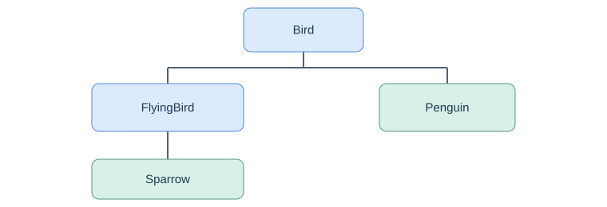
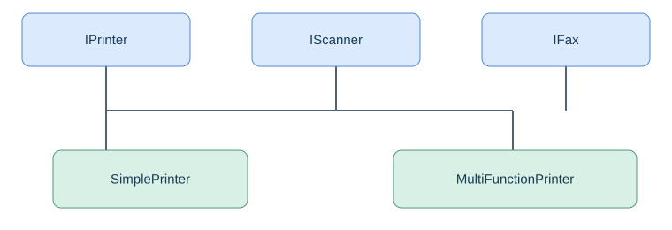
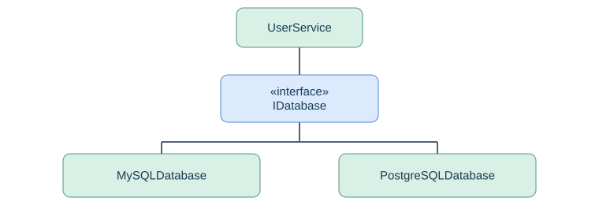

# SOLID Principles in C++ (C++11/14)

SOLID is a collection of five object-oriented design principles that help make software **maintainable, extensible, testable, reusable, and loosely coupled**. They are especially useful for low-level design (LLD), system design, and Senior/Principal C++ engineering interviews.

## 1. The five SOLID principles

| Principle | Full form | Core idea |
|---|---|---|
| **S — SRP** | Single Responsibility Principle | A class should have one reason to change |
| **O — OCP** | Open/Closed Principle | Open for extension, closed for modification |
| **L — LSP** | Liskov Substitution Principle | Derived classes must honor base-class contracts |
| **I — ISP** | Interface Segregation Principle | Don't force classes to implement unused methods |
| **D — DIP** | Dependency Inversion Principle | Depend on abstractions, not concrete implementations |

---

## 2. S — Single Responsibility Principle (SRP)

**Definition:** A class should have only one reason to change.

### Bad design — violates SRP

Imagine an application managing employees:

```cpp
class Employee {
public:
    void calculateSalary() {
        // Salary calculation
    }

    void saveToDatabase() {
        // Database operations
    }

    void generateReport() {
        // Report generation
    }
};
```

**Problem:** This class handles three responsibilities. A change in database logic, salary calculation, or report formatting may require changing `Employee`.

### Good design — follows SRP



```cpp
#include <iostream>
#include <string>
using namespace std;

class Employee {
public:
    string name;
    double baseSalary;

    Employee(string n, double s)
        : name(n), baseSalary(s) {}
};

class SalaryCalculator {
public:
    double calculate(const Employee& e) {
        return e.baseSalary * 1.20;
    }
};

class EmployeeRepository {
public:
    void save(const Employee& e) {
        cout << "Saving " << e.name << endl;
    }
};

class ReportGenerator {
public:
    void generate(const Employee& e) {
        cout << "Report for " << e.name << endl;
    }
};

int main() {
    Employee emp("John", 50000);

    SalaryCalculator calculator;
    EmployeeRepository repository;
    ReportGenerator report;

    cout << calculator.calculate(emp) << endl;
    repository.save(emp);
    report.generate(emp);
}
```

**Benefits:** Salary rules can change independently of persistence or reporting. Each component is easier to test.

**Interview takeaway:** SRP is about one *reason to change*, not necessarily one method per class.

---

## 3. O — Open/Closed Principle (OCP)

**Definition:** Software entities should be open for extension but closed for modification.

Consider a notification system supporting SMS, email, and push notifications.

### Bad design — violates OCP

```cpp
class NotificationService {
public:
    void send(string type, string message) {
        if (type == "SMS") {
            cout << "Sending SMS\n";
        }
        else if (type == "EMAIL") {
            cout << "Sending Email\n";
        }
        else if (type == "PUSH") {
            cout << "Sending Push\n";
        }
    }
};
```

**Problem:** Adding WhatsApp, Slack, or another channel requires modifying `NotificationService`.

### Good design — follows OCP



```cpp
#include <iostream>
#include <memory>
#include <string>
using namespace std;

class INotification {
public:
    virtual void send(const string& msg) = 0;
    virtual ~INotification() {}
};

class SMSNotification : public INotification {
public:
    void send(const string& msg) override {
        cout << "SMS: " << msg << endl;
    }
};

class EmailNotification : public INotification {
public:
    void send(const string& msg) override {
        cout << "Email: " << msg << endl;
    }
};

class PushNotification : public INotification {
public:
    void send(const string& msg) override {
        cout << "Push: " << msg << endl;
    }
};

class NotificationService {
public:
    void notify(INotification& notification,
                const string& message) {
        notification.send(message);
    }
};

int main() {
    EmailNotification email;
    SMSNotification sms;

    NotificationService service;
    service.notify(email, "Welcome!");
    service.notify(sms, "OTP: 1234");
}
```

To add WhatsApp, create `WhatsAppNotification : public INotification`; `NotificationService` stays unchanged.

**Interview takeaway:** OCP is commonly implemented using polymorphism, the Strategy pattern, and abstractions. It doesn't mean existing code can never be modified.

---

## 4. L — Liskov Substitution Principle (LSP)

**Definition:** Derived-class objects should be usable wherever base-class objects are expected without breaking expected behavior.

### Bad design — violates LSP

```cpp
class Bird {
public:
    virtual void fly() {
        cout << "Bird flying\n";
    }

    virtual ~Bird() {}
};

class Penguin : public Bird {
public:
    void fly() override {
        throw runtime_error("Penguin cannot fly");
    }
};
```

**Problem:** The base-class contract suggests that every bird can fly. Substituting `Penguin` violates that expectation.

### Good design — follows LSP



```cpp
#include <iostream>
using namespace std;

class Bird {
public:
    virtual void eat() {
        cout << "Bird eating\n";
    }
    virtual ~Bird() {}
};

class FlyingBird : public Bird {
public:
    virtual void fly() = 0;
};

class Sparrow : public FlyingBird {
public:
    void fly() override {
        cout << "Sparrow flying\n";
    }
};

class Penguin : public Bird {
public:
    void swim() {
        cout << "Penguin swimming\n";
    }
};

void makeBirdFly(FlyingBird& bird) {
    bird.fly();
}

int main() {
    Sparrow sparrow;
    Penguin penguin;

    makeBirdFly(sparrow);
    penguin.swim();
}
```

Only flying birds expose `fly()`, while penguins still satisfy the `Bird` contract.

**Interview takeaway:** LSP isn't simply about inheritance. Derived classes must preserve base-class behavioral guarantees, including preconditions, postconditions, and invariants.

---

## 5. I — Interface Segregation Principle (ISP)

**Definition:** Clients should not be forced to depend on methods they do not use.

### Bad design — violates ISP

```cpp
class IMachine {
public:
    virtual void print() = 0;
    virtual void scan() = 0;
    virtual void fax() = 0;
    virtual ~IMachine() {}
};

class SimplePrinter : public IMachine {
public:
    void print() override {
        cout << "Printing\n";
    }

    void scan() override {
        throw runtime_error("Not supported");
    }

    void fax() override {
        throw runtime_error("Not supported");
    }
};
```

**Problem:** A simple printer must implement scanning and faxing despite not supporting those operations.

### Good design — follows ISP



```cpp
#include <iostream>
using namespace std;

class IPrinter {
public:
    virtual void print() = 0;
    virtual ~IPrinter() {}
};

class IScanner {
public:
    virtual void scan() = 0;
    virtual ~IScanner() {}
};

class IFax {
public:
    virtual void fax() = 0;
    virtual ~IFax() {}
};

class SimplePrinter : public IPrinter {
public:
    void print() override {
        cout << "Printing document\n";
    }
};

class MultiFunctionPrinter :
    public IPrinter,
    public IScanner,
    public IFax {
public:
    void print() override {
        cout << "Printing\n";
    }

    void scan() override {
        cout << "Scanning\n";
    }

    void fax() override {
        cout << "Faxing\n";
    }
};

int main() {
    SimplePrinter printer;
    MultiFunctionPrinter machine;

    printer.print();
    machine.print();
    machine.scan();
    machine.fax();
}
```

**Interview takeaway:** Prefer small, cohesive interfaces instead of large interfaces containing unrelated operations.

---

## 6. D — Dependency Inversion Principle (DIP)

**Definition:** High-level modules should not depend on low-level modules. Both should depend on abstractions.

This is particularly important for large C++ applications, backend systems, and unit testing.

### Bad design — violates DIP

```cpp
class MySQLDatabase {
public:
    void save() {
        cout << "Saving to MySQL\n";
    }
};

class UserService {
    MySQLDatabase db;

public:
    void registerUser() {
        db.save();
    }
};
```

**Problem:** `UserService` is tightly coupled to MySQL. Switching to PostgreSQL requires modifying the service.

### Good design — follows DIP



```cpp
#include <iostream>
#include <memory>
using namespace std;

class IDatabase {
public:
    virtual void save() = 0;
    virtual ~IDatabase() {}
};

class MySQLDatabase : public IDatabase {
public:
    void save() override {
        cout << "Saving to MySQL\n";
    }
};

class PostgreSQLDatabase : public IDatabase {
public:
    void save() override {
        cout << "Saving to PostgreSQL\n";
    }
};

class UserService {
    IDatabase& database;

public:
    explicit UserService(IDatabase& db)
        : database(db) {}

    void registerUser() {
        database.save();
    }
};

int main() {
    MySQLDatabase mysql;
    PostgreSQLDatabase postgres;

    UserService service1(mysql);
    UserService service2(postgres);

    service1.registerUser();
    service2.registerUser();
}
```

Output:

```text
Saving to MySQL
Saving to PostgreSQL
```

`UserService` knows only `IDatabase`. The caller selects the concrete implementation.

**Important distinction:**

- **DIP** is a design principle: depend on abstractions.
- **Dependency Injection (DI)** is a technique: supply dependencies from outside the class.

Constructor injection in the example helps implement DIP.

---

## 7. How SOLID principles relate to design patterns

| SOLID principle | Related patterns / techniques |
|---|---|
| SRP | Facade, separation of concerns |
| OCP | Strategy, Factory Method, Decorator |
| LSP | Polymorphism, behavioral contracts |
| ISP | Small interfaces, Adapter |
| DIP | Dependency Injection, Strategy, Abstract Factory |

A single design can follow multiple SOLID principles. For example, a notification system can follow **OCP, LSP, ISP, and DIP** simultaneously by defining a small `INotification` interface, implementing interchangeable channels, and injecting the chosen channel into the service.

---

## 8. SOLID in real-world C++ systems

| System | Practical application |
|---|---|
| Authentication system | Separate token validation, acquisition, and session management (SRP) |
| Cloud storage service | Introduce new storage backends through a common interface (OCP, DIP) |
| Linux device drivers | Separate device capabilities into appropriate interfaces (ISP) |
| Network transport | Use interchangeable TCP/UDP transport implementations with clearly defined contracts (LSP, DIP) |
| Logging framework | Inject a logger interface supporting file, console, or remote logging (DIP) |

---

## 9. Common Principal Engineer interview questions

### Q1. What is the difference between SRP and ISP?

SRP focuses on the responsibilities of a class. ISP focuses on the interfaces clients are required to depend on. Both promote cohesion but address different design problems.

### Q2. What is the difference between OCP and DIP?

OCP helps extend behavior without modifying stable code. DIP reduces coupling by making high-level and low-level components depend on abstractions. DIP often makes OCP easier to achieve.

### Q3. Can SOLID be applied without inheritance?

Yes. SRP applies to ordinary classes, and DIP can be achieved with C++ templates, callbacks, or injected dependencies. Virtual-function-based polymorphism is only one technique.

### Q4. Does SOLID improve performance?

Not necessarily. Virtual dispatch, heap allocation, and additional abstraction can introduce overhead. In performance-critical C++, measure the cost and use templates or static polymorphism where appropriate.

### Q5. Can SOLID lead to overengineering?

Yes. Introducing an interface for every class or splitting cohesive logic into excessive layers can increase complexity. Apply SOLID where responsibilities and extension points justify it.

---

## 10. Quick revision — SOLID in one sentence each

- **S:** One class, one reason to change.
- **O:** Add new behavior without modifying stable existing logic.
- **L:** Derived classes must preserve base-class behavior.
- **I:** Keep interfaces small and focused.
- **D:** High-level business logic should depend on abstractions.

**Most important for C++ LLD interviews:** Be ready to take an existing tightly coupled C++ class, identify which SOLID principles it violates, and refactor it using interfaces, polymorphism, RAII, and dependency injection. Explain trade-offs instead of adding abstractions unnecessarily.

---

## GitHub folder layout

```text
SOLID_Principles.md
SOLID_Principles_Assets/
    srp.svg
    ocp.svg
    lsp.svg
    isp.svg
    dip.svg
```

All diagram links are relative, so they work when the Markdown file and asset folder are committed together to GitHub.
